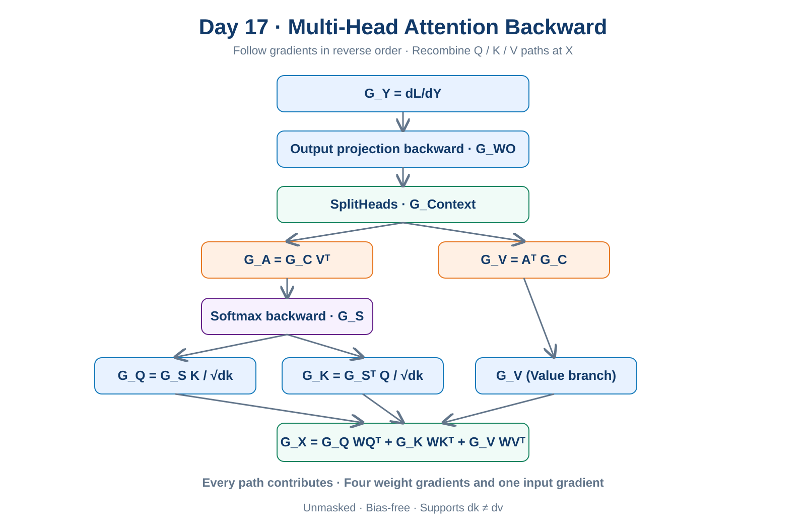

# Day 17｜Multi-Head Attention Backward：手写梯度与 Softmax Jacobian

> **项目：** [Transformer From Zero · 365 Days](https://github.com/JiamuHan1122/transformer-from-zero)  
> **日期：** 2026-11-20（本地验收：2026-11-23）  
> **阶段：** Transformer 手写反向传播 · Day 17  
> **今日主题：** Softmax Backward、Q/K/V 分支、Scaled Dot-Product Gradients、Finite Differences  
> **状态：** 理论、NumPy 手写实现、29 项专项测试、213 项全项目 Exercise 测试和 Demo 均已通过  
> **核心实现：** exercises/week17.py  
> **测试：** tests/test_week17_exercises.py  
> **实验：** scripts/day17_attention_backward_demo.py

---

## 一、今日科学问题

Day 08 实现了 Multi-Head Attention 的前向；Day 12–14 已完成 LayerNorm、Residual 和 FFN 的手写反向；Day 15–16 完成了完整 Encoder Block 和 Encoder Stack 的前向组装。

Attention 的反向是当前缺口。今天从上游梯度出发，计算：

$$
\boxed{G_X,\quad G_{W_Q},\quad G_{W_K},\quad G_{W_V},\quad G_{W_O}}
$$

## 二、复盘前向与具体形状

Day 08 采用行向量约定、无投影 Bias、无 Attention Mask：

$$
Q=XW_Q,\quad K=XW_K,\quad V=XW_V.
$$

各 Head：

$$
S=\frac{Q_hK_h^\top}{\sqrt{d_k}},
\quad A=\operatorname{Softmax}(S),
\quad C=AV_h.
$$

合并 Head：

$$
M=\operatorname{MergeHeads}(C),\quad Y=MW_O.
$$

原有 Day 08 支持 $d_k\ne d_v$，今天仍需保持这一能力。

示例 $B=2,T=4,D=6,H=3,d_k=2,d_v=4,D_{\rm out}=5$：

| 数据 | 形状 |
|---|---|
| X | (2,4,6) |
| Qh、Kh | (2,3,4,2) |
| Vh | (2,3,4,4) |
| Scores、Attention | (2,3,4,4) |
| Context | (2,3,4,4) |
| Merged | (2,4,12) |
| Y、上游梯度 | (2,4,5) |

## 三、Task A：Softmax Backward

$$
a_i=\frac{e^{s_i}}{\sum_j e^{s_j}}.
$$

$$
\frac{\partial a_i}{\partial s_j}
=a_i(\delta_{ij}-a_j),
\qquad J=\operatorname{diag}(a)-aa^\top.
$$

若上游梯度为 $g_a$：

$$
\boxed{g_s=a\odot(g_a-\sum_j a_jg_{a,j}).}
$$

手算例子：$a=[0.2,0.3,0.5]$，$g_a=[1,2,-1]$，加权点积为 0.3，得到：

$$
g_s=[0.14,0.51,-0.65],\qquad\sum_jg_{s,j}=0.
$$

## 四、Task B：Multi-Head Attention Backward

给定上游梯度 $G_Y$。

输出投影：

$$
G_M=G_YW_O^\top,\qquad
G_{W_O}=\sum_{b,t}M_{b,t,:}^\top G_{Y,b,t,:}.
$$

对 $C=AV_h$：

$$
G_A=G_CV_h^\top,\qquad G_{V_h}=A^\top G_C.
$$

Softmax：

$$
G_S=A\odot(G_A-\sum_jA_jG_{A,j}).
$$

缩放点积：

$$
G_{Q_h}=\frac{G_SK_h}{\sqrt{d_k}},\qquad
G_{K_h}=\frac{G_S^\top Q_h}{\sqrt{d_k}}.
$$

合并 Head 后，参数梯度：

$$
G_{W_Q}=\sum_{b,t}X_{b,t,:}^\top G_{Q,b,t,:},
$$
$$
G_{W_K}=\sum_{b,t}X_{b,t,:}^\top G_{K,b,t,:},
$$
$$
G_{W_V}=\sum_{b,t}X_{b,t,:}^\top G_{V,b,t,:}.
$$

同一个输入 X 被 Q、K、V 三个投影复用，输入梯度必须累加三支：

$$
\boxed{G_X=G_QW_Q^\top+G_KW_K^\top+G_VW_V^\top.}
$$

参数梯度对 Batch 和 Token 贡献求和；输入梯度保留每个位置自己的 (B,T,D) 形状。

## 五、实现要求

实现函数：

1. `softmax_backward_numpy(weights, grad_weights)`；
2. `multi_head_attention_backward_numpy(grad_output, x, w_q, w_k, w_v, w_o, num_heads)`。

要求：
- 核心实现仅使用 NumPy，不使用 Torch / Autograd。
- 重算前向中间量，不要求缓存。
- 统一 float64，不修改调用者输入。
- 返回顺序固定为 `grad_x, grad_w_q, grad_w_k, grad_w_v, grad_w_o`。
- 保持无 Mask、无投影 Bias 的 Day 08 行为，并支持 $d_k\ne d_v$。

## 六、数值验证

PyTorch 对照目标：

$$
\mathcal L=\sum_{b,t,d}Y_{b,t,d}G_{Y,b,t,d}.
$$

有限差分：

$$
g_{\mathrm{num}}\approx
\frac{\mathcal L(z+\epsilon)-\mathcal L(z-\epsilon)}{2\epsilon}.
$$

运行：

~~~powershell
python -m pytest -q -m exercise tests/test_week17_exercises.py
python -m pytest -q -m exercise
python -m scripts.day17_attention_backward_demo
~~~

本地生成 `results/day17/metrics.json`、`gradient_error_by_tensor.png`、`input_gradient_heatmaps.png`。

## 七、边界与下一步

本次只覆盖 Day 08 的**无 Mask、无投影 Bias** Multi-Head Self-Attention Backward；不包含 Mask、Dropout 或完整 Encoder Block / Stack Backward。

下一阶段将组合 MHA、LayerNorm、Residual 和 FFN 的反向链路。

---

## 八、Day 17 最终验收（2026-11-23）

- 专项测试：**29 passed in 16.03s**
- 全项目 Exercise：**213 passed, 4 deselected in 3.73s**
- Demo：**SUCCESS**
- 标量目标值：-0.97109374704345
- Demo 输入：$B=2,T=5,D=8,H=2,d_k=4,d_v=3,D_{\rm out}=8$
- 五组梯度形状： (2,5,8)、(8,8)、(8,8)、(8,6)、(6,8)

### Autograd 对照

| 梯度 | 最大绝对误差 | 相对 L2 误差 |
|---|---:|---:|
| X | $1.1102\times10^{-16}$ | $2.8465\times10^{-16}$ |
| W_Q | $6.9389\times10^{-17}$ | $4.6207\times10^{-16}$ |
| W_K | $5.5511\times10^{-17}$ | $2.5339\times10^{-16}$ |
| W_V | $4.4409\times10^{-16}$ | $2.2248\times10^{-16}$ |
| W_O | $4.4409\times10^{-16}$ | $1.7632\times10^{-16}$ |

### 有限差分

| 输入坐标 | 绝对误差 |
|---|---:|
| (0,0,0) | $1.5155\times10^{-10}$ |
| (0,2,3) | $1.0976\times10^{-11}$ |
| (1,4,7) | $2.6874\times10^{-10}$ |

### 结构性不变量

- Softmax Score 梯度行和最大误差：$2.4980\times10^{-16}$。
- Attention 权重行和最大误差：$2.2204\times10^{-16}$。
- 所有梯度有限：true。

### Warning 清理

Demo 首次运行的 Warning 来自 `float(loss)`。最终脚本已改为 `float(loss.detach().item())`，只改变日志标量读取方式，不改变计算图和梯度公式。拉取后建议重新运行 Demo，确认 Warning 消失。

### 归档说明

`results/` 被仓库 `.gitignore` 排除，图像和 metrics 保留在本地；本任务文档归档关键指标。Day 17 已完成，但完整 Encoder Block / Stack Backward 尚未完成。
