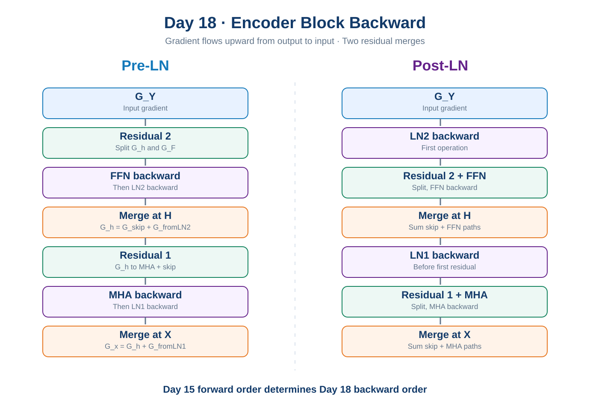

# Day 18｜完整 Transformer Encoder Block 的手写反向传播

> **项目：** Transformer From Zero · 365 Days  
> **日期：** 2026-11-24  
> **阶段：** Transformer Backward · Encoder Block  
> **主题：** Pre-LN / Post-LN、Reverse-Mode Autodiff、Residual Gradient Accumulation、MHA + LayerNorm + FFN  
> **状态：** 理论、练习、测试和 Demo 脚手架已准备；等待学生独立实现与本地验收  
> **实现：** exercises/week18.py  
> **测试：** tests/test_week18_exercises.py  
> **Demo：** scripts/day18_encoder_block_backward_demo.py

---

## 一、Day 18 的核心问题

Day 17 已验证无掩码 Multi-Head Attention Backward；Day 12/13/14 完成了 LayerNorm、Residual、FFN 的手写反向。今天需要以 Day 15 的 Forward 为准，组合成完整 Encoder Block Backward。

多个模块不仅串联，还通过残差结构产生梯度的**分叉与汇合**。反向传播必须保持逆序，不能漏掉任一恒等分支。

## 二、固定真实接口与参数顺序

输入、输出：

$$
X,Y\in\mathbb R^{B\times T\times D}.
$$

注意力参数 $W_Q,W_K,W_V,W_O$ 均为 (D,D)，Head 数 H 整除 D。LN1 的 gamma/beta 与 LN2 的 gamma/beta 均为 (D,)；FFN 参数分别为 W1 (D,Dff)、b1 (Dff,)、W2 (Dff,D)、b2 (D,)。

加上 X，需输出**13 个梯度**，顺序必须和 Day 15 的参数一致（忽略非可微 Head 数）：

1. grad_x
2. grad_w_q
3. grad_w_k
4. grad_w_v
5. grad_w_o
6. grad_gamma_attn
7. grad_beta_attn
8. grad_w1
9. grad_b1
10. grad_w2
11. grad_b2
12. grad_gamma_ffn
13. grad_beta_ffn

## 三、两个基本法则

复合函数 $Y=F_3(F_2(F_1(X)))$ 的反向按 F3、F2、F1 逆序计算。

残差函数：

$$
Y=X+F(X).
$$

其输入梯度必须汇合两条路径：

$$
\boxed{G_X=G_Y+J_F^\top G_Y}.
$$

例如 $y=x+2x=3x$，若上游梯度为 4，则 $G_x=4+8=12$。

## 四、Pre-LN 的完整 Forward 与 Backward

### 4.1 Forward

$$
N_1=\operatorname{LN}_1(X),\qquad A=\operatorname{MHA}(N_1),
$$

$$
H=X+A,
$$

$$
N_2=\operatorname{LN}_2(H),\qquad F=\operatorname{FFN}(N_2),
$$

$$
\boxed{Y=H+F}.
$$

### 4.2 Backward：第一次残差汇合

从 $G_Y$ 开始，经第二个残差节点：

$$
G_{H,\mathrm{skip}}=G_Y,\qquad G_F=G_Y.
$$

然后经 FFN 和 LN2：

$$
G_{N_2}=\operatorname{FFNBackward}(G_F;N_2),
$$

$$
G_{H,\mathrm{LN2}}=\operatorname{LNBackward}(G_{N_2};H).
$$

在 H 汇合：

$$
\boxed{G_H=G_{H,\mathrm{skip}}+G_{H,\mathrm{LN2}}}.
$$

### 4.3 Backward：第二次残差汇合

经过第一个残差节点，将 $G_H$ 分给 X 恒等路径和 Attention：

$$
G_{X,\mathrm{skip}}=G_H,\qquad G_A=G_H.
$$

反向经过 Attention 再经过 LN1：

$$
G_{N_1}=\operatorname{MHABackward}(G_A;N_1),
$$

$$
G_{X,\mathrm{LN1}}=\operatorname{LNBackward}(G_{N_1};X).
$$

最终：

$$
\boxed{G_X=G_H+G_{X,\mathrm{LN1}}}.
$$

Pre-LN 需在 H 与 X **分别进行一次梯度合并**。

### 4.4 零分支不变量

当 Wv=Wo=0 且 W2=b2=0 时，两个输出分支都变为零，Pre-LN 变成 $Y=X$，因此：

$$
\boxed{G_X=G_Y}.
$$

这是额外的数学结构检查，不能用 Shape 检查替代。

## 五、Post-LN 的完整 Forward 与 Backward

### 5.1 Forward

$$
A=\operatorname{MHA}(X),\qquad H_{\mathrm{raw}}=X+A,
$$

$$
H=\operatorname{LN}_1(H_{\mathrm{raw}}),
$$

$$
F=\operatorname{FFN}(H),\qquad Y_{\mathrm{raw}}=H+F,
$$

$$
\boxed{Y=\operatorname{LN}_2(Y_{\mathrm{raw}})}.
$$

### 5.2 Backward

Post-LN 的第一个反向步骤必须是 LN2：

$$
G_{Y_{\mathrm{raw}}}
=\operatorname{LNBackward}(G_Y;Y_{\mathrm{raw}}).
$$

第二个残差拆分，FFN 反向并在 H 合并：

$$
G_H=G_{Y_{\mathrm{raw}}}+
\operatorname{FFNBackward}(G_{Y_{\mathrm{raw}}};H).
$$

随后经 LN1：

$$
G_{H_{\mathrm{raw}}}
=\operatorname{LNBackward}(G_H;H_{\mathrm{raw}}).
$$

第一个残差拆分，经过 MHA 并合并：

$$
\boxed{
G_X=G_{H_{\mathrm{raw}}}+
\operatorname{MHABackward}(G_{H_{\mathrm{raw}}};X).
}
$$

与 Pre-LN 不同，Post-LN 即使输出分支为零，梯度仍需穿过两次 LN，不应默认 $G_X=G_Y$。

## 六、复用 Day 12/13/14/17 的函数

已验证的接口：

~~~python
grad_skip, grad_branch = residual_add_backward_numpy(grad_output)

grad_input, grad_gamma, grad_beta = layer_norm_backward_numpy(
    grad_output, ln_input, gamma, eps
)

grad_input, grad_w1, grad_b1, grad_w2, grad_b2 = ffn_backward_numpy(
    grad_output, ffn_input, w1, b1, w2
)

grad_input, grad_wq, grad_wk, grad_wv, grad_wo = (
    multi_head_attention_backward_numpy(
        grad_output, attention_input, w_q, w_k, w_v, w_o, num_heads
    )
)
~~~

必须传入 **该模块在前向真正使用的输入**，特别是 LN1 的 Pre-LN 输入是 X，而 Post-LN 输入为 H_raw。形状相同不意味着梯度正确。

## 七、今日代码要求

在 exercises/week18.py 中完成 transformer_encoder_block_backward_numpy。

函数以 grad_output 为第一个参数，随后严格沿用 Day 15 Forward 的参数顺序，最后 eps=1e-5、norm_first=True。

约束：

- 核心部分只使用 NumPy，不调用 Torch/Autograd；
- 使用给定输入 Validator，先转换全部 14 个 NumPy 数组到 float64；
- 重算完整前向的中间状态，按相反顺序调用现有四类 Backward；
- 两个残差节点都必须拆分并合并；
- 参数梯度不按 Batch 或 Token 平均；
- 返回 13 个梯度，不修改任何原数组；
- 不添加 Mask、Dropout、分类头或 Stack-level LayerNorm。

## 八、今天为什么要使用三重验收？

1. **形状测试：** 每组梯度 Shape、顺序、dtype 正确；
2. **独立 PyTorch Autograd：** Pre-LN、Post-LN 两种模式下 13 组梯度一致；
3. **中心有限差分：** 逐一抽查 X、Attention 权重、LayerNorm gamma/beta、FFN 权重与 Bias 的导数。

目标函数：

$$
\mathcal L=\sum_{b,t,d}Y_{b,t,d}G_{Y,b,t,d}.
$$

有限差分：

$$
g_{\mathrm{num}}\approx
\frac{\mathcal L(z+\epsilon)-\mathcal L(z-\epsilon)}{2\epsilon}.
$$

其他边界测试涵盖 float32 输入转 float64、无输入变异、零输出分支、非法形状、非全 1 gamma 与非零 beta。

## 九、正式运行与预期产物

~~~powershell
python -m pytest -q -m exercise tests/test_week18_exercises.py
python -m pytest -q -m exercise
python -m scripts.day18_encoder_block_backward_demo
~~~

运行成功后，在本地产生：

~~~text
results/day18/
├── metrics.json
├── gradient_error_comparison.png
├── pre_post_gradient_norms.png
└── input_gradient_pre_post.png
~~~

这些图是随机参数下的梯度数值校验，不证明 Pre-LN 或 Post-LN 谁更适合训练或任务。测试和 Demo 尚未执行，暂不填写任何结果。

## 十、思考题

1. Pre-LN 为什么需要在 H 与 X 两个位置分别相加梯度？
2. 为什么 Pre-LN 中 MHA 收到的上游梯度不是原始 G_Y？
3. 为什么 Post-LN 反向第一步必须是 LN2？
4. LN Backward 为什么必须使用它真正的前向输入？
5. 为什么 Wq 的梯度要对 Batch 与 Token 贡献求和，而 X 的梯度不能？
6. 为什么 Pre-LN 零分支时 G_X=G_Y，而 Post-LN 不一定？
7. 完成 Block Backward 是否就意味着多层 Encoder Stack Backward 已完成？为什么？

---

**Day 18 目标：独立实现 Pre-LN/Post-LN Encoder Block 的完整反向传播，并通过 PyTorch Autograd、有限差分和结构不变量验证全部 13 组梯度。**
