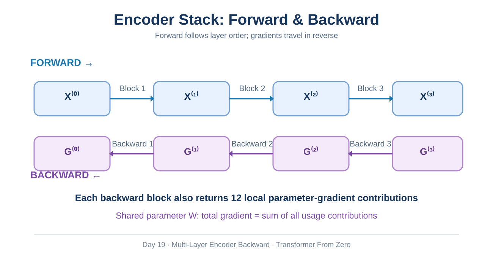

# Day 19｜Multi-Layer Transformer Encoder Stack Backward

> 日期：2026-11-25  
> 项目：Transformer From Zero · 365 Days  
> 状态：理论讲义、练习脚手架、测试与 Demo 已准备；待本地实现及验收  
> 代码：exercises/week19.py  
> 测试：tests/test_week19_exercises.py  
> Demo：scripts/day19_encoder_stack_backward_demo.py

## 一、核心问题

Day 16 已实现多层 Encoder Stack 的前向；Day 18 已实现单层 Encoder Block Backward。今天要求让梯度从最后一层逐层传回输入，同时保留各层 12 组参数梯度，并能对共享参数聚合梯度。

## 二、前向与反向数学

前向：

$$
X^{(0)}=X,\qquad
X^{(l+1)}=F_l(X^{(l)};\theta_l).
$$

给定最终上游梯度：

$$
G^{(L)}=\frac{\partial\mathcal L}{\partial X^{(L)}}.
$$

逆序传播：

$$
\boxed{G^{(l)}=J_{F_l}(X^{(l)})^\top G^{(l+1)}.}
$$

每层参数梯度：

$$
G_{\theta_l}=
\left(\frac{\partial F_l}{\partial\theta_l}\right)^\top
G^{(l+1)}.
$$

重要：每次 Block Backward 必须使用 Day 16 返回的该层真实输入，而不是始终使用最初的 X。

## 三、Day 16 的 Forward 历史

Day 16 返回三个结果：

~~~python
final_output, attentions, hidden_states = encoder_stack_forward_numpy(
    x, layers, num_heads, norm_first=norm_first, eps=eps
)
~~~

其中 hidden_states.shape 为 (L+1,B,T,D)，第 l 个状态正是第 l 层的输入。Day 19 需要它保证各层反向局部 Jacobian 的计算位置正确。

## 四、任务 A：完整 Stack Backward

在 exercises/week19.py 完成 encoder_stack_backward_numpy：

1. 验证参数及上游梯度。
2. 调用 Day 16 的 forward 重算完整 hidden_states。
3. 把上游梯度转换为 float64。
4. 从 L-1 到 0 逆序循环。
5. 每层调用 Day 18 的 transformer_encoder_block_backward_numpy。
6. 用 Day 16 _LAYER_KEYS 把每层 12 个梯度按前向层序保存到 per_layer_grads。
7. 按 G^(0),...,G^(L) 顺序保存 hidden_grads。
8. 返回输入梯度 grad_x、per_layer_grads、hidden_grads。

在层间传播中，新的输入梯度替代当前的上游梯度；不同层的隐藏状态梯度对应不同变量，不能直接求和。

## 五、任务 B：Weight Tying

Day 16 允许传入重复的层字典（或不同字典复用同一个 NumPy 参数数组）。

若 W 在若干层被复用，它的总梯度是：

$$
\boxed{G_{W,\mathrm{total}}=\sum_{l\in\mathcal S}G_{W,\mathrm{usage}\ l}.}
$$

实现 aggregate_tied_parameter_gradients_numpy：

- 按原始 NumPy 数组的对象身份进行分组，而不是按数值相等分组。
- 同一个数组在不同字典中出现也需要合并。
- 返回与 layers 对齐的梯度字典副本，每个共享位置都显示总梯度。
- 不修改参数和原始梯度。
- 将来优化器必须对每个共享数组对象只执行一次更新，而不是对每个出现位置重复更新。

## 六、验证

- L=1/2/3，Pre-LN 与 Post-LN 均与独立 Torch Autograd 对照；
- L=1 与 Day 18 全部梯度一致；
- 支持不同层不同 Dff；
- 正确返回 (L+1,B,T,D) 的隐藏状态梯度；
- float32 输入升级为 float64，但不修改原始数组；
- 第一层与最后一层参数中心有限差分；
- 共享整个字典、共享单个数组、数值相同但独立的数组；
- 非法参数与错误梯度形状检查。

运行：

~~~powershell
python -m pytest -q -m exercise tests/test_week19_exercises.py
python -m pytest -q -m exercise
python -m scripts.day19_encoder_stack_backward_demo
~~~

预计输出：

~~~text
results/day19/
├── metrics.json
├── gradient_norm_across_depth.png
└── gradient_error_by_layer.png
~~~

本次未运行完整练习，不可虚构测试通过数。单次随机实验的梯度范数变化不能证明训练中一定发生梯度消失或爆炸。

## 七、今日思考题

1. 为什么 Stack Backward 必须按反向层序进行？
2. 为什么反向第 l 层必须使用 hidden_states[l]？
3. 为什么保存梯度的列表依然按前向层序排列？
4. 为什么相同数值的两个独立权重不能按共享参数聚合？
5. 为什么共享参数的各层梯度贡献需要相加？
6. 为什么训练更新时一个共享对象只能更新一次？
7. 为什么本次仍不是完整端到端训练流程？

**本课完成标准：三组返回结构、全部层及参数梯度、共享参数梯度聚合通过独立数值检验后，才进行最终归档。**
