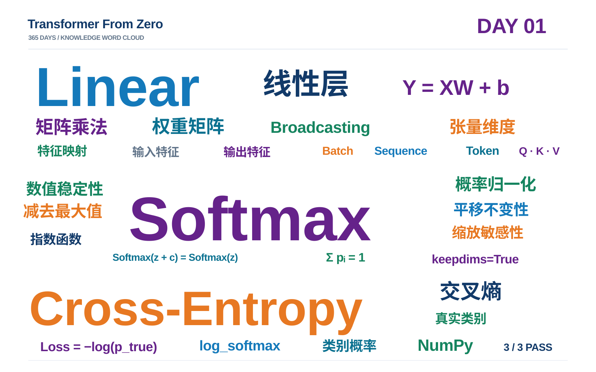

# Day 01 学习笔记｜Linear、Softmax 与 Cross-Entropy

> **项目：** [Transformer From Zero — 365 Days](https://github.com/JiamuHan1122/transformer-from-zero)  
> **日期：** 2026-11-04  
> **阶段：** Week 01 · NumPy 基础  
> **状态：** Task A / B / C 均已实现并通过练习测试

## 0. 今天学到了什么？

我们完成了一条从**模型分数**到**训练损失**的基础计算链：

```text
输入特征 X ──[线性投影 Y = XW + b]──> logits（原始分数）
                                       │
                                       ▼
                                 Softmax（概率）
                                       │
                                       ▼
                         Cross-Entropy（和真实标签比较）
```

它们的职责不同：

| 模块 | 解决的问题 | 关键词 |
| --- | --- | --- |
| Linear | 如何把输入特征映射到新的特征空间？ | 矩阵乘法、维度、广播 |
| Softmax | 如何把一组分数转成和为 1 的权重？ | 指数、归一化、数值稳定 |
| Cross-Entropy | 如何量化模型对正确答案有多不确定？ | 真实标签、负对数、平均损失 |

> **重要区分：** 在实际训练中，交叉熵通常直接接收 **logits**，通过稳定的 `log_softmax` 计算损失；不必先显式计算 Softmax 再取对数。

---

## 1. Linear：线性层与张量维度

### 1.1 核心公式

$$
Y = XW + b
$$

若 $X$ 的最后一个维度为 $d_{\text{in}}$，要映射到 $d_{\text{out}}$，则在本笔记的矩阵写法中：

$$
W\in\mathbb{R}^{d_{\text{in}}\times d_{\text{out}}},\quad
b\in\mathbb{R}^{d_{\text{out}}}.
$$

**为什么 $W$ 的行数等于输入特征数？** 每个输出特征都需要对所有输入特征进行加权求和；权重矩阵中的每一行对应一个输入特征，每一列对应一个输出特征。不是“每个输入特征拥有一个独立的权重矩阵”。

普通矩阵乘法的维度规则：

$$
(m\times n)\,(n\times p)\rightarrow(m\times p).
$$

### 1.2 例题 A：多样本线性变换

给定：

$$
X=\begin{bmatrix}1&2&3\\4&5&6\end{bmatrix},\quad
W=\begin{bmatrix}1&0\\0&1\\1&1\end{bmatrix},\quad
b=\begin{bmatrix}10&20\end{bmatrix}.
$$

先计算矩阵乘法：

$$
XW=\begin{bmatrix}4&5\\10&11\end{bmatrix}.
$$

再将同一偏置向量加到每一行：

$$
Y=XW+b=\begin{bmatrix}14&25\\20&31\end{bmatrix}.
$$

形状为 $(2,3)@(3,2)+(2,)\rightarrow(2,2)$。偏置能自动加到每一行，依靠的是 **NumPy Broadcasting（广播）**。

### 1.3 例题 B：Transformer 中的逐 Token 投影

假设输入是：

$$
X\in\mathbb{R}^{8\times10\times512}.
$$

三个维度依次是 Batch Size、Sequence Length、Hidden Dimension。把每个 Token 的 512 维映射到 64 维：

$$
W\in\mathbb{R}^{512\times64},\qquad
Y\in\mathbb{R}^{8\times10\times64}.
$$

原因：线性层对每个 Token 使用**同一组权重**，只改变最后的特征维，前面的批次和序列维不变。

**课堂测试：** $X\in\mathbb{R}^{4\times20\times768}$，Query 投影到 128 维，答案：

- $W_Q$ 形状：$(768,128)$；
- $Q$ 形状：$(4,20,128)$。

**和 PyTorch 的一个区别：** 我们写 `x @ weight` 时，`weight` 为 `(in_features, out_features)`；`torch.nn.Linear(in_features, out_features)` 在内部存储的 `weight` 为 `(out_features, in_features)`，计算中使用其转置。

### 1.4 自己实现的 NumPy 版本

```python
import numpy as np


def linear_numpy(x: np.ndarray, weight: np.ndarray, bias: np.ndarray) -> np.ndarray:
    return x @ weight + bias
```

**注意：** `@` 是矩阵乘法；`*` 是逐元素乘法，两者不能混淆。

---

## 2. Softmax：把分数变成概率权重

### 2.1 核心公式

$$
\operatorname{softmax}(x_i)=\frac{e^{x_i}}{\sum_j e^{x_j}}.
$$

所有输出都为正（理论上的有限实数情形），且总和为 1。分数越大，对应权重越大。

### 2.2 例题 A：为什么要减去最大值？

输入 $x=[1000,1001,1002]$，直接计算 $e^{1000}$ 可能造成 **Overflow（上溢）**。先减去最大值：

$$
x'=[-2,-1,0].
$$

然后计算：

$$
\operatorname{softmax}(x')\approx[0.09003,\ 0.24473,\ 0.66524].
$$

减去最大值不会改变数学上的 Softmax 结果，但可以避免很大的指数值。

**平移不变性：** 对所有元素减去同一个常数 $c$：

$$
\begin{aligned}
\operatorname{softmax}(x_i-c)
&=\frac{e^{x_i-c}}{\sum_j e^{x_j-c}}\\
&=\frac{e^{x_i}e^{-c}}{e^{-c}\sum_j e^{x_j}}\\
&=\operatorname{softmax}(x_i).
\end{aligned}
$$

> 虽然数学上可以减去任意常数，**数值计算中通常减最大值**：它能让最大指数等于 1，同时避免其它指数大于 1。

### 2.3 例题 B：为什么缩放会改变分布？

注意：**加减同一个数**与**乘除同一个倍数**是两回事。

| Scores | Softmax（约） | 特征 |
| --- | --- | --- |
| $[2,4,6]$ | $[0.0159,0.1173,0.8668]$ | 最大值权重高 |
| $[0.2,0.4,0.6]$ | $[0.2693,0.3289,0.4018]$ | 更均匀 |

原因可以从概率之比看出来：

$$
\frac{p_i}{p_j}=e^{x_i-x_j}.
$$

加减相同常数不会改变 $x_i-x_j$；乘以 $a$ 则会把差值变为 $a(x_i-x_j)$。当 $a>1$，分布往往更尖锐；当 $0<a<1$，分布趋于平缓。

**联系 Transformer：** Scaled Dot-Product Attention 使用

$$
\operatorname{softmax}\!\left(\frac{QK^\top}{\sqrt{d_k}}\right).
$$

在常见的独立、零均值、单位方差假设下，点积方差会随 $d_k$ 增大；除以 $\sqrt{d_k}$ 有助于控制分数尺度，减少 Softmax 过度饱和。这**不只是**为了防止指数溢出。

### 2.4 自己实现的稳定 Softmax

```python
def softmax_numpy(logits: np.ndarray, axis: int = -1) -> np.ndarray:
    max_value = np.max(logits, axis=axis, keepdims=True)
    shifted = logits - max_value
    exp_values = np.exp(shifted)
    sum_exp = np.sum(exp_values, axis=axis, keepdims=True)
    return exp_values / sum_exp
```

`axis=-1` 表示沿最后一个维度计算。`keepdims=True` 保留归约维度，便于广播：例如 `(2,3)` 沿最后一维求最大值，会得到 `(2,1)`，可逐行相减。

**边界说明：** 这个课堂实现假定每行至少有一个有限数值；若整行全为 `-inf`（例如错误地完全 Mask 掉一行）或包含 `NaN`，还需要额外处理。

---

## 3. Cross-Entropy：模型如何衡量预测错误程度？

### 3.1 核心公式

对于一个样本，若真实类别的预测概率为 $p$：

$$
L=-\ln p.
$$

对于 $N$ 个样本，真实类别索引为 $y_i$：

$$
L=-\frac{1}{N}\sum_{i=1}^N\log p_{i,y_i}.
$$

**真实类别的概率越大，交叉熵越小。** 例子：

| 真实类别预测概率 $p$ | 交叉熵 $-\ln(p)$（约） |
| ---: | ---: |
| 0.9 | 0.105 |
| 0.7 | 0.357 |
| 0.2 | 1.609 |
| 0.1 | 2.303 |

### 3.2 例题 A：Logits 与 Targets

```python
logits = np.array([
    [2.0, 1.0, 0.0],
    [0.5, 1.0, 2.0],
])
targets = np.array([0, 2])
```

- `logits.shape == (2,3)`：两个样本，每个样本三个类别的原始分数；
- `targets.shape == (2,)`：第一行的正确类别是第 0 类，第二行是第 2 类。

需要先由原始分数获得每个真实类别的**对数概率**，再取负数、求平均。

### 3.3 例题 B：NumPy 高级索引

如果：

```python
log_probs = np.array([
    [-0.4, -1.4, -2.4],
    [-1.9, -1.4, -0.5],
])
targets = np.array([0, 2])
rows = np.arange(2)
correct_log_probs = log_probs[rows, targets]
# array([-0.4, -0.5])
```

`log_probs[rows, targets]` 会**成对索引**：取 `(0,0)` 与 `(1,2)` 位置，而不是选一个矩形子矩阵。因此此例的平均交叉熵是：

$$
L=-(-0.4-0.5)/2=0.45.
$$

### 3.4 为什么用稳定的 `log_softmax`，而不先 Softmax 再 `log`？

例如 `logits = [0,-1000]`。理论上第二类的概率大于 0，但在浮点数中 $e^{-1000}$ 可能 **Underflow（下溢）** 为 0。若先 Softmax 再 `np.log`，可能得到 `log(0)=-inf`。

稳定计算方式先减最大值 $m$，再直接求：

$$
\log p_i=(x_i-m)-\log\!\left(\sum_j e^{x_j-m}\right).
$$

这样避免了“先把极小概率变成 0，再对 0 取对数”的问题。对 `[0,-1000]`，第二类的稳定对数概率约为 `-1000`，而不是 `-inf`。

### 3.5 自己实现的 NumPy 版本

```python
def cross_entropy_numpy(logits: np.ndarray, targets: np.ndarray) -> float:
    # logits: (N, C), targets: (N,)
    max_per_row = np.max(logits, axis=1, keepdims=True)
    shifted = logits - max_per_row

    sum_exp = np.sum(np.exp(shifted), axis=1, keepdims=True)
    log_norm = np.log(sum_exp)
    log_probs = shifted - log_norm

    rows = np.arange(logits.shape[0])
    correct_log_probs = log_probs[rows, targets]
    return float(-np.mean(correct_log_probs))
```

**适用范围：** 本练习处理二维 logits（`N × C`），真实标签为合法的整数类别索引。以后 GPT 的输出常是 `(B,T,V)`，需要适配维度或先展平。

---

## 4. 动手验证与测试记录

在 Conda 环境 `tfz` 中执行：

```powershell
conda activate tfz
python -m pytest -q -m exercise
```

**本次实际结果：**

```text
... [100%]
3 passed, 4 deselected in 2.16s
```

- `test_linear_numpy_against_torch`：通过；
- `test_softmax_stays_finite_for_large_logits`：通过；
- `test_cross_entropy_against_torch`：通过。

四个 `deselected` 是当前练习筛选条件排除了非练习测试，并非测试失败。若要运行基础测试，可执行 `python -m pytest -q`。

> **测试注意：** 项目 `pyproject.toml` 默认设置了 `-m 'not exercise'`，所以运行练习测试时要显式加 `-m exercise`。如果命令指定的测试函数名不存在，会出现 `not found`；这不等于函数实现失败。

## 5. 今天纠正的四个认识误区

1. **不是每个输入特征各有一张权重矩阵。** 一张 $W$ 的每一行对应一个输入特征，每一列对应一个输出特征。
2. **Softmax 平移不变，不等于缩放不变。** 加减相同常数不改变概率；乘以倍数通常会改变概率分布的尖锐程度。
3. **数值稳定性不只是上溢。** Softmax 需留意 `exp` 上溢，Cross-Entropy 还需防止极小概率下溢成 0。
4. **训练用的交叉熵通常接收 logits。** 不必先计算并保存所有普通概率值后才取对数。

## 6. 学习成果与下一步

**已完成：** `linear_numpy`、`softmax_numpy`、`cross_entropy_numpy` 三个实现和练习测试；基础计算链已经打通。当前本地 Git 基线提交为 `324891c`，本篇笔记应单独形成后续提交。

**下一课（Day 02）：反向传播与梯度。** 要回答的问题是：我们已经能够计算 Loss，如何从 Loss 推导 $\partial L/\partial W$，再亲手完成一次权重更新？

建议预习：导数、偏导数、链式法则、梯度下降、有限差分梯度检查。

---

## 7. Day 01 知识词云



> 以当日重点概念为视觉主体：线性层与特征映射、Softmax 数值稳定性、Cross-Entropy 损失，以及 NumPy 实现和练习验证。
