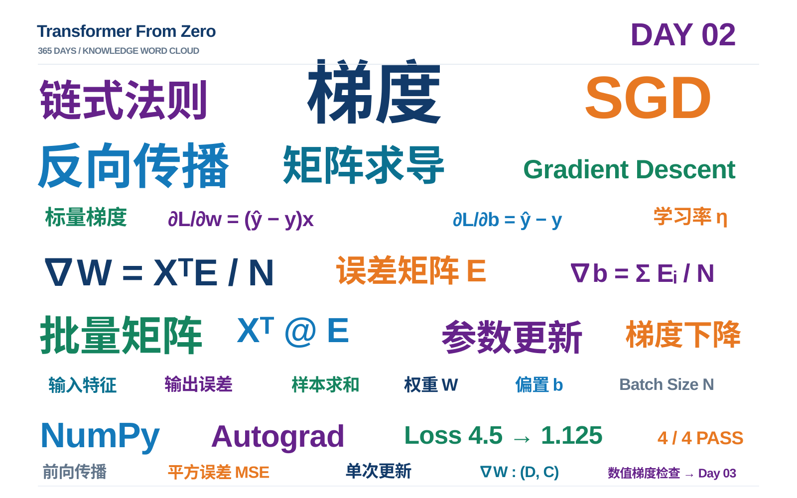

# Day 02 学习笔记｜梯度、链式法则、SGD 与批量矩阵反向传播

> **项目：** [Transformer From Zero — 365 Days](https://github.com/JiamuHan1122/transformer-from-zero)  
> **日期：** 2026-11-05  
> **阶段：** Week 02 · Manual Gradients / SGD / Matrix Backpropagation  
> **代码：** [exercises/week02.py](../../exercises/week02.py)  
> **测试：** [tests/test_week02_exercises.py](../../tests/test_week02_exercises.py)  
> **结果：** Task A / B / C 全部完成，**4 passed**

## 0. 从 Day 1 到 Day 2：我们多学会了什么？

Day 1 解决的是**怎样得到模型输出和损失**：

```text
输入 X → Linear（XW+b）→ Softmax / Log-Softmax → Loss
```

Day 2 进一步解决**知道 Loss 后，怎样更新权重**：

```text
输入 X ──→ 前向传播（预测） ──→ Loss
 ↑                                  │
 │                                  ▼
 └── 参数更新（SGD） ←── 梯度（反向传播）
```

注意：本轮为了便于求导，采用**线性模型 + 平方误差损失**，不使用 Day 1 的交叉熵；它们都可以作为训练中的损失函数，但数学形式不同。

本轮三个核心任务：

| 任务 | 核心函数 | 学会的事情 |
| --- | --- | --- |
| A | `scalar_linear_gradients()` | 对单样本标量模型应用链式法则 |
| B | `sgd_step()` | 沿负梯度方向进行一次参数更新 |
| C | `batch_linear_mse_gradients()` | 求整批数据对整个权重矩阵和偏置向量的梯度 |

---

## 1. 梯度与链式法则：从一个参数开始

### 1.1 模型与损失

设一个线性模型：

$$
\hat y = wx+b,\qquad
L=\frac12(\hat y-y)^2.
$$

这里 $x$ 是输入，$w$ 是权重，$b$ 是偏置，$y$ 是真实值，$\hat y$ 是预测值。

求梯度需要沿着“参数 $\to$ 预测 $\to$ 损失”的计算链反向应用**链式法则**：

$$
\frac{\partial L}{\partial w}
=
\frac{\partial L}{\partial \hat y}
\frac{\partial\hat y}{\partial w}.
$$

因为

$$
\frac{\partial L}{\partial\hat y}=\hat y-y,\quad
\frac{\partial\hat y}{\partial w}=x,\quad
\frac{\partial\hat y}{\partial b}=1,
$$

所以

$$
\boxed{\frac{\partial L}{\partial w}=(\hat y-y)x},\qquad
\boxed{\frac{\partial L}{\partial b}=\hat y-y}.
$$

**理解：** 对同一个预测误差，输入 $x$ 的大小会影响权重梯度；偏置是直接相加的，所以偏置梯度不需要乘以 $x$。

### 1.2 例题 A：计算标量模型的损失和梯度

已知：

$$
x=2,\quad w=1,\quad b=0,\quad y=5.
$$

前向传播：

$$
\hat y=1\times2+0=2.
$$

损失：

$$
L=\frac12(2-5)^2=\boxed{4.5}.
$$

由于 $\hat y-y=-3$：

$$
\frac{\partial L}{\partial w}=(-3)\times2=\boxed{-6},
\qquad
\frac{\partial L}{\partial b}=\boxed{-3}.
$$

对应 NumPy / Python 代码：

```python
def scalar_linear_gradients(x, w, b, target):
    y_pred = w * x + b
    loss = 0.5 * (y_pred - target) ** 2

    dL_dy = y_pred - target
    grad_w = dL_dy * x
    grad_b = dL_dy
    return loss, grad_w, grad_b
```

此例返回 `(4.5, -6.0, -3.0)`。

**不要混淆：** 梯度为负表示在当前点上，参数增加会使 Loss 的局部一阶变化趋向于负；不是“参数必须减少”。

---

## 2. SGD：用梯度更新参数

### 2.1 更新公式

对学习率 $\eta>0$：

$$
w_{\mathrm{new}}=w-\eta\frac{\partial L}{\partial w},
\qquad
b_{\mathrm{new}}=b-\eta\frac{\partial L}{\partial b}.
$$

所谓“沿负梯度更新”，就是在参数上减去“学习率 × 梯度”。

### 2.2 例题 B：手算一次梯度下降

继续上面的例题，取 $\eta=0.1$，梯度分别为 $-6$ 和 $-3$。

$$
w_{\mathrm{new}}=1-0.1(-6)=\boxed{1.6},
$$

$$
b_{\mathrm{new}}=0-0.1(-3)=\boxed{0.3}.
$$

重新前向传播：

$$
\hat y_{\mathrm{new}}=1.6\times2+0.3=3.5.
$$

新的损失：

$$
L_{\mathrm{new}}=\frac12(3.5-5)^2=\boxed{1.125}.
$$

| 指标 | 更新前 | 更新后 |
| --- | ---: | ---: |
| 权重 $w$ | 1.0 | 1.6 |
| 偏置 $b$ | 0.0 | 0.3 |
| 预测 $\hat y$ | 2.0 | 3.5 |
| 损失 $L$ | 4.5 | 1.125 |

本次损失下降了 $75\%$，但**这不是任意学习率都保证下降的证明**。学习率过大时，一步更新可能越过最优点，反而导致损失增大。

对应实现：

```python
def sgd_step(w, b, grad_w, grad_b, learning_rate):
    new_w = w - learning_rate * grad_w
    new_b = b - learning_rate * grad_b
    return new_w, new_b
```

本轮只实现**一次更新**，还不是完整的多轮训练循环。

---

## 3. 从标量推广到矩阵：批量线性层的梯度

### 3.1 形状定义与损失约定

令：

$$
X\in\mathbb R^{N\times D},\quad
W\in\mathbb R^{D\times C},\quad
b\in\mathbb R^C,\quad
Y\in\mathbb R^{N\times C}.
$$

$N$ 是样本数，$D$ 是输入特征数，$C$ 是输出特征数。前向传播：

$$
\hat Y=XW+b.
$$

定义误差矩阵：

$$
E=\hat Y-Y\in\mathbb R^{N\times C}.
$$

本次练习的**精确损失定义**为：

$$
\boxed{L=\frac1{2N}\sum_{i=1}^N\sum_{j=1}^C E_{ij}^2}.
$$

先在每个样本的输出维度求平方和，再对 $N$ 个样本取平均。因此分母是 $2N$，**不是 $2NC$**。

### 3.2 第一步：损失对预测矩阵的梯度

对每个位置 $(i,j)$：

$$
\frac{\partial L}{\partial\hat Y_{ij}}
=\frac1{2N}\cdot2(\hat Y_{ij}-Y_{ij})
=\frac{E_{ij}}{N}.
$$

合写为：

$$
\boxed{\frac{\partial L}{\partial\hat Y}=\frac EN}.
$$

### 3.3 第二步：损失对权重矩阵的梯度

把矩阵乘法展开到单个元素：

$$
\hat Y_{ij}=\sum_{k=1}^{D}X_{ik}W_{kj}+b_j.
$$

固定某个权重 $W_{kj}$，它会被**所有 $N$ 个样本共享**，因此求导时要累加各样本的贡献：

$$
\frac{\partial L}{\partial W_{kj}}
=
\sum_{i=1}^{N}
\frac{\partial L}{\partial\hat Y_{ij}}
\frac{\partial\hat Y_{ij}}{\partial W_{kj}}.
$$

因为

$$
\frac{\partial\hat Y_{ij}}{\partial W_{kj}}=X_{ik},
$$

代入得到：

$$
\boxed{
\frac{\partial L}{\partial W_{kj}}
=\frac1N\sum_{i=1}^{N}X_{ik}E_{ij}
}.
$$

每个权重的梯度，都来自对应的**输入特征 × 输出误差**，并对 batch 取平均。

### 3.4 为什么出现 $X^\top$？——本轮重点难点

矩阵乘法规则为：

$$
(AB)_{kj}=\sum_i A_{ki}B_{ij}.
$$

因为

$$
(X^\top)_{ki}=X_{ik},
$$

所以

$$
(X^\top E)_{kj}
=\sum_{i=1}^{N}(X^\top)_{ki}E_{ij}
=\sum_{i=1}^{N}X_{ik}E_{ij}.
$$

这与上一节对 $W_{kj}$ 的标量求导结果相同，因此：

$$
\boxed{\nabla_WL=\frac{X^\top E}{N}}.
$$

**特别容易混淆的下标：**

- $(X^\top E)_{kj}$：**最终乘积矩阵**的第 $k$ 行、第 $j$ 列；
- $X_{ik}$：第 $i$ 个样本、第 $k$ 个输入特征；
- $E_{ij}$：第 $i$ 个样本、第 $j$ 个输出误差；
- $i$：被求和消去的样本下标；
- $k,j$：没有求和，保留为最终权重梯度矩阵的行列下标。

**$E$ 的下标是 $ij$，不是 $kj$。** 左边整体乘积的下标 $(kj)$ 并不意味着每个因子也都使用 $(kj)$。

**下标展开小练习：** 固定 $k=2,j=1,N=3$，则

$$
(X^\top E)_{21}
=X_{12}E_{11}+X_{22}E_{21}+X_{32}E_{31}.
$$

**形状检查：**

$$
X^\top:(D,N),\qquad E:(N,C)
\quad\Rightarrow\quad
X^\top E:(D,C),
$$

恰好与 $W$ 的形状一致。维度检查能够发现错误，但**只有求导过程才能证明公式正确**。

### 3.5 第三步：偏置的梯度

偏置 $b_j$ 直接加在每个样本的第 $j$ 个输出上，因此：

$$
\frac{\partial\hat Y_{ij}}{\partial b_j}=1.
$$

在所有样本上累加：

$$
\frac{\partial L}{\partial b_j}
=\sum_{i=1}^N
\frac{E_{ij}}{N}\cdot1
=\frac1N\sum_{i=1}^N E_{ij}.
$$

所以：

$$
\boxed{\nabla_b L=\frac1N\sum_{i=1}^N E_i}.
$$

对应 NumPy 中的 `np.sum(error, axis=0) / N`：沿样本维度求和，结果保留输出特征维。

---

## 4. 例题 C：手算一个完整的批量梯度

已知：

$$
X=\begin{bmatrix}1&2\\3&4\end{bmatrix},\quad
W=\begin{bmatrix}1&0\\0&1\end{bmatrix},\quad
b=[0,0],\quad
Y=\begin{bmatrix}0&0\\1&1\end{bmatrix}.
$$

### 4.1 前向与误差

因为 $W$ 是单位矩阵，$\hat Y=X$，所以：

$$
E=\hat Y-Y
=\begin{bmatrix}1&2\\2&3\end{bmatrix}.
$$

### 4.2 损失

此处 $N=2$，故：

$$
L=\frac1{2\times2}(1^2+2^2+2^2+3^2)
=\boxed{4.5}.
$$

### 4.3 权重梯度

$$
X^\top=
\begin{bmatrix}1&3\\2&4\end{bmatrix}.
$$

$$
X^\top E
=
\begin{bmatrix}1&3\\2&4\end{bmatrix}
\begin{bmatrix}1&2\\2&3\end{bmatrix}
=
\begin{bmatrix}7&11\\10&16\end{bmatrix}.
$$

$$
\boxed{
\nabla_W L=\frac{X^\top E}{2}
=\begin{bmatrix}3.5&5.5\\5&8\end{bmatrix}.
}
$$

### 4.4 偏置梯度

$$
\boxed{
\nabla_b L
=\frac12[1+2,\;2+3]
=[1.5,2.5].
}
$$

验证结果形状：$\nabla_W L$ 为 $(2,2)$，$\nabla_b L$ 为 $(2,)$，分别与 $W,b$ 对应。

---

## 5. NumPy 实现与 PyTorch Autograd 对照

本轮最终实现的核心代码：

```python
def batch_linear_mse_gradients(x, weight, bias, targets):
    N = x.shape[0]
    predictions = x @ weight + bias
    error = predictions - targets

    # 每个样本先求平方和，再对样本取平均
    loss = 0.5 * np.mean(np.sum(error**2, axis=-1))

    grad_weight = (x.T @ error) / N
    grad_bias = np.sum(error, axis=0) / N
    return float(loss), grad_weight, grad_bias
```

对应维度：

| 张量 | 形状 |
| --- | --- |
| `x` | `(N,D)` |
| `weight` | `(D,C)` |
| `bias` | `(C,)` |
| `predictions` / `error` | `(N,C)` |
| `grad_weight` | `(D,C)` |
| `grad_bias` | `(C,)` |

对照 PyTorch，**要确保损失定义完全一致**：

```python
xt = torch.from_numpy(x)
wt = torch.tensor(weight, dtype=torch.float64, requires_grad=True)
bt = torch.tensor(bias, dtype=torch.float64, requires_grad=True)
yt = torch.from_numpy(targets)

pred = xt @ wt + bt
loss_torch = 0.5 * ((pred - yt) ** 2).sum(dim=-1).mean()
loss_torch.backward()

# wt.grad 与 NumPy 的 grad_weight 比较
# bt.grad 与 NumPy 的 grad_bias 比较
```

在本轮实验中，Autograd **只是检查答案的参考实现**；三项练习的手写计算不依赖 `loss.backward()` 或 `torch.optim`。

### 5.1 常见错误：把两个不同的 MSE 定义混在一起

本轮用：

```python
loss = 0.5 * np.mean(np.sum(error**2, axis=-1))
```

这等价于 $L=(1/(2N))\sum_{i,j}E_{ij}^2$。

但如果写：

```python
loss = 0.5 * np.mean(error**2)
```

就变成 $L=(1/(2NC))\sum_{i,j}E_{ij}^2$，在 $C>1$ 时与本轮 Loss 不同，梯度也会小 $C$ 倍。不能只改 Loss 而不改导数。

### 5.2 另一个易错点：括号和矩阵乘法的优先级

推荐写成：

```python
grad_weight = (x.T @ error) / N
```

既与公式保持一致，也更容易阅读。

---

## 6. 实验记录与 Git 里程碑

本轮实际运行并通过：

```powershell
python -m pytest -q -m exercise tests/test_week02_exercises.py::test_scalar_linear_gradients
python -m pytest -q -m exercise tests/test_week02_exercises.py::test_sgd_step_one_update
python -m pytest -q -m exercise tests/test_week02_exercises.py::test_batch_linear_mse_gradients_against_autograd
python -m pytest -q -m exercise tests/test_week02_exercises.py::test_batch_gradient_descent_reduces_loss
python -m pytest -q -m exercise tests/test_week02_exercises.py
```

最后一个命令的结果：

```text
.... [100%]
4 passed in 1.87s
```

已提交并推送本轮代码：

- Commit：`5cbef7c` — `feat: implement manual gradients and SGD`
- 新增：`exercises/week02.py`、`tests/test_week02_exercises.py`、`docs/03_week02_tasks.md`
- 主分支：`main`

**测试通过的含义：** 在既定样例上，手写梯度与 PyTorch Autograd 结果一致，且一个选定的小步长能降低样例损失；这不等于已验证所有数值极端情况，也不等于完成完整训练循环。

---

## 7. 本轮收获与未完成事项

**已经掌握：**

1. 从 $\hat y=wx+b$ 和平方误差出发，使用链式法则推导标量梯度。
2. 解释为什么负梯度可以用于局部下降，以及学习率为什么重要。
3. 推导 $\nabla_W L=X^\top E/N$ 和 $\nabla_b L=\sum_i E_i/N$。
4. 理解求和下标 $i$ 与结果下标 $(k,j)$ 的区别。
5. 用 NumPy 实现手动梯度，并通过 PyTorch Autograd 对照。

**还没有完成：** 数值梯度检查、多个训练 step 的完整循环、多个线性层的链式反向传播以及 Transformer 的 Q/K/V 梯度。

下一轮 Day 3：

- 用有限差分 $\bigl(L(\theta+\epsilon)-L(\theta-\epsilon)\bigr)/(2\epsilon)$ 检查手写梯度；
- 从随机初始化出发，用 NumPy 多轮训练 $y=3x+2$；
- 记录 Loss 曲线，分析学习率和收敛。

> **一句话总结：** Day 1 学会“计算模型的输出与损失”；Day 2 学会“从损失反推梯度，并对参数执行一次更新”。从标量到矩阵，变的是计算规模，不变的是链式法则。

---

*相关前置笔记：[Day 01 — Linear、Softmax 与 Cross-Entropy](2026-11-04-day01-linear-softmax-cross-entropy.md)。*

---

## 8. Day 02 知识词云



> 核心关键词：梯度、链式法则、SGD、反向传播、矩阵求导、误差矩阵、NumPy、Autograd。
