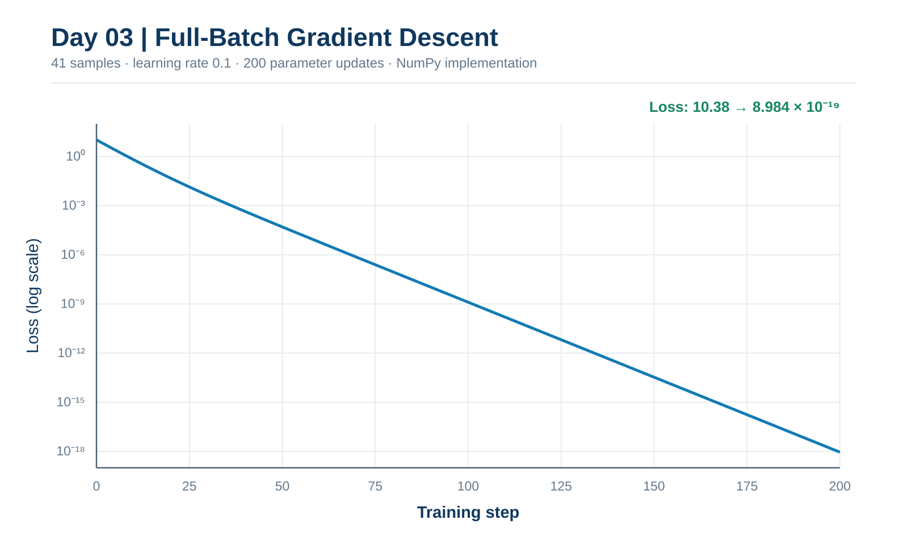
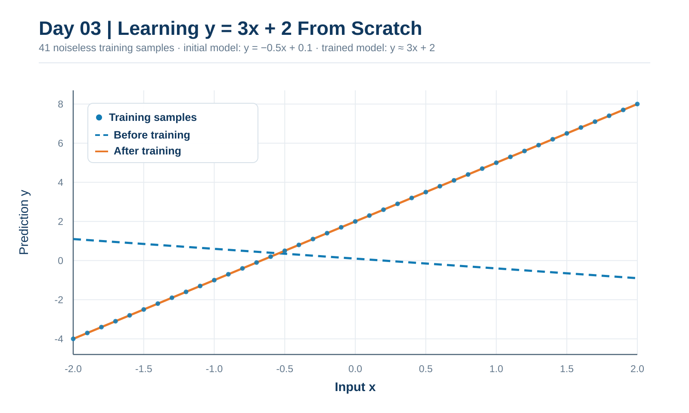
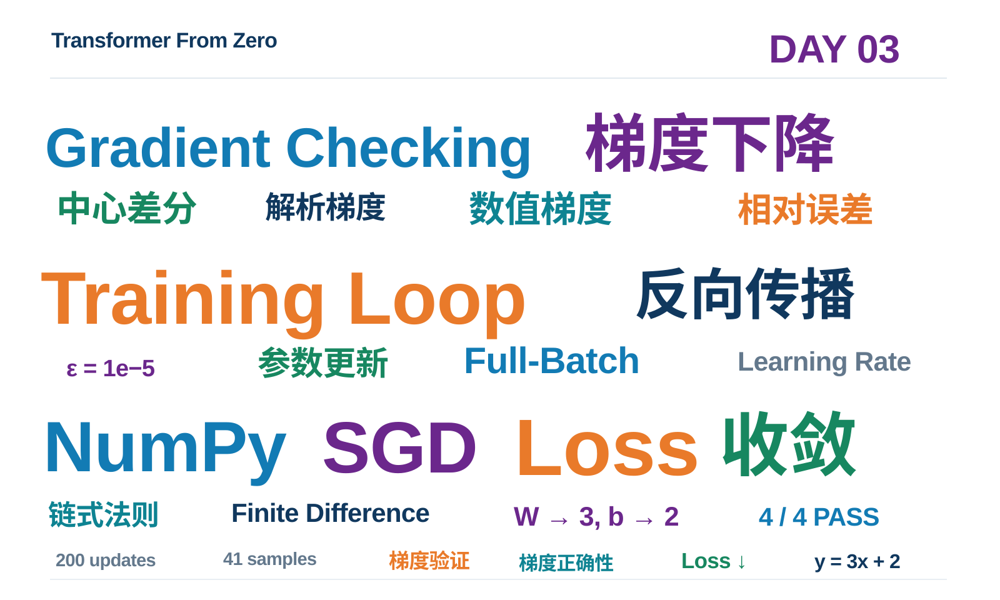

# Day 03｜数值梯度检查、训练循环与第一次模型收敛

> **Transformer From Zero — 365 Days**  
> 日期：2026-11-06  
> 阶段性里程碑：**Milestone 01 — Train Your First Model from Scratch**  
> 结果：**4 passed；41 个样本；200 次 Full-Batch Gradient Descent 更新；成功拟合 y = 3x + 2**

## 0. 前三天的知识闭环

| 日期 | 主题 | 完成的能力 |
| --- | --- | --- |
| Day 01 | Linear、Softmax、Cross-Entropy | 计算模型输出与损失 |
| Day 02 | 链式法则、SGD、批量矩阵梯度 | 求导并更新参数 |
| Day 03 | 数值梯度检查、训练循环 | 验证梯度并训练首个模型 |

完整流程：**Forward → Loss → Backward → Update → Repeat**。

本次所有梯度和优化操作均由自己实现的 NumPy 代码完成；Matplotlib 仅用于绘图。

## 1. Task A：中心差分（Finite Difference）

### 原理

通过扰动某个参数，比较两次前向损失，可以在不使用链式法则的情况下近似该参数的偏导数：

$$
\frac{\partial L}{\partial\theta_i}\approx
\frac{L(\theta+\epsilon e_i)-L(\theta-\epsilon e_i)}{2\epsilon}.
$$

这里 e_i 仅在所选参数位置为 1，其他位置为 0。

实际实现的关键知识：

- 使用 **np.ndindex(parameters.shape)** 遍历一维、二维或更高维数组的所有元素。
- 使用 **np.zeros_like(..., dtype=np.float64)** 创建与参数相同形状的梯度数组。
- 每次从原始参数创建 float64 副本，仅扰动当前元素，并独立计算 loss_plus 和 loss_minus。
- 使用中心差分结果写入对应的 grad[i]。
- **不原地修改**调用方参数。epsilon 太大时截断误差增加，太小时浮点舍入误差增加。

### 课堂例题

模型为 ŷ=wx+b，损失为：

$$
L=\frac12(\hat y-y)^2.
$$

取 x=2,w=1,b=0,y=5，则：

$$
L(w)=\frac12(2w-5)^2.
$$

当 epsilon=0.001：

$$
L(1.001)=4.494002,\qquad L(0.999)=4.506002.
$$

因此：

$$
\frac{4.494002-4.506002}{0.002}=-6.
$$

与 Day 02 解析梯度一致。对于这个二次损失，中心差分在精确算术下能给出精确导数，一般函数则只是近似。

**Task A：** 一维二次函数测试、二维矩阵测试均通过。

## 2. Task B：Gradient Checking

### 同一个损失，两条独立路线

本轮沿用 Day 02 的批量线性回归模型：

$$
\hat Y=XW+b,\qquad E=\hat Y-Y,
$$

以及**精确定义**：

$$
L=\frac1{2N}\sum_{i=1}^{N}\sum_{j=1}^{C} E_{ij}^2.
$$

解析梯度：

$$
\nabla_W L=\frac{X^\top E}{N},
\qquad
\nabla_b L=\frac1N\sum_{i=1}^{N}E_i.
$$

数值梯度通过扰动参数、重复计算前向 Loss 得出。两种梯度不能共享解析求导结果，否则检查就失去了独立性。

### 为什么要有 loss_w 和 loss_b

- **loss_w(w)** 仅改变 W，固定输入、偏置、目标值。
- **loss_b(b)** 仅改变 b，固定输入、权重、目标值。

它们通过 Python 闭包读取固定的外部变量。再分别交给前一任务的有限差分函数。切记把 Task B 收到的 epsilon 原样传递给 Task A，而不是永远使用默认值。

### 相对误差

$$
r=
\frac{\|g_{\rm analytic}-g_{\rm numeric}\|_2}
{\max(10^{-12},\|g_{\rm analytic}\|_2+\|g_{\rm numeric}\|_2)}.
$$

对于矩阵，NumPy 的默认矩阵范数是 Frobenius 范数，等价于把所有元素平方求和后开根号。分母中的 10⁻¹² 用于避免除零，而不是扰动步长。梯度接近零时，应同时关注绝对误差。

**实际训练演示的检查结果：**

| 参数 | 相对误差 |
| --- | ---: |
| Weight | 2.616 × 10⁻¹² |
| Bias | 2.306 × 10⁻¹³ |

本次误差远低于约定测试阈值 10⁻⁷。这支持此处解析梯度与数值梯度在当前输入和浮点设置下高度一致，并不代表已经覆盖所有可能的模型错误。

## 3. Task C：完整训练循环

训练采用如下更新公式：

$$
\theta_{t+1}=\theta_t-\eta\nabla L(\theta_t).
$$

**为什么每一步都要重新计算梯度？** 因为参数变化后，当前位置的 Loss 梯度也会变化。始终沿第一步梯度走可能越过最优点甚至发散。

实现经验：

1. 通过 float64 副本保护初始 W 与 b，不修改原数组。
2. 先计算初始损失，写入 loss_history。
3. 每一步更新权重和偏置，再重新计算 Loss 与新梯度。
4. 训练 steps 次时，记录 **steps+1** 个损失值，包括第 0 步。
5. 直接保留矩阵权重 W 和向量偏置 b 的原始形状。最初尝试拼接二维 W 和一维 b 会产生维度错误，没有必要这样做。

本轮每步使用全部训练样本的梯度，属于 **Full-Batch Gradient Descent**，而不是随机抽取样本的 SGD；两者采用相同形式的负梯度参数更新。

## 4. Milestone 01：第一次完整训练

### 实验设置

| 配置 | 数值 |
| --- | --- |
| 任务 | 拟合无噪声合成规律 y = 3x + 2 |
| 样本 | 41 个，x 等间距分布于 [−2,2] |
| 初始模型 | ŷ = −0.5x + 0.1 |
| 损失 | 每样本平方误差求和的平均值再乘 0.5 |
| 学习率 | 0.1 |
| 参数更新 | 200 次 |
| 梯度实现 | Day 02 手写矩阵梯度，Day 03 有限差分验证 |

可复现的演示脚本：[scripts/day03_training_demo.py](../../scripts/day03_training_demo.py)。

运行命令：

~~~powershell
conda activate tfz
python scripts/day03_training_demo.py
~~~

### 训练日志

| Step | Loss |
| ---: | ---: |
| 0 | 1.0380000000e+01 |
| 1 | 7.8041200000e+00 |
| 2 | 5.8748554720e+00 |
| 5 | 2.5270256233e+00 |
| 10 | 6.3940124565e-01 |
| 20 | 4.7246551977e-02 |
| 50 | 5.0359226657e-05 |
| 100 | 1.2741224299e-09 |
| 200 | 8.9842335908e-19 |

**参数对照：**

| 指标 | 更新前 | 更新后 |
| --- | ---: | ---: |
| Weight | −0.50000000 | 3.00000000 |
| Bias | 0.10000000 | 2.00000000 |
| Loss | 10.38 | 8.9842335908 × 10⁻¹⁹ |

最终参数显示保留 8 位小数，不意味着浮点数与精确的 3、2 完全相等。

### 训练图 1：Loss 收敛

上图是基于**相同训练配置与解析迭代关系重绘的矢量版本**，与实际终点结果一致；原始 Matplotlib PNG 位于本地 results/day03/loss_curve.png。纵轴为对数刻度，所以近似直线意味着 Loss 呈指数式下降，而不是原始数值线性下降。

### 训练图 2：拟合前后对比

基于本轮已知样本和直线关系重绘的矢量版本；原始 PNG 位于 results/day03/linear_fit_comparison.png。蓝色虚线为初始模型；训练后直线与无噪声数据点几乎完全重合。

### 预测点验证

| 输入 x | 真实值 | 更新前预测 | 更新后预测 |
| ---: | ---: | ---: | ---: |
| −2 | −4 | 1.1 | −4.000000 |
| 0 | 2 | 0.1 | 2.000000 |
| 2 | 8 | −0.9 | 8.000000 |

演示输出：**SUCCESS: your NumPy model learned y = 3x + 2.**

这个实验验证了简单无噪声线性模型的训练过程，不等于已证明泛化能力、抗噪性或复杂非线性建模能力。

## 5. 测试与 Git 记录

Day 03 全部测试：

~~~text
.... [100%]
4 passed in 0.16s
~~~

包括：

- test_finite_difference_gradient_quadratic
- test_finite_difference_gradient_matrix
- test_gradient_check_linear_mse
- test_numpy_training_learns_y_equals_3x_plus_2

用户亲自推送的 Day 03 代码 Commit：

**ac86e2a — feat: complete day03 gradient checking and numpy training**

本地 results/day03 目录保存原始训练图片及 metrics.json；由于仓库已有忽略结果文件的设置，正式笔记使用轻量化 SVG 展示图，可随 Git 同步。

## 6. 本次必须记住的六个要点

1. **数值梯度用于检查，解析梯度用于高效训练。**
2. **偏导数要求只扰动目标参数，其他变量固定。**
3. **相同损失定义是梯度对照的前提。**
4. **梯度必须跟随参数位置重新计算。**
5. **训练 200 次应记录 201 个 Loss。**
6. **测试通过和在小型合成数据上收敛，不代表真实复杂任务已被解决。**

下一步建议 Day 04 进入非线性激活函数 ReLU 与多层神经网络（MLP），理解为什么堆叠线性层本身不能产生非线性能力。

---

## 7. Day 03 知识词云

> 使用与前几天一致的白底简洁排版，核心词包括 Gradient Checking、Training Loop、梯度下降、数值梯度、解析梯度、NumPy、Loss 与收敛。
