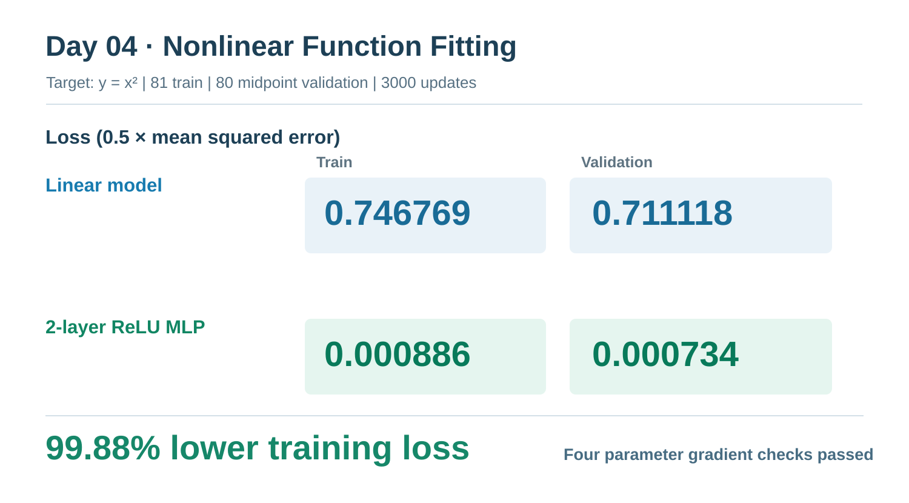
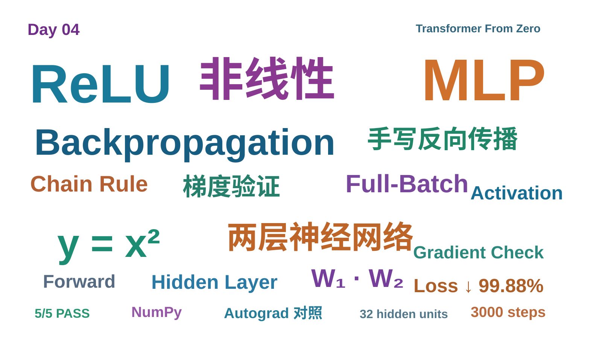

# Day 04｜ReLU、两层 MLP 手写反向传播与非线性训练实验
单纯堆叠线性层只能形成更复杂参数化的仿射变换，无法突破线性函数的表达限制。非线性激活通过输入依赖的激活状态，使网络形成不同的局部映射，并通过组合这些映射实现对复杂非线性函数的近似。
> Transformer From Zero — 365 Days | 2026-11-07  
> Milestone 02：**手写两层 ReLU MLP，在非线性函数拟合中显著优于线性模型**  
> 实验脚本：[day04_nonlinear_mlp_demo.py](../../scripts/day04_nonlinear_mlp_demo.py)  
> 练习代码：[week04.py](../../exercises/week04.py) | 测试：[test_week04_exercises.py](../../tests/test_week04_exercises.py)

## 一、从 Day 3 到 Day 4：为什么不只是增加线性层？

如果没有激活函数，两层仿射变换可合并：

$$
Y=(XW_1+b_1)W_2+b_2=X(W_1W_2)+(b_1W_2+b_2).
$$

因此堆叠任意多层纯仿射变换，整体仍是一个仿射变换。加入 ReLU 后：

$$
Z_1=XW_1+b_1,\quad H=\operatorname{ReLU}(Z_1),\quad \hat Y=HW_2+b_2,
$$

模型就能够通过分段线性映射逼近非线性函数，例如本次的 $y=x^2$。

## 二、Task A：ReLU 前向与反向

$$
\operatorname{ReLU}(z)=\max(0,z).
$$

NumPy 前向实现：

~~~python
def relu_numpy(x):
    return np.maximum(0, x)
~~~

反向传播采用分段导数：$z>0$ 取 1，$z<0$ 取 0。**在 $z=0$ 处 ReLU 数学上不可导，本练习约定其梯度为 0**。上游梯度必须经链式法则逐元素相乘：

$$
\frac{\partial L}{\partial Z}=
\frac{\partial L}{\partial H}\odot\mathbf1[Z>0].
$$

~~~python
def relu_backward_numpy(pre_activation, grad_output):
    return np.where(pre_activation > 0, grad_output, 0)
~~~

例如前向输入为 `[-2,0,3]`、上游梯度为 `[5,7,-2]` 时，传回的梯度是 `[0,0,-2]`，而不是 `[0,0,1]`。

## 三、Task B：两层 MLP 前向传播

~~~python
z1 = x @ w1 + b1
hidden = relu_numpy(z1)
predictions = hidden @ w2 + b2
~~~

| 张量 | 形状 |
| --- | --- |
| x | (N,D) |
| w1 | (D,H) |
| b1 | (H,) |
| hidden | (N,H) |
| w2 | (H,C) |
| b2 | (C,) |
| predictions | (N,C) |

ReLU 的逐元素操作不改变张量形状。

## 四、Task C：手动推导并实现两层反向传播

本轮沿用前三天的损失约定：

$$
E=\hat Y-Y,\qquad L=\frac1{2N}\sum_{i,j}E_{ij}^2.
$$

输出误差梯度：

$$
G_2=E/N.
$$

第二层权重与偏置梯度：

$$
\nabla_{W_2}L=H^\top G_2,\qquad\nabla_{b_2}L=\sum_i G_{2,i}.
$$

从第二层传回隐藏层，再经过 ReLU 的导数：

$$
G_H=G_2W_2^\top,\qquad G_1=G_H\odot\mathbf1[Z_1>0].
$$

第一层参数梯度：

$$
\nabla_{W_1}L=X^\top G_1,\qquad\nabla_{b_1}L=\sum_i G_{1,i}.
$$

其中 $G_2$ 已经除过样本数 $N$，后面**不应该重复除 $N$**。所有层的梯度均需用同一次前向和反向传播时的参数计算，再统一更新。

## 五、单元测试验收

用户本地完整输出：

~~~text
python -m pytest -q -m exercise tests/test_week04_exercises.py
..... [100%]
5 passed in 1.94s
~~~

五项检查包括：ReLU 前向、ReLU 反向及零点处理、MLP 前向与 PyTorch 对照、四组反向梯度与 PyTorch Autograd 对照、单步参数更新后 Loss 下降。**Autograd 仅在测试中充当参考实现，不用于手写模型的训练。**

## 六、最终训练：线性模型 VS 两层 ReLU MLP

### 实验设置

| 项目 | 设置 |
| --- | --- |
| 拟合目标 | $y=x^2$，区间 $[-2,2]$，无噪声 |
| 训练集 | 81 个等间距输入点 |
| 验证集 | 80 个相邻训练点的区间中点 |
| 对照模型 | 单层线性模型 $wx+b$ |
| 实验模型 | 2 层 ReLU MLP，隐藏宽度 32 |
| 学习率与更新 | 0.05，3000 次全批量参数更新 |
| 参数初始化 | 固定随机种子 2026 |
| 损失函数 | $0.5\sum(\hat y-y)^2/N$ |

实验命令：

~~~powershell
python scripts/day04_nonlinear_mlp_demo.py
~~~

### 独立数值梯度检查（实际日志）

| 参数组 | 相对误差 |
| --- | ---: |
| w1 | 6.979e-11 |
| b1 | 6.022e-11 |
| w2 | 7.101e-12 |
| b2 | 3.135e-12 |

四组梯度均与有限差分估计高度一致，支持代码在此次测试设置下正确实现了链式法则。

### 训练日志关键节点

| 更新步数 | 线性模型 Loss | 两层 MLP Loss |
| ---: | ---: | ---: |
| 0 | 1.680658333 | 2.653244435 |
| 1 | 1.589604167 | 1.275616702 |
| 2 | 1.507427781 | 0.754812087 |
| 10 | 1.081555464 | 0.328483707 |
| 50 | 0.752298561 | 0.093387322 |
| 100 | 0.746802180 | 0.040212115 |
| 500 | 0.746769444 | 0.016035951 |
| 1000 | 0.746769444 | 0.005947328 |
| 2000 | 0.746769444 | 0.001813930 |
| 3000 | 0.746769444 | 0.000886492 |

### 最终测试与验证结果

| 模型 | 训练 Loss | 验证 Loss |
| --- | ---: | ---: |
| 线性模型 | 0.7467694444 | 0.7111181467 |
| 两层 ReLU MLP | 0.0008864915 | 0.0007343671 |

MLP 相对线性基线的**训练 Loss 降幅为 99.88%**。这是同一种损失定义下的对比，不代表实际世界里所有非线性任务都能获得同等收益。

线性模型最终参数为 $w\approx 0$、$b\approx1.36666667$，说明对于本次关于 0 对称的二次函数训练样本，最优线性拟合为水平线。MLP 则通过分段线性片段近似抛物线。

### 训练结果可视化

该 SVG 是根据本轮**实测日志数据绘制的汇总图**，与运行脚本生成的两张原始 PNG 不同；原始 PNG 保存在本地 `results/day04/loss_curves.png` 和 `results/day04/nonlinear_fit_comparison.png`。

**对原始图的观察：** 线性模型 Loss 很快停止下降，MLP 在 3000 步内持续下降。拟合图中，MLP 的预测曲线与 $x^2$ 接近，线性预测则是一条水平线。

验证集是相邻训练样本间的中点，因此上述小验证误差说明**同一区间内插值表现良好**，不构成区间外推能力的证据；本次没有噪声或随机多次重复实验。

## 七、今天的关键收获

1. **表达能力：** 没有激活函数，任意多层仿射映射仍等价于一层。
2. **链式法则：** 反向传播按计算图逆序传递误差信号，权重梯度是输入转置乘局部误差梯度。
3. **ReLU 门控：** 部分神经元处于关闭状态时，对相应输入的梯度为 0。
4. **验证梯度：** 先和 Autograd 以及有限差分对照，再进行长期训练。
5. **验证模型：** 不只报告训练 Loss，还要报告预留点误差，并清楚交代其属于插值验证。
6. **可复现性：** 固定数据、随机种子、模型宽度、学习率、更新步数，并保存日志和绘图。

## 八、Day 04 知识词云

## 九、下一步

继续学习不同非线性激活（Sigmoid、Tanh、GELU）及它们的导数、梯度性质，与之后的 Transformer FFN 相衔接。

---

本次 GitHub 同步包含笔记及两张 SVG。**原始 Matplotlib PNG 是本地训练产物，未被替换为声称是原图的 SVG。**