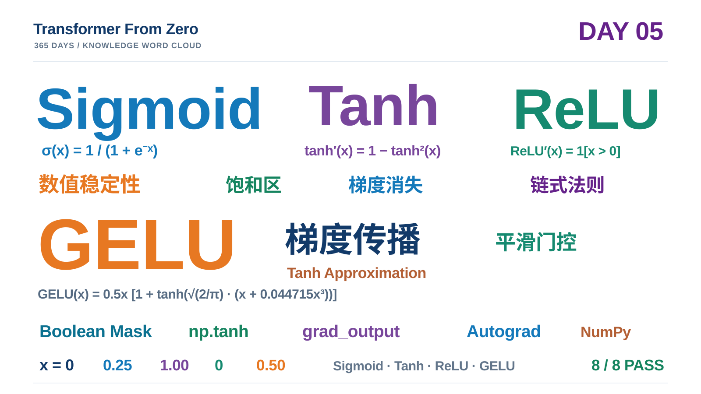

# Day 05｜Sigmoid、Tanh、GELU 与激活函数梯度

> **项目：** [Transformer From Zero — 365 Days](https://github.com/JiamuHan1122/transformer-from-zero)  
> **日期：** 2026-11-08  
> **阶段：** Week 01 · 激活函数与梯度传播  
> **状态：** Task A–D 完成；8 项练习测试全部通过  
> **实验脚本：** [day05_activation_demo.py](../../scripts/day05_activation_demo.py)  
> **练习实现：** [week05.py](../../exercises/week05.py)  
> **测试文件：** [test_week05_exercises.py](../../tests/test_week05_exercises.py)

## 0. 今天学到了什么？

Day 04 我们使用 ReLU 构建了两层 MLP，并通过拟合 $y=x^2$ 观察到：激活函数让多层网络获得了单层线性模型不具备的非线性表达能力。

Day 05 把问题推进一步：

**不同激活函数如何改变前向输出，以及反向传播时梯度如何通过它们？**

今天实现并比较了四种激活函数：

- **Sigmoid：** 将实数输入压缩到 $(0,1)$，适合表达门控或概率形式的输出，但在两端容易饱和。
- **Tanh：** 将输入压缩到 $(-1,1)$，以 0 为中心，同样存在饱和区。
- **ReLU：** 负数区域关闭，正数区域保持线性；正半轴导数为 1，但负半轴梯度为 0。
- **GELU（Tanh 近似）：** 根据输入大小平滑地抑制或保留信息，是 Transformer FFN 中常见的激活选择之一。

今天还把 Day 04 的 ReLU 反向传播函数直接导入复用，避免重复实现。

## 1. 统一视角：激活函数的前向与反向

设某层线性变换产生预激活值 $z$，激活函数为 $a=f(z)$。

前向传播：

$
a=f(z)
$

反向传播时，若上游梯度为：

$
G_{\mathrm{out}}=\frac{\partial L}{\partial a},
$

则根据链式法则：

$
\boxed{
G_{\mathrm{in}}
=\frac{\partial L}{\partial z}
=G_{\mathrm{out}}\odot f'(z)
}
$

其中 $\odot$ 表示逐元素相乘。

**关键认识：** 激活函数的导数决定了局部梯度如何被缩放、保留或截断；它不是单独决定整个网络训练效果的唯一因素。

## 2. Task A：Sigmoid——数值稳定与饱和梯度

### 2.1 前向传播

$
\sigma(x)=\frac{1}{1+e^{-x}}
$

直接使用该公式时，若 $x=-1000$，就需要计算 $e^{1000}$，可能产生数值上溢。

利用等价变形：

$
\sigma(x)=
\begin{cases}
\frac{1}{1+e^{-x}},&x\geq 0,\$4pt]
\frac{e^x}{1+e^x},&x<0.
\end{cases}
$

这样在负数区域计算 $e^x$，避免了计算极大的 $e^{-x}$。

**实现要点：** 使用布尔掩码分别计算两个分支。不能简单写成 **np.where(condition, expr1, expr2)**，因为 NumPy 的 **np.where** 会先计算两个候选表达式，再选择结果；不安全的指数表达式仍可能被执行。

实际实现采用：

~~~python
forward = np.zeros_like(x, dtype=np.float64)
mask = x >= 0

forward[mask] = 1 / (1 + np.exp(-x[mask]))

exp_x = np.exp(x[~mask])
forward[~mask] = exp_x / (1 + exp_x)
~~~

对 $[-1000,0,1000]$ 这样的输入，输出保持有限，且不需要计算 $e^{1000}$。

### 2.2 反向传播

$
\sigma'(x)=\sigma(x)(1-\sigma(x))
$

$
\boxed{
G_{\mathrm{in}}
=G_{\mathrm{out}}\odot\sigma(x)(1-\sigma(x))
}
$

为什么最大导数只有 0.25？

令 $s=\sigma(x)$，则：

$
s(1-s)=\frac14-\left(s-\frac12\right)^2
\leq\frac14.
$

当 $s=0.5$，也就是 $x=0$ 时，导数取得最大值：

$
\boxed{\sigma'(0)=0.25}
$

当输入很大或很小时，Sigmoid 输出接近 1 或 0，导数都会趋近于 0。这就是 Sigmoid 饱和区容易导致梯度衰减的原因。

## 3. Task B：Tanh——零中心化与梯度衰减

### 3.1 前向传播

$
\tanh(x)=\frac{e^x-e^{-x}}{e^x+e^{-x}}
$

输出范围为：

$
-1<\tanh(x)<1.
$

Tanh 以 0 为中心，因此正、负输入会对应正、负输出。本任务直接使用 **np.tanh(x)**，利用 NumPy 已有的稳定实现。

### 3.2 反向传播

$
\boxed{
\tanh'(x)=1-\tanh^2(x)
}
$

$
\boxed{
G_{\mathrm{in}}
=G_{\mathrm{out}}\odot(1-\tanh^2(x))
}
$

在 $x=0$ 时：

$
\tanh(0)=0,\qquad \tanh'(0)=1.
$

但当输入绝对值较大时，Tanh 也会逐渐饱和，导数趋近于 0。

**对比 Sigmoid：** Tanh 在零点的最大导数为 1，而 Sigmoid 为 0.25；Tanh 的输出还是零中心的。但这并不意味着 Tanh 在所有网络和任务中都一定优于 Sigmoid。

## 4. Task C：GELU——平滑门控与完整求导

### 4.1 前向传播：Tanh 近似

今天实现的是常用的 Tanh 近似版本，而不是基于误差函数 erf 的精确 GELU：

$
\operatorname{GELU}_{\mathrm{tanh}}(x)
=\frac{x}{2}\left[
1+\tanh\left(
\sqrt{\frac{2}{\pi}}
(x+0.044715x^3)
\right)\right].
$

令：

$
a=\sqrt{\frac2\pi},\qquad
u=a(x+0.044715x^3).
$

则：

$
\operatorname{GELU}_{\mathrm{tanh}}(x)
=\frac12x(1+\tanh(u)).
$

对应 PyTorch 参考设置为：

~~~python
torch.nn.functional.gelu(x, approximate="tanh")
~~~

### 4.2 反向传播：乘积法则与链式法则

令 $t=\tanh(u)$，首先计算：

$
\frac{du}{dx}
=a(1+3\cdot0.044715x^2).
$

由于：

$
f(x)=\frac12x(1+t),
$

使用乘积法则：

$
f'(x)=\frac12(1+t)+\frac12x\frac{dt}{dx}.
$

再使用链式法则：

$
\frac{dt}{dx}
=(1-\tanh^2(u))\frac{du}{dx}.
$

最终得到：

$
\boxed{
f'(x)=
\frac12(1+t)+
\frac12x(1-t^2)\frac{du}{dx}
}
$

反向传播：

$
\boxed{
G_{\mathrm{in}}=G_{\mathrm{out}}f'(x)
}
$

**特别注意：GELU 的导数不保证始终位于 $[0,1]$。** 不要像 ReLU 一样人为截断负数梯度。

例如，本次实际运行在 $x=-2$ 时：

$
\operatorname{GELU}'(-2)\approx-0.086099.
$

这是 Tanh 近似 GELU 的正常数学行为，不是求导代码错误。

## 5. Task D：统一比较四种激活函数的梯度

我们使用同一个输入网格 $x$，令上游梯度全部为 1：

$
G_{\mathrm{out}}=\mathbf 1.
$

于是：

$
G_{\mathrm{in}}=\mathbf 1\odot f'(x)=f'(x).
$

因此，四个反向传播函数返回的就是各自的导数曲线。

~~~python
upstream = np.ones_like(x, dtype=np.float64)

return {
    "sigmoid": sigmoid_backward_numpy(x, upstream),
    "tanh": tanh_backward_numpy(x, upstream),
    "relu": relu_backward_numpy(x, upstream),
    "gelu": gelu_tanh_backward_numpy(x, upstream),
}
~~~

其中 ReLU 反向传播直接从 Day 04 导入：

~~~python
from exercises.week04 import relu_backward_numpy
~~~

本项目对 ReLU 在 $x=0$ 处采用导数为 0 的约定。

### 5.1 四种激活函数的导数对比

| 激活函数 | $x=0$ 的导数 | 梯度特点 |
|---|---:|---|
| Sigmoid | 0.25 | 两端饱和，梯度趋近 0 |
| Tanh | 1.00 | 零点梯度最大，两端饱和 |
| ReLU | 0.00 | 正半轴恒为 1，负半轴为 0 |
| GELU | 0.50 | 平滑变化，部分负区间导数小于 0 |

### 5.2 一道链式法则计算例题

给定：

$
x=[-2,0,2],\qquad
G_{\mathrm{out}}=[2,3,4].
$

根据：

$
G_{\mathrm{in}}=G_{\mathrm{out}}\odot f'(x),
$

分别得到：

| 激活函数 | 导数 $f'(x)$ | 传回梯度 $G_{\mathrm{in}}$ |
|---|---|---|
| Sigmoid | [0.104994, 0.25, 0.104994] | [0.209987, 0.75, 0.419974] |
| Tanh | [0.070651, 1, 0.070651] | [0.141302, 3, 0.282603] |
| ReLU | [0, 0, 1] | [0, 0, 4] |
| GELU | [-0.086099, 0.5, 1.086099] | [-0.172199, 1.5, 4.344397] |

**思考：** 为什么同一个上游梯度，经过不同激活函数后会产生完全不同的梯度？

答案就在局部导数 $f'(x)$：激活函数不仅改变前向输出，也会改变误差信号向前一层传递的方式。

## 6. 最终实验：四种激活函数与梯度曲线

运行命令：

~~~powershell
python scripts/day05_activation_demo.py
~~~

本次实验设置：

| 项目 | 实际设置 |
|---|---|
| 输入区间 | [-6, 6] |
| 采样点数 | 1201 |
| 数值精度 | float64 |
| 激活函数 | Sigmoid / Tanh / ReLU / GELU |
| 梯度计算 | 手动 NumPy 反向传播 |
| 对照 | PyTorch 参考实现与 Day 03 中心差分 |

### 6.1 前向输出实测

| x | Sigmoid | Tanh | ReLU | GELU |
|---:|---:|---:|---:|---:|
| -4 | 0.017986 | -0.999329 | 0 | -0.000070 |
| -2 | 0.119203 | -0.964028 | 0 | -0.045402 |
| 0 | 0.500000 | 0 | 0 | 0 |
| 2 | 0.880797 | 0.964028 | 2 | 1.954598 |
| 4 | 0.982014 | 0.999329 | 4 | 3.999930 |

### 6.2 梯度实测

| x | Sigmoid' | Tanh' | ReLU' | GELU' |
|---:|---:|---:|---:|---:|
| -4 | 0.017663 | 0.001341 | 0 | -0.000335 |
| -2 | 0.104994 | 0.070651 | 0 | -0.086099 |
| 0 | 0.250000 | 1.000000 | 0 | 0.500000 |
| 2 | 0.104994 | 0.070651 | 1 | 1.086099 |
| 4 | 0.017663 | 0.001341 | 1 | 1.000335 |

原始实验图片和指标文件保存在本地：

~~~text
results/day05/
├── metrics.json
├── activation_functions.png
└── activation_gradients.png
~~~

其中 **results/** 属于项目本地实验产物目录，受 **.gitignore** 规则管理；本篇笔记和知识词云单独纳入 GitHub。

## 7. 八项测试：最终验收

实际执行：

~~~powershell
python -m pytest -q -m exercise tests/test_week05_exercises.py
~~~

实际终端结果：

~~~text
........ [100%]
8 passed in 1.95s
~~~

八项测试覆盖：

1. Sigmoid 数值稳定性、输出值和形状。
2. Sigmoid 手动反向与 PyTorch 对照。
3. Tanh 前向与 PyTorch 对照。
4. Tanh 手动反向与 PyTorch 对照。
5. GELU Tanh 近似前向与 PyTorch 对照。
6. GELU 手动反向与 PyTorch 对照。
7. 四种激活函数梯度曲线及 ReLU 跨日复用。
8. GELU 反向梯度与 Day 03 中心差分结果对照。

**验收结论：** 四种激活函数的 NumPy 前向与反向实现均通过本日练习测试。PyTorch 只作为独立参考，不参与这些 NumPy 函数的实现。

## 8. 今天真正需要记住的知识

1. **激活函数提供非线性表达能力。** Day 04 已经通过 MLP 拟合实验验证了这一点。
2. **反向传播的核心是链式法则。** 上游梯度乘以当前运算的局部导数。
3. **Sigmoid 和 Tanh 都会饱和。** 输入进入饱和区域后，局部导数趋近于 0。
4. **ReLU 在正半轴保留梯度。** 但负半轴会关闭梯度。
5. **GELU 是平滑门控。** 它的导数可能小于 0，也可能大于 1。
6. **数值稳定性属于实现正确性的一部分。** 公式等价不代表直接计算就一定稳定。
7. **模块应该复用，而不是重复造轮子。** 今天的梯度曲线直接复用了 Day 04 的 ReLU backward。

## 9. Day 05 知识词云

> 以四种激活函数为核心，汇集数值稳定性、饱和区、梯度消失、链式法则、GELU Tanh 近似、NumPy 与梯度验证。

## 10. 下一步：从激活函数走向 Transformer FFN

下一阶段需要把今天掌握的非线性激活放回神经网络结构中理解：

- 为什么 Transformer 的 FFN 需要两次线性投影？
- 激活函数在 FFN 中位于什么位置？
- ReLU、GELU 与后续常见的 SwiGLU 有什么区别？
- 残差连接和归一化如何与梯度传播协同工作？

Day 05 的核心链条已经打通：

$
\boxed{
\text{Forward}
\rightarrow
\text{Activation}
\rightarrow
\text{Local Derivative}
\rightarrow
\text{Backward}
}
$

**Day 05 完成。**
