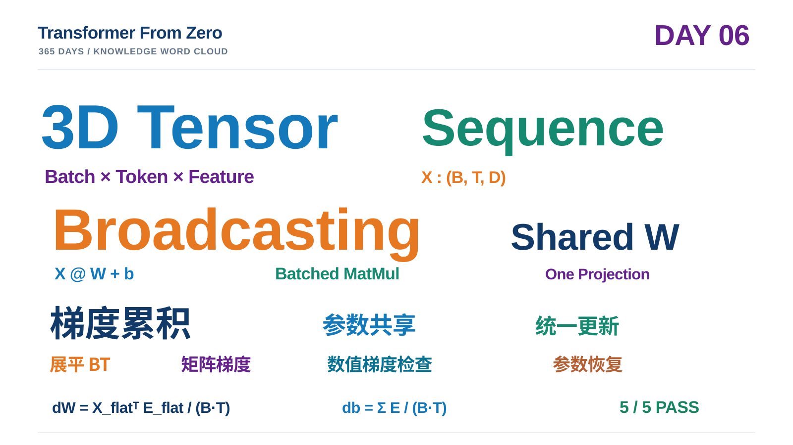

# Day 06｜Tensor Shape、Broadcasting 与共享三维线性层

> **项目：** [Transformer From Zero — 365 Days](https://github.com/JiamuHan1122/transformer-from-zero)  
> **日期：** 2026-11-09  
> **阶段：** Week 01 · 从二维批量计算走向三维序列张量  
> **状态：** Task A–B 完成；5 项练习测试全部通过；最终训练 Demo 成功  
> **实验脚本：** [day06_sequence_linear_demo.py](../../scripts/day06_sequence_linear_demo.py)  
> **练习实现：** [week06.py](../../exercises/week06.py)  
> **测试文件：** [test_week06_exercises.py](../../tests/test_week06_exercises.py)  
> **任务说明：** [07_week06_tasks.md](../07_week06_tasks.md)

## 0. 今天学到了什么？

前几天，我们已经能用 NumPy 实现二维批量线性层：

$
Y=XW+b
$

但 Transformer 接收的不是简单的二维样本矩阵，而是一批 Token 序列。今天，我们把张量表示扩展到三维：

$
X\in\mathbb{R}^{B\times T\times D}
$

其中：

- **B：** Batch size，一批中有多少条序列；
- **T：** Sequence length，每条序列包含多少个 Token；
- **D：** Feature dimension，每个 Token 的特征维度。

今天完成了两个核心任务：

1. 用 NumPy 的批量矩阵乘法和 Broadcasting，实现共享参数的三维线性层。
2. 手动推导并实现权重、偏置梯度，让所有 Batch 中的所有 Token 共同更新同一份参数。

最后，我们训练了一个真正的三维序列回归小模型，验证手写梯度、参数共享和训练过程。

## 1. Tensor Shape：先读懂三个维度

例如：

$
X:(4,8,64)
$

表示：

- 4 条序列；
- 每条序列 8 个 Token；
- 每个 Token 有 64 个特征。

这里要区分三个概念：

- **Rank（秩/阶）：** 张量有多少个轴。上述张量的 ndim = 3。
- **Shape（形状）：** 每个轴的长度。上述张量的 shape = (4, 8, 64)。
- **Axis（轴）：** 某个维度的位置。axis=0 是 Batch，axis=1 是 Sequence，axis=2 是 Feature。

记忆方式：

$
\boxed{(B,T,D)=
(\text{Batch},\text{Token},\text{Feature})}
$

不要把 T 和 D 混淆：Token 数量描述序列长度，Feature 数量描述每个 Token 的表示宽度。

## 2. Task A：三维线性层前向传播

### 2.1 输入与输出形状

定义：

$
X\in\mathbb{R}^{B\times T\times D}
$

$
W\in\mathbb{R}^{D\times H},\qquad
b\in\mathbb{R}^{H}
$

计算：

$
\boxed{Y=XW+b}
$

输出：

$
Y\in\mathbb{R}^{B\times T\times H}
$

例如：

$
(4,8,64)@(64,128)\rightarrow(4,8,128)
$

这里 NumPy 的矩阵乘法会对最后两个矩阵维度执行乘法，同时保留前面的 Batch 维度，不需要手动逐条序列循环。

### 2.2 为什么 Bias 可以直接相加？

线性层输出的形状是：

$
Y:(B,T,H)
$

偏置的形状是：

$
b:(H,)
$

NumPy 会从最后一个维度开始对齐。偏置的 H 与输出最后一维相同，因此会沿 Batch 和 Token 两个维度广播：

$
Y_{b,t,:}=X_{b,t,:}W+b
$

注意：这里不是为每个 Token 创建一份独立偏置，而是所有 Token 使用同一份 b。

### 2.3 代码实现

文件：**exercises/week06.py**

~~~python
def linear_3d_numpy(x, weight, bias):
    return x @ weight + bias
~~~

这段代码很短，但背后包含三个重要机制：

1. @ 支持批量矩阵乘法；
2. + bias 触发 Broadcasting；
3. 所有 Token 共享同一份 weight 和 bias。

### 2.4 一个重要边界：共享参数不等于 Token 交互

这层线性变换会对每个 Token 使用同一个投影矩阵，但每个 Token 的输入向量仍然不同，因此输出也不同。

它本身不会让 Token 1 读取 Token 2 的特征。

换句话说：

- **参数共享：** 不同 Token 使用相同的 W、b；
- **Token 信息交互：** 一个 Token 的表示依赖其他 Token 的内容。

今天实现的线性层具备前者，不具备后者。后者正是后续 Attention 要解决的重要问题。

## 3. Task B：共享参数的梯度累积

这是今天最重要的知识点。

### 3.1 先定义误差和 Loss

前向传播：

$
P=XW+b
$

$
E=P-Y
$

本练习规定的 Loss 为：

$
\boxed{
L=\frac{1}{2BT}
\sum_{b=1}^{B}\sum_{t=1}^{T}\sum_{h=1}^{H}
E_{bth}^{2}
}
$

注意归约顺序：

- 对每个 Token 的 H 个特征误差求平方和；
- 再对全部 B×T 个 Token 求平均。

因此分母是 BT，**不是 BTH**。

### 3.2 把 Batch 与 Sequence 合并

令：

$
M=BT
$

将输入和误差的前两个维度展平：

$
X_{\mathrm{flat}}\in\mathbb{R}^{M\times D}
$

$
E_{\mathrm{flat}}\in\mathbb{R}^{M\times H}
$

这样，三维序列问题就转化成了 Week 02 学过的二维批量矩阵问题。

### 3.3 权重梯度

由：

$
L=\frac{1}{2M}\sum_{m=1}^{M}
\sum_{h=1}^{H}E_{mh}^{2}
$

先得到：

$
\frac{\partial L}{\partial E_{\mathrm{flat}}}
=\frac{E_{\mathrm{flat}}}{M}
$

因为：

$
E_{\mathrm{flat}}=X_{\mathrm{flat}}W-Y_{\mathrm{flat}}
$

所以：

$
\boxed{
\frac{\partial L}{\partial W}
=\frac{X_{\mathrm{flat}}^\top E_{\mathrm{flat}}}{M}
}
$

形状检查：

$
(D,M)@(M,H)=(D,H)
$

最终梯度形状与原始权重 W 完全一致。

这里中间的 M=BT 维度被矩阵乘法求和消去。每个 Token 对共享权重的梯度贡献，都被累积到了同一份梯度矩阵中。

### 3.4 偏置梯度

偏置被所有 Token 共享，因此需要累加所有 Token 的误差：

$
\boxed{
\frac{\partial L}{\partial b}
=\frac{1}{M}\sum_{m=1}^{M}E_{\mathrm{flat},m}
}
$

在原始三维形状下，对 Batch 和 Sequence 两个轴求和：

$
\boxed{
\frac{\partial L}{\partial b}
=\frac{1}{BT}\sum_{b=1}^{B}\sum_{t=1}^{T}E_{b,t,:}
}
$

因此代码中：

~~~python
grad_bias = np.sum(error, axis=(0, 1)) / (B * T)
~~~

最终得到形状为 (H,) 的偏置梯度。

### 3.5 为什么要累积，而不是分别更新？

假设一共有 4 个 Token，它们共享同一份 W，各自贡献梯度：

$
g_1,g_2,g_3,g_4
$

最终梯度为：

$
\boxed{
\nabla_W L=\frac{g_1+g_2+g_3+g_4}{4}
}
$

先汇总梯度，再统一更新参数。

不能为每个 Token 单独创建一份 W，否则就不再是共享参数的线性层了。

**今天的核心记忆：参数共享 → 梯度累积 → 统一更新。**

## 4. Task B：NumPy 完整实现

~~~python
def linear_3d_mse_gradients(x, weight, bias, targets):
    B, T, D = x.shape
    _, _, H = targets.shape

    predictions = linear_3d_numpy(x, weight, bias)
    error = predictions - targets

    loss = 0.5 * np.sum(error**2) / (B * T)

    grad_weight = (
        x.reshape(B * T, D).T
        @ error.reshape(B * T, H)
    ) / (B * T)

    grad_bias = np.sum(error, axis=(0, 1)) / (B * T)

    return loss.item(), grad_weight, grad_bias
~~~

这里复用了 Week 02 的矩阵梯度推导。没有使用 PyTorch Autograd，也没有调用优化器。

## 5. 今日例题与答案

### 例题一：三维线性层的输出形状

已知：

$
X:(4,8,64),\quad
W:(64,128),\quad
b:(128,)
$

求输出形状。

**解答：**

$
(4,8,64)@(64,128)
=(4,8,128)
$

偏置广播不改变输出形状，因此：

$
\boxed{Y:(4,8,128)}
$

### 例题二：Bias Broadcasting

已知：

$
X:(4,8,64),\quad W:(64,128),\quad b:(128,)
$

问：偏置是否需要扩展成 (4,8,128) 才能相加？

**解答：**

不需要。NumPy 会自动把 (128,) 广播到 (4,8,128) 的每个 Batch、每个 Token。

逻辑上每个 Token 都加同一份偏置，但不意味着必须真的复制出 32 份偏置数组。

### 例题三：共享权重的梯度累积

假设 B=2、T=3，共有 6 个 Token。每个 Token 对权重产生一个梯度贡献 g。

求最终权重梯度。

**解答：**

$
\boxed{
\nabla_W L=
\frac{1}{6}
\sum_{b=1}^{2}\sum_{t=1}^{3}g_{b,t}
}
$

6 个 Token 的贡献汇总后，统一更新同一份权重。

### 例题四：Loss 的归约方式

假设 B=2、T=2、H=2，每个位置的误差都是：

$
E_{b,t,:}=[1,1]
$

求本练习定义的 Loss。

**解答：**

每个 Token 的损失：

$
\frac12(1^2+1^2)=1
$

共有 4 个 Token，取平均：

$
L=\frac{1+1+1+1}{4}
=\boxed{1}
$

如果错误地除以 BTH=8，就会得到 0.5，与本练习的 Loss 定义不一致。

## 6. 五项练习测试：全部通过

运行命令：

~~~powershell
python -m pytest -q -m exercise tests/test_week06_exercises.py
~~~

本次实际结果：

~~~text
.....                                                                    [100%]
5 passed in 2.13s
~~~

覆盖内容：

1. 三维线性层与 PyTorch 参考结果一致，且不修改输入数组；
2. Bias 正确广播到每一个 Token；
3. 手动计算的权重、偏置梯度与 PyTorch Autograd 对照一致；
4. Loss 正确地对特征求和、对 Token 求平均；
5. 一次梯度下降更新能够降低 Loss。

PyTorch 仅用于测试参考，不参与 NumPy 实现。

## 7. 最终训练实验：让共享三维线性层真正学会映射

### 7.1 实验设计

脚本：

~~~powershell
python scripts/day06_sequence_linear_demo.py
~~~

使用一个可控的合成序列回归任务：

$
Y_{b,t}=X_{b,t}W_{\mathrm{true}}+b_{\mathrm{true}}
$

每个 Token 都由同一份真实权重和偏置生成目标。

| 项目 | 设置 |
|---|---:|
| 随机种子 | 606 |
| 训练数据 | 16 条序列 |
| 验证数据 | 4 条独立序列 |
| 序列长度 | 8 Tokens |
| 输入维度 | 4 |
| 输出维度 | 3 |
| 共享参数总量 | 15 |
| 学习率 | 0.08 |
| 梯度更新 | 200 次 |

训练和验证序列独立采样，验证集没有参与参数更新。

### 7.2 先独立检查梯度

使用 Day 03 实现的中心差分函数，对权重和偏置分别进行数值梯度检查。

| 参数 | 相对误差 |
|---|---:|
| Weight | $1.145\times10^{-11}$ |
| Bias | $4.125\times10^{-11}$ |

两项误差都远小于 $10^{-6}$ 的验收阈值。

### 7.3 训练过程

| Step | Train Loss | Validation Loss |
|---:|---:|---:|
| 0 | 4.21881364 | 4.56822112 |
| 1 | 3.61780845 | 3.90768581 |
| 2 | 3.10806671 | 3.34947279 |
| 5 | 1.99234314 | 2.13593481 |
| 10 | 0.98417115 | 1.05332137 |
| 20 | 0.27202899 | 0.29972407 |
| 50 | 0.01142012 | 0.01577184 |
| 100 | 0.00013750 | 0.00023420 |
| 150 | 0.00000201 | 0.00000361 |
| 200 | $3.0033\times10^{-8}$ | $5.4575\times10^{-8}$ |

训练和验证 Loss 都持续下降，最终达到 $10^{-8}$ 量级。

### 7.4 参数恢复

| 参数 | 最大绝对误差 |
|---|---:|
| $W_{\mathrm{trained}}-W_{\mathrm{true}}$ | $1.976921\times10^{-4}$ |
| $b_{\mathrm{trained}}-b_{\mathrm{true}}$ | $1.208956\times10^{-4}$ |

训练得到的参数已经非常接近生成目标时使用的真实参数。

### 7.5 未见过的序列预测

实验还单独展示了验证集第一条序列中 Token 0、2、4、7 的预测值。

例如 Token 0：

| 特征 | Ground truth | Trained prediction |
|---|---:|---:|
| Feature 0 | 2.28016 | 2.28018 |
| Feature 1 | -1.51778 | -1.51778 |
| Feature 2 | -0.73016 | -0.73015 |

预测结果与真实目标非常接近。

**解释边界：** 这是一个无噪声、线性、可控的合成任务。它验证了实现、梯度和共享参数训练链路，不等于证明模型已经具备复杂序列建模能力，也不能替代后续 Attention 实验。

## 8. 实验图片与指标

脚本成功生成：

~~~text
results/day06/
├── metrics.json
├── loss_curve.png
└── sequence_prediction_comparison.png
~~~

- loss_curve.png：训练序列和独立验证序列的 Loss 曲线。
- sequence_prediction_comparison.png：一条未见过的验证序列中，各输出特征的真实值、训练前预测和训练后预测。
- metrics.json：实验配置、梯度检查误差、Loss 检查点和参数恢复误差。

这些是本地实验产物；项目的 results/ 目录由 Git 忽略规则管理，本次通过笔记记录核心结果，不把本地运行产物误认为已经上传 GitHub。

## 9. 今天真正需要记住的知识

1. 三维序列张量通常使用 (B,T,D) 表示。
2. x @ weight 能够保留 Batch 维度，对最后两个矩阵维度执行乘法。
3. (H,) 的偏置可以广播到 (B,T,H)。
4. 共享参数意味着不同 Token 使用同一份权重，而不是拥有各自独立的权重。
5. 共享参数的梯度必须汇总所有 Batch、所有 Token 的贡献。
6. 本练习的 Loss 对特征维度求和，再对 B×T 个 Token 求平均。
7. 三维线性层只独立变换各 Token，不负责 Token 之间的信息交互。
8. 训练集与独立验证集同步下降，且参数接近真实值，说明本次合成实验成功。

## 10. Day 06 知识词云

今天的视觉关键词：

**Tensor Shape · Batch · Sequence · Feature · Broadcasting · Batched MatMul · Shared Weight · Gradient Accumulation · Flatten · NumPy · Finite Difference · Parameter Recovery**

## 11. 下一步：从共享线性投影走向 Attention

今天的线性层已经可以处理一批 Token，但它还没有让不同 Token 之间交换信息。

下一步要回答：

- 一个 Token 怎样读取其他 Token 的表示？
- Query、Key、Value 分别承担什么作用？
- 为什么要计算 $QK^\top$？
- Attention 权重怎样对 Value 做加权求和？
- 形状如何从 (B,T,D) 变化到多头注意力中的各个维度？

今天建立的张量维度、批量矩阵乘法、广播和梯度累积，将直接用于后续 Attention 实现。

$
\boxed{
\text{3D Tensor}
\rightarrow
\text{Shared Linear Projection}
\rightarrow
\text{Gradient Accumulation}
\rightarrow
\text{Sequence Training}
}
$

**Day 06 完成。**
