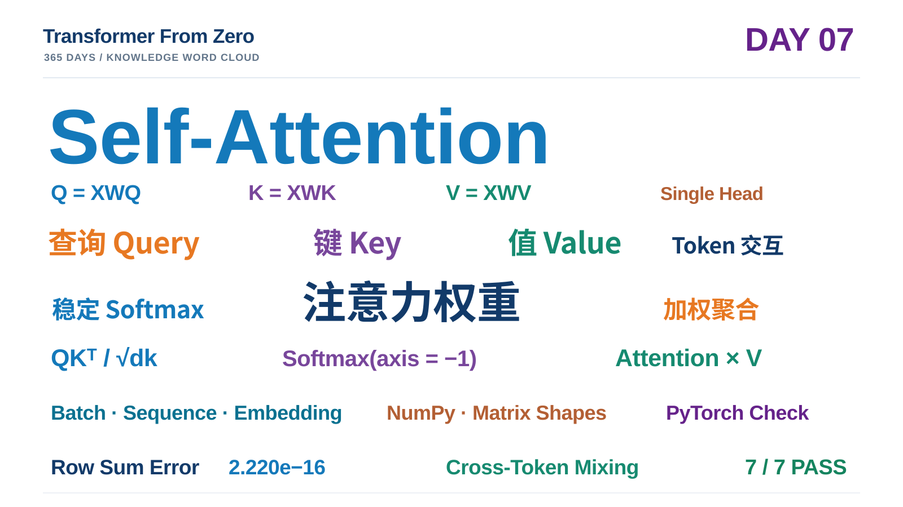

# Day 07 学习笔记｜从 Stable Softmax 到 Self-Attention

> **项目：** [Transformer From Zero · 365 Days](https://github.com/JiamuHan1122/transformer-from-zero)  
> **日期：** 2026-11-10  
> **阶段：** Attention 核心机制 · Day 07  
> **今日主题：** Stable Softmax、Scaled Dot-Product Attention、Single-Head Self-Attention  
> **状态：** 三项核心函数完成；7 项练习测试通过；Demo 验证成功  
> **核心实现：** [exercises/week07.py](../../exercises/week07.py)  
> **测试：** [tests/test_week07_exercises.py](../../tests/test_week07_exercises.py)  
> **实验脚本：** [scripts/day07_attention_demo.py](../../scripts/day07_attention_demo.py)

---

## 一、今天的目标：让 Token 真正发生信息交互

前几天，我们已经从 NumPy 的线性运算、Softmax、损失函数和梯度计算，逐步走到了非线性网络。今天进入 Transformer 最核心的机制之一：**Attention（注意力机制）**。

今天要回答三个连续的问题：

1. 如何把一组任意实数分数转换成数值稳定、和为 1 的权重？
2. 给定 Query、Key、Value，如何计算一个 Query 应该从哪些 Key 对应的 Value 中聚合信息？
3. 当 Q、K、V 都由同一段输入序列投影得到时，如何构造 Self-Attention，让序列中的 Token 相互交换信息？

今天不是直接调用 PyTorch 的 Transformer 或 MultiheadAttention，而是用 NumPy 手写最小版本，并用 PyTorch 作为独立参考进行验证。

**今天最终实现的计算链：**

$
X\rightarrow(Q,K,V)\rightarrow QK^\top
\rightarrow\frac{QK^\top}{\sqrt{d_k}}
\rightarrow\operatorname{Softmax}
\rightarrow AV
$

这里的 $A$ 是 Attention 权重矩阵。

## 二、先建立直觉：Query、Key、Value 分别是什么？

可以先把 Attention 理解成一次**由内容决定的加权信息读取**。

- **Query（Q，查询）：** 当前 Token 想要寻找什么信息。
- **Key（K，键）：** 每个 Token 提供什么特征，供 Query 匹配。
- **Value（V，值）：** 每个 Token 真正提供给其他 Token 聚合的信息内容。

对某个 Query 而言：

1. 用它与所有 Key 做点积，得到一组匹配分数。
2. 对分数进行缩放和 Softmax，得到归一化权重。
3. 用这些权重对所有 Value 做加权求和。
4. 得到该 Query 对应的输出表示。

因此，Q 和 K 决定**信息从哪里读取、读取多少**，V 决定**实际读取和聚合什么内容**。

注意：这是一种帮助理解的直觉，不意味着 Attention 权重天然就是人类意义上的因果解释或特征重要性。

## 三、Task A：手写数值稳定的 Softmax

### 3.1 数学定义

对于向量 $x=[x_1,x_2,\ldots,x_n]$，Softmax 定义为：

$
\operatorname{Softmax}(x_i)
=\frac{e^{x_i}}{\sum_{j=1}^{n}e^{x_j}}.
$

它把任意实数分数转换为非负权重，并满足：

$
0\leq p_i\leq1,\qquad \sum_i p_i=1.
$

在 Attention 中，我们会对每个 Query 对应的一整行 Key 分数做 Softmax。

### 3.2 为什么必须做数值稳定处理？

直接计算 $e^{x_i}$ 可能溢出。例如输入中包含 1000 时，直接计算 $e^{1000}$ 会超出常规浮点数的表示范围。

Softmax 有一个重要性质：对所有输入同时加上或减去同一个常数，输出不变：

$
\operatorname{Softmax}(x+c)
=\operatorname{Softmax}(x).
$

因此可以减去当前归一化轴上的最大值：

$
\boxed{
\operatorname{Softmax}(x_i)
=
\frac{e^{x_i-m}}
{\sum_j e^{x_j-m}},
\qquad m=\max_j x_j
}
$

这样，指数函数的输入不大于 0，最大指数值为 1，从而显著降低上溢风险。

### 3.3 NumPy 实现

~~~python
def softmax_numpy(x, axis=-1):
    x = np.asarray(x, dtype=np.float64)

    max_values = np.max(x, axis=axis, keepdims=True)
    shifted = x - max_values

    exp_shifted = np.exp(shifted)
    sum_exp = np.sum(exp_shifted, axis=axis, keepdims=True)

    return exp_shifted / sum_exp
~~~

几个实现细节：

- **axis** 决定沿哪个维度归一化，默认 **-1** 表示最后一个维度。
- **keepdims=True** 保留被归约的维度，保证减法和除法能够正确广播。
- 统一转成 **float64**，让本次 NumPy 数值比较更加稳定。
- 不对输入数组原地修改，避免改变调用者的数据。

例如矩阵形状为 **(B, Tq, Tk)** 时，**axis=-1** 就是对每个 Query 的所有 Key 分数归一化，而不是在 Query 维度或 Batch 维度归一化。

## 四、Task B：Scaled Dot-Product Attention

### 4.1 从 Q 和 K 得到匹配分数

设：

$
Q\in\mathbb R^{B\times T_q\times d_k},
\quad
K\in\mathbb R^{B\times T_k\times d_k},
\quad
V\in\mathbb R^{B\times T_k\times d_v}.
$

其中：

- $B$：Batch Size；
- $T_q$：Query 的数量；
- $T_k$：Key/Value 的数量；
- $d_k$：Query 和 Key 的特征维度；
- $d_v$：Value 的特征维度。

对 Key 的最后两个维度转置：

$
K^\top\in\mathbb R^{B\times d_k\times T_k}.
$

然后批量矩阵乘法：

$
S=QK^\top
\in\mathbb R^{B\times T_q\times T_k}.
$

矩阵中第 $i$ 行、第 $j$ 列表示第 $i$ 个 Query 与第 $j$ 个 Key 的匹配分数。

### 4.2 为什么要除以 $\sqrt{d_k}$？

原始点积为：

$
s=q\cdot k=\sum_{r=1}^{d_k}q_rk_r.
$

在一个简化假设下，如果 Q、K 的各维分量近似独立、均值为 0、方差为 1，那么每个乘积项的方差约为 1，求和后的方差约为 $d_k$。

因此，点积的典型尺度会随着维度增大而增大。分数过大时，Softmax 容易集中到少数位置，进入较饱和的区域，使梯度变得不理想。

缩放：

$
\boxed{
S_{\mathrm{scaled}}=\frac{QK^\top}{\sqrt{d_k}}
}
$

在上述简化假设下，可以把分数的方差尺度控制在约 1。

**关键点：** 缩放因子由 Query/Key 的维度 $d_k$ 决定，不是由 Value 的维度 $d_v$ 决定。

### 4.3 Softmax 得到注意力权重

$
\boxed{
A=\operatorname{Softmax}
\left(\frac{QK^\top}{\sqrt{d_k}}\right)
}
$

在最后一个维度上执行 Softmax：

$
A\in\mathbb R^{B\times T_q\times T_k}.
$

每一个 Query 对应一行权重，并且：

$
\sum_{j=1}^{T_k}A_{ij}=1.
$

### 4.4 用权重聚合 Value

$
\boxed{O=AV}
$

维度：

$
(B,T_q,T_k)\times(B,T_k,d_v)
\rightarrow(B,T_q,d_v).
$

每个 Query 的输出，都是所有 Value 的加权和：

$
o_i=\sum_{j=1}^{T_k}A_{ij}v_j.
$

### 4.5 完整公式

$
\boxed{
\operatorname{Attention}(Q,K,V)
=
\operatorname{Softmax}
\left(\frac{QK^\top}{\sqrt{d_k}}\right)V
}
$

### 4.6 NumPy 实现

~~~python
def scaled_dot_product_attention_numpy(q, k, v):
    dk = q.shape[-1]

    scores = q @ k.transpose(0, 2, 1)
    scores = scores / np.sqrt(dk)

    weights = softmax_numpy(scores, axis=-1)
    output = weights @ v

    return output, weights
~~~

这里有两个容易写错的地方：

1. **k.transpose(0, 2, 1)**：只交换 Key 的最后两个维度，保留 Batch 维度。
2. **softmax_numpy(scores, axis=-1)**：每个 Query 都应该在所有 Key 上归一化。

本实现允许 $T_q$ 和 $T_k$ 不相同，也允许 $d_k$ 和 $d_v$ 不相同，因此它是通用的、未加 Mask 的 Scaled Dot-Product Attention，而不仅仅是方阵 Self-Attention。

## 五、Task C：从 Attention 到 Self-Attention

### 5.1 输入序列如何变成 Q、K、V？

设输入序列为：

$
X\in\mathbb R^{B\times T\times D}.
$

对同一个输入 $X$，分别使用三组独立的投影矩阵：

$
W_Q\in\mathbb R^{D\times d_k},
$

$
W_K\in\mathbb R^{D\times d_k},
$

$
W_V\in\mathbb R^{D\times d_v}.
$

得到：

$
\boxed{Q=XW_Q}
$

$
\boxed{K=XW_K}
$

$
\boxed{V=XW_V}
$

对应形状：

| 张量 | 形状 | 含义 |
|---|---|---|
| $X$ | (B, T, D) | 输入 Token 序列 |
| $W_Q$ | (D, dk) | Query 投影矩阵 |
| $W_K$ | (D, dk) | Key 投影矩阵 |
| $W_V$ | (D, dv) | Value 投影矩阵 |
| $Q$ | (B, T, dk) | 查询表示 |
| $K$ | (B, T, dk) | 键表示 |
| $V$ | (B, T, dv) | 值表示 |

这里 Q、K、V 来自同一份输入序列，但使用不同的投影矩阵。它们不是简单地把 X 复制三份。

### 5.2 为什么叫 Self-Attention？

在一般的 Attention 中，Query 序列和 Key/Value 序列可以来自不同来源。

而在 Self-Attention 中：

- Q 来自当前输入序列 X；
- K 来自同一个输入序列 X；
- V 也来自同一个输入序列 X。

因此，序列中的每个 Token 都可以根据自己的 Query，与同一序列中各个 Token 的 Key 进行匹配，再聚合对应的 Value。

### 5.3 Self-Attention 的完整公式

$
\boxed{
\operatorname{SelfAttention}(X)
=
\operatorname{Softmax}
\left(
\frac{(XW_Q)(XW_K)^\top}{\sqrt{d_k}}
\right)
(XW_V)
}
$

这里为了简洁省略了 Batch 维度上的转置记号；实际代码需要对每个 Batch 分别转置 K 的最后两个维度。

### 5.4 NumPy 实现

~~~python
def self_attention_numpy(x, w_q, w_k, w_v):
    q = x @ w_q
    k = x @ w_k
    v = x @ w_v

    output, weights = scaled_dot_product_attention_numpy(q, k, v)

    return output, weights
~~~

这个实现刻意保持分层：

- Task A 只负责 Softmax；
- Task B 只负责 Q、K、V 已经给定时的注意力计算；
- Task C 负责从输入 X 生成 Q、K、V，再复用 Task B。

这体现了一个重要的软件工程原则：**把复杂模型拆成可以独立验证、可以复用的小模块。**

## 六、把今天的张量维度串起来

### 6.1 通用 Scaled Dot-Product Attention

$
\begin{aligned}
Q &: (B,T_q,d_k)\\
K &: (B,T_k,d_k)\\
V &: (B,T_k,d_v)\\
QK^\top &: (B,T_q,T_k)\\
A &: (B,T_q,T_k)\\
AV &: (B,T_q,d_v)
\end{aligned}
$

### 6.2 本次 Self-Attention Demo 的实际设置

$
B=2,\quad T=5,\quad D=4,\quad d_k=3,\quad d_v=4.
$

| 中间变量 | 实际形状 |
|---|---|
| X | (2, 5, 4) |
| Q | (2, 5, 3) |
| K | (2, 5, 3) |
| V | (2, 5, 4) |
| $QK^\top$ | (2, 5, 5) |
| Attention Weights | (2, 5, 5) |
| Output | (2, 5, 4) |

注意：这里 $d_k=3$，而 $d_v=4$。这验证了实现没有错误地假设 Key 和 Value 必须使用相同的特征维度。

## 七、七项练习测试：逐项验收

实际测试文件：**tests/test_week07_exercises.py**

运行命令：

~~~powershell
python -m pytest -q -m exercise tests/test_week07_exercises.py
~~~

本次实际验收：**7 passed**。

| 测试 | 验证内容 |
|---|---|
| 1 | Softmax 已知数值、输出形状、行和为 1、float64 与输入不被修改 |
| 2 | Softmax 支持多个 axis，并与 PyTorch 结果对照 |
| 3 | Softmax 对较大的正数和负数输入保持数值稳定 |
| 4 | Scaled Dot-Product Attention 与 PyTorch 对照，检查输出形状、权重行和及输入不变性 |
| 5 | 只有一个 Key 时，Softmax 权重必为 1，输出应等于对应 Value |
| 6 | Self-Attention 与 PyTorch 对照，支持不同的 $d_k$ 和 $d_v$，并检查输入与投影矩阵不被修改 |
| 7 | 构造等分权重，验证 Attention 确实会跨 Token 聚合信息 |

### 7.1 为什么“只有一个 Key”是一个好测试？

当 $T_k=1$ 时，每个 Query 只有一个可以选择的 Key：

$
\operatorname{Softmax}([s])=[1].
$

因此：

$
O=1\cdot V=V.
$

这是一种非常直接的边界条件测试：不需要依赖复杂随机数，就能检查 Softmax 归一化和 Value 聚合是否正确。

### 7.2 为什么要专门测试跨 Token 信息交互？

测试中令 Q 和 K 全为 0：

$
QK^\top=0.
$

Softmax 后每个 Query 对两个 Key 的权重都是：

$
A=
\begin{bmatrix}
0.5&0.5\\
0.5&0.5
\end{bmatrix}.
$

若：

$
V=
\begin{bmatrix}
1\\
3
\end{bmatrix},
$

那么：

$
O=AV=
\begin{bmatrix}
2\\
2
\end{bmatrix}.
$

每个 Query 的输出都变成两个 Token 的 Value 平均值。这证明了 Attention 的输出不是只依赖当前 Token 自身，而是能够聚合其他 Token 的信息。

## 八、最终 Demo：观察真实 Self-Attention 权重

### 8.1 运行命令

~~~powershell
conda activate tfz
python scripts/day07_attention_demo.py
~~~

本次 Demo 使用：

| 设置 | 数值 |
|---|---:|
| 随机种子 | 707 |
| Batch Size | 2 |
| Sequence Length | 5 |
| Input Dimension | 4 |
| Query / Key Dimension | 3 |
| Value Dimension | 4 |

这是一次**前向机制演示**，不是模型训练实验。

### 8.2 Attention 权重矩阵

本次 Demo 打印的第 0 个序列的注意力权重（保留四位小数）：

$
A=
\begin{bmatrix}
0.4888&0.1764&0.1141&0.0624&0.1583\\
0.2140&0.2052&0.2245&0.1964&0.1598\\
0.1185&0.1464&0.1979&0.3978&0.1394\\
0.2719&0.2099&0.1771&0.1313&0.2098\\
0.3815&0.2669&0.2519&0.0257&0.0740
\end{bmatrix}
$

横轴是 Key Token 位置，纵轴是 Query Token 位置。

例如：

- Query 0 对 Key 0 的权重最高，为 0.4888。
- Query 2 对 Key 3 的权重最高，为 0.3978。
- Query 4 对 Key 0 的权重最高，为 0.3815。

**每一行代表一个 Query 如何在整个 Key 序列上分配注意力。** 不同 Query 得到不同的权重分布，说明注意力分配是随内容变化的。

### 8.3 Softmax 归一化检查

本次终端输出：

~~~text
Maximum row-sum error: 2.220e-16
~~~

即：

$
\max_i\left|\sum_j A_{ij}-1\right|
=2.220\times10^{-16}.
$

这是双精度浮点计算精度范围内的零误差，说明每行注意力权重都正确归一化。

### 8.4 跨 Token 扰动实验

Demo 中执行了一个更有解释力的实验：

1. 保存原始输入序列 X 和对应输出。
2. 只修改第 2 个 Token 的输入特征。
3. 重新计算 Self-Attention。
4. 比较第 0 个 Token 的输出是否发生变化。

实际终端输出：

~~~text
Change in output at token 0 after perturbing input token 2: 1.132912e-01
~~~

也就是：

$
\left\|
O_{\mathrm{changed}}[0,0]
-
O_{\mathrm{original}}[0,0]
\right\|_2
=0.1132912.
$

只修改 Token 2，却观察到 Token 0 的输出也发生了变化。这是因为 Token 2 的 Key/Value 会参与其他 Query 的注意力计算。

**这项实验直接展示了 Self-Attention 的核心：Token 之间可以进行动态的信息交互。**

### 8.5 Demo 产物

脚本在本地生成：

~~~text
results/
└── day07/
    ├── metrics.json
    └── attention_weights.png
~~~

其中：

- **metrics.json**：保存随机种子、输入与输出形状、最大行和误差、跨 Token 扰动变化量和注意力矩阵。
- **attention_weights.png**：第 0 个序列的 Attention 权重热力图。

这些是本地实验产物，受项目 **.gitignore** 规则管理；本篇笔记与知识词云作为长期学习资料提交到 GitHub。

## 九、今天真正掌握的内容

今天最重要的不是记住一个公式，而是理解一条完整的信息流：

1. **Softmax：** 把原始分数转换为归一化权重，并通过减最大值保证数值稳定。
2. **Query-Key 匹配：** 点积衡量 Query 和 Key 在投影空间中的匹配程度。
3. **Scaled Dot-Product：** 除以 $\sqrt{d_k}$，控制点积随特征维度增长的尺度。
4. **Value 聚合：** Attention 权重决定从不同 Value 中聚合多少信息。
5. **Self-Attention：** Q、K、V 从同一输入序列生成，使 Token 能够相互读取信息。
6. **维度意识：** 每次矩阵乘法都必须核对 Batch、序列长度、Key 维度和 Value 维度。
7. **实验验证：** 不只看函数能否运行，还要用数值对照、边界条件和跨 Token 扰动验证机制是否符合预期。

## 十、当前实现的边界：我们还没有完成整个 Transformer

今天实现的是**未加 Mask 的单头 Self-Attention 前向核心**，有意保持最小化。

目前还没有实现：

- Causal Mask（因果遮挡）；
- Padding Mask；
- Multi-Head Attention；
- Attention Dropout；
- 输出投影矩阵 $W_O$；
- Positional Encoding / Positional Embedding；
- Residual Connection 与 Layer Normalization；
- Transformer Feed-Forward Network；
- Attention 的训练与反向传播。

尤其需要注意：当前版本没有 Causal Mask，所以一个 Token 可以关注序列中位于它后面的 Token。它还不能直接作为自回归 GPT 的因果注意力层使用。

另外，当前输入没有加入位置编码，模型也没有显式获得 Token 的绝对或相对位置信息。

这些不是今天实现的错误，而是后续逐步扩展的明确边界。

## 十一、Day 07 知识词云

今天的核心关键词：

**Self-Attention · Query · Key · Value · Stable Softmax · Scaled Dot-Product · Attention Weights · Weighted Sum · Token Interaction · Matrix Shapes · NumPy · PyTorch Reference**

## 十二、下一步：从单头注意力走向 Multi-Head Attention

下一步要解决的问题是：

- 为什么只使用一个注意力头可能不够？
- 多个头如何使用不同的 $W_Q,W_K,W_V$ 学习不同的关系？
- 每个头的输出如何拼接？
- 为什么还需要输出投影矩阵 $W_O$？
- Multi-Head Attention 的张量维度如何变化？

从今天的单头版本出发，下一步就可以自然扩展为 Multi-Head Attention，而不是直接调用现成模块。

---

## Day 07 完成记录

$
\boxed{
\text{Stable Softmax}
\rightarrow
\text{Scaled Dot-Product Attention}
\rightarrow
\text{Self-Attention}
}
$

- [x] Task A：NumPy Stable Softmax
- [x] Task B：Scaled Dot-Product Attention
- [x] Task C：Single-Head Self-Attention
- [x] 7 项练习测试全部通过
- [x] Demo 前向运行成功
- [x] Attention 权重行和误差达到双精度精度范围
- [x] 跨 Token 信息交互得到实验证据

**Day 07 完成。**
