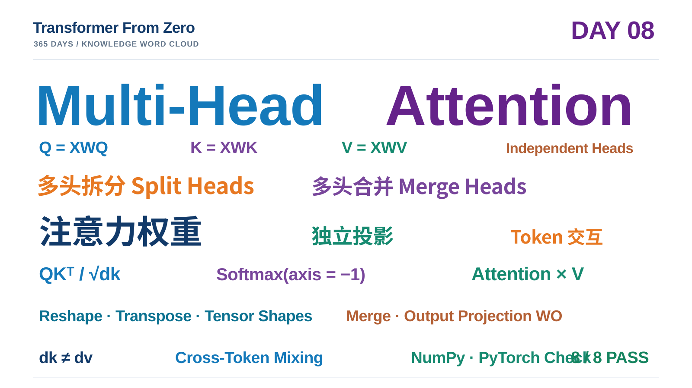

# Day 08 学习笔记｜从 Single-Head 到 Multi-Head Attention

> **项目：** [Transformer From Zero · 365 Days](https://github.com/JiamuHan1122/transformer-from-zero)  
> **日期：** 2026-11-11  
> **阶段：** Attention 核心机制 · Day 08  
> **今日主题：** Multi-Head Attention、Split Heads、Merge Heads、Output Projection  
> **状态：** 3 个核心函数完成；8 项练习测试通过；Demo 验证成功  
> **核心实现：** `exercises/week08.py`  
> **测试：** `tests/test_week08_exercises.py`  
> **实验脚本：** `scripts/day08_multi_head_attention_demo.py`

---

## 一、今天的目标：从一个信息交互子空间扩展到多个子空间

Day 07 实现了 Single-Head Self-Attention：输入序列经过一组 Q/K/V 投影，计算一张注意力权重矩阵，再根据权重聚合 Value。

单头机制只有一套 Q/K/V 投影和一张注意力矩阵。Multi-Head Attention 则将投影后的特征划分为多个 Head，让每个 Head 使用独立的投影通道计算注意力，最后拼接各 Head 的结果并进行输出投影。

今天的完整计算链为：

$$
X\rightarrow(Q,K,V)\rightarrow\operatorname{SplitHeads}
\rightarrow\operatorname{Attention}
\rightarrow\operatorname{MergeHeads}
\rightarrow W^O\rightarrow Y
$$

需要特别注意：不同 Head **有能力**形成不同的注意力模式，但随机初始化时出现差异，并不代表 Head 已经学会了可解释的语义功能。

## 二、Multi-Head Attention 的数学定义

设输入序列为 $X\in\mathbb{R}^{B\times T\times D}$，共有 $H$ 个注意力头。第 $h$ 个 Head 使用独立的投影矩阵：

$$
Q_h=XW_h^Q,\qquad K_h=XW_h^K,\qquad V_h=XW_h^V
$$

其中每个 Head 的 Query/Key 维度为 $d_k$，Value 维度为 $d_v$。第 $h$ 个 Head 的输出为：

$$
\operatorname{head}_h=
\operatorname{Softmax}
\left(
\frac{Q_hK_h^\top}{\sqrt{d_k}}
\right)V_h
$$

将所有 Head 的输出沿特征维度拼接，再进行输出投影：

$$
\boxed{
\operatorname{MultiHead}(X)=
\operatorname{Concat}(\operatorname{head}_1,\ldots,\operatorname{head}_H)W^O
}
$$

本日使用融合投影矩阵实现。融合矩阵沿输出通道拼接各 Head 的投影参数：

$$
W^Q\in\mathbb{R}^{D\times(Hd_k)},\quad
W^K\in\mathbb{R}^{D\times(Hd_k)}
$$

$$
W^V\in\mathbb{R}^{D\times(Hd_v)},\quad
W^O\in\mathbb{R}^{(Hd_v)\times D_{\mathrm{out}}}
$$

因此：

$$
Q=XW^Q,\qquad K=XW^K,\qquad V=XW^V
$$

融合矩阵只是把不同 Head 的投影参数放在同一个大矩阵中进行一次矩阵乘法，并不意味着所有 Head 共用相同参数。

## 三、Task A：Split Heads

### 3.1 为什么需要拆分 Head 维度？

融合投影之后，Q、K、V 的 Head 通道仍然合并在最后一个特征维度中：

$$
Q,K\in\mathbb{R}^{B\times T\times(Hd_k)}
$$

$$
V\in\mathbb{R}^{B\times T\times(Hd_v)}
$$

为了让每个 Head 独立计算注意力，需要先把最后一个维度拆成 Head 数量和每个 Head 的特征维度。

以 Q 为例：

$$
(B,T,Hd_k)\rightarrow(B,T,H,d_k)
$$

然后交换 Head 轴与 Token 轴：

$$
(B,T,H,d_k)\rightarrow(B,H,T,d_k)
$$

最终：

$$
Q_{\mathrm{heads}}\in\mathbb{R}^{B\times H\times T\times d_k}
$$

同理：

$$
K_{\mathrm{heads}}\in\mathbb{R}^{B\times H\times T\times d_k}
$$

$$
V_{\mathrm{heads}}\in\mathbb{R}^{B\times H\times T\times d_v}
$$

### 3.2 NumPy 实现

```python
def split_heads_numpy(x, num_heads):
    B, T, _ = x.shape
    D_head = x.shape[-1] // num_heads
    x = x.reshape(B, T, num_heads, D_head)
    x = x.transpose(0, 2, 1, 3)
    return x
```

这里两个操作不能混淆：

- `reshape`：把最后一个融合特征维度重新解释为 `(H, D_head)`，不改变元素的逻辑排列顺序。
- `transpose(0, 2, 1, 3)`：把轴从 `(B,T,H,D_head)` 调整为 `(B,H,T,D_head)`，让每个 Head 对应一组独立的 Token 特征矩阵。

正式实现还检查了输入必须是三维数组、`num_heads` 必须是正整数，以及最后一个维度必须能被 Head 数量整除。

## 四、Task B：Merge Heads

每个 Head 完成注意力计算后，输出形状为：

$$
O_{\mathrm{heads}}\in\mathbb{R}^{B\times H\times T\times d_v}
$$

需要先把 Head 轴移回 Token 轴之后：

$$
(B,H,T,d_v)\rightarrow(B,T,H,d_v)
$$

再合并最后两个维度：

$$
(B,T,H,d_v)\rightarrow(B,T,Hd_v)
$$

NumPy 实现：

```python
def merge_heads_numpy(x):
    x = x.transpose(0, 2, 1, 3)
    B, T, H, D_head = x.shape
    x = x.reshape(B, T, H * D_head)
    return x
```

### 4.1 为什么 Split 与 Merge 应该互为逆操作？

对合法输入，拆分后再合并应恢复原始形状与数值：

$$
\boxed{
\operatorname{MergeHeads}
\left(
\operatorname{SplitHeads}(X,H)
\right)=X
}
$$

这是一个非常重要的 Round-trip Test。它能检查轴顺序是否正确，而不只是检查输出形状是否正确。

## 五、Task C：Multi-Head Self-Attention

### 5.1 先计算融合 Q/K/V

$$
Q=XW^Q,\qquad K=XW^K,\qquad V=XW^V
$$

形状为：

$$
Q,K:(B,T,Hd_k),\qquad V:(B,T,Hd_v)
$$

### 5.2 拆分 Head 后计算注意力分数

拆分后：

$$
Q_h,K_h\in\mathbb{R}^{B\times H\times T\times d_k}
$$

对 K 的最后两个维度转置：

$$
K_h^\top\in\mathbb{R}^{B\times H\times d_k\times T}
$$

批量矩阵乘法：

$$
S=Q_hK_h^\top
\in\mathbb{R}^{B\times H\times T\times T}
$$

缩放并计算注意力权重：

$$
\boxed{
A=\operatorname{Softmax}
\left(
\frac{Q_hK_h^\top}{\sqrt{d_k}}
\right)
}
$$

Softmax 必须沿最后一个维度，也就是 Key/Token 维度计算：

$$
\sum_{j=1}^{T}A_{b,h,i,j}=1
$$

注意：不能沿 Head 维度做 Softmax。每个 Head 都有自己的注意力分布，每个 Query 在该 Head 的所有 Key 上独立归一化。

### 5.3 使用权重聚合 Value

$$
O_h=AV_h
$$

维度变化：

$$
(B,H,T,T)\times(B,H,T,d_v)
\rightarrow(B,H,T,d_v)
$$

### 5.4 合并 Head 并进行输出投影

$$
O_{\mathrm{merged}}=
\operatorname{MergeHeads}(O_h)
\in\mathbb{R}^{B\times T\times(Hd_v)}
$$

$$
\boxed{Y=O_{\mathrm{merged}}W^O}
$$

最终：

$$
(B,T,Hd_v)\times(Hd_v,D_{\mathrm{out}})
\rightarrow(B,T,D_{\mathrm{out}})
$$

输出投影 $W^O$ 对拼接后的多头特征进行可学习的线性组合。它不会在 Token 维度上混合位置；跨 Token 的信息聚合发生在各 Head 的 Attention 计算中。

## 六、完整张量维度：本次实际例子

本次 Demo 使用：

$$
B=2,\quad T=5,\quad D=8,\quad H=2
$$

$$
d_k=4,\quad d_v=4,\quad D_{\mathrm{out}}=8
$$

| 中间变量 | 形状 |
|---|---|
| $X$ | $(2,5,8)$ |
| $W^Q,W^K$ | $(8,8)$ |
| $W^V$ | $(8,8)$ |
| $W^O$ | $(8,8)$ |
| $Q,K,V$ | $(2,5,8)$ |
| $Q_{\mathrm{heads}},K_{\mathrm{heads}}$ | $(2,2,5,4)$ |
| $V_{\mathrm{heads}}$ | $(2,2,5,4)$ |
| $S$ | $(2,2,5,5)$ |
| $A$ | $(2,2,5,5)$ |
| $O_{\mathrm{heads}}$ | $(2,2,5,4)$ |
| $O_{\mathrm{merged}}$ | $(2,5,8)$ |
| $Y$ | $(2,5,8)$ |

注意：虽然本次例子中 $d_k=d_v=4$，实现并没有把两者绑定为必须相等。测试还单独验证了 $d_k=2,d_v=4$ 的情况。

## 七、八项练习测试：逐项验收

运行命令：

```powershell
python -m pytest -q -m exercise tests/test_week08_exercises.py
```

实际结果：

```text
........
8 passed
```

| 测试 | 验证内容 |
|---|---|
| 1 | Split Heads 的形状、元素顺序与输入不变性 |
| 2 | Split Heads 对非法维度、非法 Head 数量和不可整除维度的检查 |
| 3 | Merge Heads 恢复正确的轴顺序、形状与数值 |
| 4 | Split 与 Merge 的往返一致性 |
| 5 | Multi-Head Attention 与独立 PyTorch 参考实现数值一致 |
| 6 | 支持不同的 $d_k$ 与 $d_v$ |
| 7 | $H=1$ 且输出投影为单位矩阵时，与 Day 07 单头结果一致 |
| 8 | 两个 Head 能够产生不同的注意力权重模式 |

PyTorch 只在测试文件中充当独立参考实现；`exercises/week08.py` 的核心计算全部使用 NumPy。

## 八、Day 08 Demo：三个实验现象

### 8.1 实验设置

| 参数 | 数值 |
|---|---:|
| 随机种子 | 808 |
| Batch Size | 2 |
| Sequence Length | 5 |
| Model Dimension | 8 |
| Head 数量 | 2 |
| 每个 Head 的 $d_k$ | 4 |
| 每个 Head 的 $d_v$ | 4 |
| Output Dimension | 8 |

本次实验使用随机输入与随机初始化的投影矩阵，是前向计算机制演示，不是模型训练。

### 8.2 Head 之间的注意力模式不同

Batch 0 的两个 Head 得到：

$$
\operatorname{Mean}|A^{(0)}-A^{(1)}|=0.278229
$$

$$
\max|A^{(0)}-A^{(1)}|=0.707621
$$

例如 Query 1：

- Head 0 对 Key 2 的权重为 $0.2987$。
- Head 1 对 Key 3 的权重为 $0.8329$。

说明不同 Head 可以形成不同的 Query-Key 匹配模式。不能仅凭随机初始化结果就给 Head 赋予“语法头”“位置头”等语义标签。

### 8.3 注意力权重正确归一化

终端输出：

```text
Maximum row-sum error: 2.220e-16
```

即：

$$
\max_{b,h,i}
\left|
\sum_{j=1}^{T}A_{b,h,i,j}-1
\right|
=2.220\times10^{-16}
$$

误差处于 float64 浮点精度范围内，说明每个 Batch、每个 Head、每个 Query 的权重都沿 Key 维度正确归一化。

### 8.4 输入扰动与跨 Token 输出变化

实验只修改 Batch 0 的 Token 2：

$$
X'_{0,2,:}=X_{0,2,:}+\delta
$$

其中：

$$
\delta=[1.0,-0.5,0.75,0.25,-0.4,0.6,-0.2,0.9]
$$

定义每个 Query Token 的输出变化：

$$
\Delta_i=
\left\|
Y'_{0,i,:}-Y_{0,i,:}
\right\|_2
$$

实际结果：

| Query Token | 输出变化 L2 |
|---|---:|
| Token 0 | 0.092329 |
| Token 1 | 1.455427 |
| Token 2（直接修改） | 6.626665 |
| Token 3 | 0.033166 |
| Token 4 | 2.464527 |

其他 Token 的平均输出变化：

$$
\operatorname{Mean}(\Delta_{\mathrm{cross}})=1.011362
$$

其他 Token 的最大输出变化：

$$
\operatorname{Max}(\Delta_{\mathrm{cross}})=2.464527
$$

为什么修改 Token 2 会影响其他 Query 的输出？

对于未被直接修改的 Query Token $i$，它自己的 Query 向量保持不变；但 Token 2 对应的 Key 和 Value 已经变化：

$$
K_2'\neq K_2,\qquad V_2'\neq V_2
$$

因此，Query $i$ 与 Key 2 的匹配分数可能变化，聚合到的 Value 内容也发生变化，最终导致输出变化。

本次结果中，Token 4 对 Key 2 的 Head 1 注意力权重为 $0.4174$，因此受到较明显的影响；Token 3 对 Key 2 的两个 Head 权重都很低，因此变化很小。

**这说明信息交互强度具有内容依赖性，不同 Token 不会受到相同程度的影响。**

但这项单次随机扰动实验只证明当前计算图存在跨 Token 信息传递，不能证明该信息对某个具体任务有益，也不能代替训练后模型的系统性评估。

### 8.5 本地实验产物

```text
results/
└── day08/
    ├── metrics.json
    ├── attention_heatmaps.png
    ├── head_difference.png
    └── perturbation_impact.png
```

其中 `metrics.json` 保存数值指标、注意力矩阵与扰动结果。`results/` 已被 `.gitignore` 排除，默认不提交这些本地实验产物；正式笔记、代码和测试应提交到 GitHub。

## 九、今天真正掌握的内容

1. **多头不是复制：** 每个 Head 对应独立的 Q/K/V 投影通道。
2. **Split Heads：** 先 reshape 拆出 Head 维度，再 transpose 调整轴顺序。
3. **独立注意力：** 每个 Head 单独计算 $Q_hK_h^\top$ 和 Softmax。
4. **归一化轴：** Softmax 沿最后一个维度，即 Key/Token 维度执行。
5. **Merge Heads：** 先交换轴，再合并 Head 与特征维度。
6. **Output Projection：** $W^O$ 对拼接后的多头特征进行线性组合。
7. **维度独立性：** $d_k$ 与 $d_v$ 可以不同。
8. **跨 Token 交互：** 一个 Token 的 Key/Value 变化能够影响其他 Query 的输出。

## 十、当前实现边界

今天实现的是无 Mask、无 Bias 的 Multi-Head Self-Attention 前向计算。以下内容尚未实现：

- Causal Mask；
- Padding Mask；
- Dropout；
- Positional Encoding；
- Residual Connection；
- Layer Normalization；
- Feed-Forward Network；
- 反向传播与训练。

因此当前实现还不是完整 Transformer Block，也不能直接当作 GPT 的因果注意力层使用。

## 十一、Day 08 知识词云



核心关键词：

**Multi-Head Attention · Query · Key · Value · Split Heads · Merge Heads · Independent Projections · Attention Weights · Softmax · Output Projection · Token Interaction · Shape Invariants · NumPy**

## 十二、下一步学习方向

下一步可以进入 Masked Attention，重点理解：

1. 为什么自回归语言模型不能看到未来 Token？
2. Causal Mask 如何作用于 Attention Scores？
3. 为什么 Mask 应该在 Softmax 之前应用？
4. Padding Mask 与 Causal Mask 分别解决什么问题？
5. 如何测试被 Mask 的位置权重严格为零？

---

## Day 08 完成记录

$$
\boxed{
\text{Split Heads}
\rightarrow
\text{Independent Attention}
\rightarrow
\text{Merge Heads}
\rightarrow
W^O
}
$$

- [x] Task A：Split Heads
- [x] Task B：Merge Heads
- [x] Task C：Multi-Head Self-Attention
- [x] 8 项练习测试全部通过
- [x] 与 PyTorch 独立参考实现数值一致
- [x] 不同 $d_k$ 与 $d_v$ 测试通过
- [x] Round-trip Test 通过
- [x] 多头注意力差异实验通过
- [x] 跨 Token 扰动实验通过
- [x] Demo 数值记录与三张图生成成功

**Day 08 完成。**