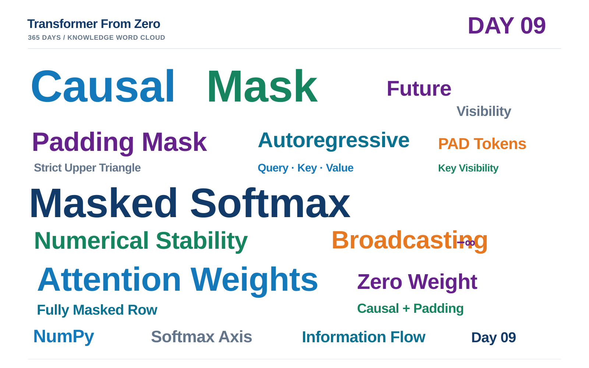

# Day 09 学习笔记｜Masked Attention：让注意力知道哪些信息不可见

> **项目：** [Transformer From Zero · 365 Days](https://github.com/JiamuHan1122/transformer-from-zero)  
> **日期：** 2026-11-12  
> **阶段：** Attention 核心机制 · Day 09  
> **今日主题：** Causal Mask、Padding Mask、Masked Softmax、Masked Multi-Head Attention  
> **状态：** 核心实现完成；15 项练习测试通过；Demo 验证成功  
> **核心实现：** \`exercises/week09.py\`  
> **测试：** \`tests/test_week09_exercises.py\`  
> **实验脚本：** \`scripts/day09_masked_attention_demo.py\`

---

## 一、今天要解决的核心问题：谁可以看见谁？

Day 08 的普通 Multi-Head Self-Attention 允许每个 Query 读取序列中的所有 Key。它能够建立 Token 之间的信息交互，但并不知道某些信息在当前任务中是否应该被看见。

今天引入 Mask，为注意力计算增加明确的信息可见性约束：

1. **自回归生成：** 当前 Token 不能读取未来 Token，否则模型训练时会提前看到答案。
2. **变长 Batch：** 为了对齐序列长度而补充的 PAD 位置不是有效内容，不应该作为 Key 被关注。
3. **数值稳定性：** 遮挡位置必须得到严格的零权重；如果一整行都被遮挡，也必须避免 Softmax 产生 NaN。

本日统一采用 Boolean Mask 约定：

- \`True\`：blocked / 不可见；
- \`False\`：allowed / 可见。

需要牢记：**Mask 不是删除 Token，而是约束 Query 与 Key 之间允许发生的信息交互。**

## 二、Task A：Causal Mask——阻断未来信息

### 2.1 因果可见性规则

对于长度为 \(T\) 的序列，位置 \(i\) 的 Query 只能读取位置 \(j\) 满足 \(j\le i\) 的 Key。也就是说，当前位置和过去位置可见，未来位置不可见。

因此，允许访问矩阵是包含对角线的下三角矩阵；而本项目使用的 Boolean blocked mask 是**严格上三角矩阵**：

$$
M^{\mathrm{causal}}_{ij}
=
\begin{cases}
\mathrm{False}, & j\le i,\\
\mathrm{True}, & j>i.
\end{cases}
$$

以 \(T=5\) 为例：

| Query \ Key | 0 | 1 | 2 | 3 | 4 |
|---|---:|---:|---:|---:|---:|
| 0 | 可见 | 遮挡 | 遮挡 | 遮挡 | 遮挡 |
| 1 | 可见 | 可见 | 遮挡 | 遮挡 | 遮挡 |
| 2 | 可见 | 可见 | 可见 | 遮挡 | 遮挡 |
| 3 | 可见 | 可见 | 可见 | 可见 | 遮挡 |
| 4 | 可见 | 可见 | 可见 | 可见 | 可见 |

对应 NumPy 实现：

\`\`\`python
mask = np.triu(
    np.ones((seq_len, seq_len), dtype=bool),
    k=1,
)
\`\`\`

\`np.triu(..., k=1)\` 只保留主对角线以上的元素，因此对角线和下三角均为 False，严格上三角为 True。

### 2.2 为什么 Causal Mask 是 GPT 自回归生成的基础？

假设模型正在预测第 \(i+1\) 个 Token。它可以利用前面已经出现的 Token，但不能利用尚未生成的未来 Token。

如果不加因果约束，训练时位置 \(i\) 的输出可能读取 \(i+1,i+2,\ldots\) 位置的真实内容，造成未来信息泄漏。推理时这些未来 Token 尚不存在，训练和推理的信息条件就不一致。

Causal Mask 从注意力计算层面保证：每个位置只能使用当前位置及其之前的信息。

## 三、Task B：Padding Mask——排除填充 Key

### 3.1 Padding 从哪里来？

一个 Batch 中的句子通常长度不同。为了组成规则的张量，需要将短序列补齐：

\`\`\`text
样本 A:  11   12   13   14   15
样本 B:  21   22   23   PAD  PAD
\`\`\`

PAD 只是为了张量对齐而添加的占位符，不代表真实语义内容。它作为 Key 时，不应被有效 Query 读取。

给定 \`token_ids\`，Padding Mask 定义为：

$$
M^{\mathrm{pad}}_{b,j}
=
\begin{cases}
\mathrm{True}, & token\_ids_{b,j}=pad\_token\_id,\\
\mathrm{False}, & \text{otherwise}.
\end{cases}
$$

其输出形状为 \((B,T)\)，每个 PAD 位置对应 True。

### 3.2 两种 Mask 如何广播？

多头注意力分数的形状为：

$$
S\in\mathbb{R}^{B\times H\times T\times T}.
$$

Causal Mask 原始形状为 \((T,T)\)，需要扩展为：

$$
(T,T)\longrightarrow(1,1,T,T).
$$

Padding Mask 原始形状为 \((B,T)\)，需要扩展为：

$$
(B,T)\longrightarrow(B,1,1,T).
$$

这样，Causal Mask 可以沿 Batch 和 Head 维度广播；Padding Mask 可以沿 Head 和 Query 维度广播。

二者组合使用逻辑或：

$$
M^{\mathrm{combined}}
=
M^{\mathrm{causal}}\lor M^{\mathrm{pad}}.
$$

只要某个 Key 因为“位于未来”或“属于 PAD”而不可见，组合 Mask 就会将它标记为 True。

### 3.3 一个重要边界：PAD Key 与 PAD Query 不一样

本日 Padding Mask 屏蔽的是 **PAD 位置作为 Key 被读取**。它并不自动将 PAD 位置作为 Query 时产生的输出清零。

如果训练目标中也不希望 PAD 位置参与损失计算，还需要额外使用 Loss Mask 忽略 PAD 目标位置。不能把 Attention Padding Mask 和 Loss Mask 混为一谈。

## 四、Task C：Masked Softmax——遮挡之后如何正确归一化？

### 4.1 回顾普通 Softmax

对一行分数 \(s_1,\ldots,s_n\)，Softmax 定义为：

$$
\operatorname{Softmax}(s_i)
=
\frac{\exp(s_i)}
{\sum_{j=1}^{n}\exp(s_j)}.
$$

稳定实现通常先减去该行最大值 \(m\)：

$$
\operatorname{Softmax}(s_i)
=
\frac{\exp(s_i-m)}
{\sum_{j=1}^{n}\exp(s_j-m)}.
$$

这样可以避免直接计算大数的指数时溢出。

### 4.2 Mask 必须在 Softmax 之前应用

将不可见位置的分数替换为负无穷：

$$
\widetilde{s}_{ij}
=
\begin{cases}
s_{ij}, & M_{ij}=\mathrm{False},\\
-\infty, & M_{ij}=\mathrm{True}.
\end{cases}
$$

因为：

$$
\exp(-\infty)=0,
$$

所以被遮挡位置的注意力权重严格为零。剩余可见位置再经过 Softmax，概率会在可见 Key 之间重新归一化。

**顺序必须是：计算 Scores → 应用 Mask → Softmax。**

### 4.3 为什么全遮挡行会产生 NaN？

稳定 Softmax 会减去最大值。但如果一整行都被替换为负无穷，那么该行最大值也是负无穷：

$$
-\infty-(-\infty)=\mathrm{NaN}.
$$

因此，不能直接将所有分数替换为负无穷后，再无条件调用普通 Softmax。

正确做法是先识别该行是否全部被遮挡。若全部被遮挡，就直接返回全零行；否则，只对可见位置做稳定归一化。

令该行可见位置集合为：

$$
\mathcal{V}=\{j\mid M_j=\mathrm{False}\}.
$$

若 \(\mathcal{V}\) 非空，令：

$$
m=\max_{j\in\mathcal{V}}s_j.
$$

则 Masked Softmax 为：

$$
A_i=
\begin{cases}
\displaystyle
\frac{\exp(s_i-m)}
{\sum_{j\in\mathcal{V}}\exp(s_j-m)},
& i\in\mathcal{V},\[10pt]
0, & i\notin\mathcal{V}.
\end{cases}
$$

若 \(\mathcal{V}=\varnothing\)，则整行输出全零。

### 4.4 本日实现中的关键步骤

1. 检查输入数组、Boolean Mask、归一化轴。
2. 将 Mask 广播到 Scores 的完整形状。
3. 将 Scores 转为 float64，进行稳定计算。
4. 找出全遮挡行，避免对负无穷执行无效减法。
5. 只让可见位置产生非零指数值。
6. 对可见位置归一化。
7. 再次显式保证所有被遮挡位置严格为零。

这个实现同时处理普通遮挡、广播 Mask、全遮挡行和极端分数。

## 五、Task D：Masked Multi-Head Self-Attention

今天不是重新发明多头注意力，而是在 Day 08 的计算链中加入 Masked Softmax。

### 5.1 完整计算过程

首先计算融合投影：

$$
Q=XW^Q,\qquad K=XW^K,\qquad V=XW^V.
$$

然后复用 Day 08 的 Split Heads：

$$
Q_h,K_h\in
\mathbb{R}^{B\times H\times T\times d_k},
$$

$$
V_h\in
\mathbb{R}^{B\times H\times T\times d_v}.
$$

计算缩放点积注意力分数：

$$
S=\frac{Q_hK_h^\top}{\sqrt{d_k}},
\qquad
S\in\mathbb{R}^{B\times H\times T\times T}.
$$

应用 Mask 并归一化：

$$
A=\operatorname{MaskedSoftmax}(S,M).
$$

使用注意力权重聚合 Value：

$$
O_h=AV_h.
$$

最后复用 Day 08 的 Merge Heads，并执行输出投影：

$$
Y=\operatorname{MergeHeads}(O_h)W^O.
$$

### 5.2 为什么必须复用 Day 08？

Day 08 已经完成了：

- \`split_heads_numpy\`：将融合的特征通道拆分成独立 Head；
- \`merge_heads_numpy\`：将多个 Head 的输出重新合并。

Day 09 的新任务是控制信息可见性，而不是再次实现张量拆分与合并。因此，本日直接从 \`exercises.week08\` 导入这两个函数，并从 Day 07 复用 \`softmax_numpy\` 作为无 Mask 分支的归一化函数。

这也是项目逐日积累代码资产的意义：后续实现应该建立在已经验证过的基础函数之上，而不是反复复制代码。

## 六、完整张量维度：今天 Demo 的实际配置

本次 Demo 使用：

$$
B=2,\quad T=5,\quad D=8,\quad H=2,
$$

$$
d_k=4,\quad d_v=4,\quad D_{\mathrm{out}}=8.
$$

| 中间变量 | 形状 |
|---|---|
| 输入 \(X\) | \((2,5,8)\) |
| \(W^Q,W^K\) | \((8,8)\) |
| \(W^V\) | \((8,8)\) |
| \(W^O\) | \((8,8)\) |
| \(Q,K,V\) | \((2,5,8)\) |
| \(Q_h,K_h,V_h\) | \((2,2,5,4)\) |
| Attention Scores \(S\) | \((2,2,5,5)\) |
| Attention Weights \(A\) | \((2,2,5,5)\) |
| Head Outputs \(O_h\) | \((2,2,5,4)\) |
| Merge Heads 后 | \((2,5,8)\) |
| 最终输出 \(Y\) | \((2,5,8)\) |

这里的 Mask 可以是 \((T,T)\)、\((1,1,T,T)\) 或 \((B,1,1,T)\) 等可广播形状；最终都能作用于 \((B,H,T,T)\) 的注意力分数。

## 七、15 项测试：逐项验收

运行命令：

\`\`\`powershell
conda activate tfz
python -m pytest -q -m exercise tests/test_week09_exercises.py
\`\`\`

本地实际结果：

\`\`\`text
...............                                      [100%]
15 passed, 1 warning
\`\`\`

测试覆盖如下：

| 测试内容 | 验证重点 |
|---|---|
| Causal Mask 形状与方向 | 严格上三角为 True |
| 非法序列长度 | 拒绝 0、负数、浮点数、布尔值、字符串和 None |
| Padding Mask | 正确识别 PAD 且不修改输入 |
| Masked Softmax 正常归一化 | 可见位置权重和为 1，遮挡位置为 0 |
| 全遮挡行 | 返回全零且没有 NaN |
| 极端分数 | 大数条件下保持数值稳定 |
| 广播与非法 Mask | 支持广播，拒绝非 Boolean 或不兼容形状 |
| 与 PyTorch 参考实现对照 | 输出和权重数值一致 |
| 未来 Token 干预 | 修改未来 Token 不改变过去输出 |
| Causal + Padding 组合 | 所有被遮挡 Key 的权重严格为零 |

共 15 项测试全部通过。

**关于唯一的 Warning：** 它来自测试参考代码将 \`np.broadcast_to\` 生成的只读数组传给 PyTorch。它是测试辅助代码中的只读数组提示，不是 NumPy 核心实现失败；本次测试结果仍为 15 passed。

## 八、Demo 实验：用数值验证因果约束

### 8.1 运行方式

从仓库根目录执行：

\`\`\`powershell
python -m scripts.day09_masked_attention_demo
\`\`\`

注意使用模块方式运行。直接执行 \`python scripts/day09_masked_attention_demo.py\` 时，当前项目的包导入路径可能无法解析 \`exercises\`；使用 \`-m\` 可以从项目根目录正确解析包。

### 8.2 输出形状与数值指标

Demo 输出：

\`\`\`json
{
  "input_shape": [2, 5, 8],
  "output_shape": [2, 5, 8],
  "attention_weights_shape": [2, 2, 5, 5],
  "maximum_blocked_attention_weight": 0.0,
  "maximum_visible_row_sum_error_for_non_padding_queries": 2.220446049250313e-16,
  "maximum_past_output_change_after_future_token_perturbation": 0.0,
  "stable_masked_softmax": [
    [0.7310585786300049, 0.2689414213699951, 0.0]
  ]
}
\`\`\`

这些指标分别说明：

- **被遮挡位置最大权重为 0.0：** Mask 确实阻止了被禁止的 Key 参与注意力分配。
- **可见行权重和误差为 \(2.22\times10^{-16}\)：** 非 PAD Query 的可见注意力权重正确归一化，误差处于 float64 浮点精度范围。
- **未来扰动导致的过去输出变化为 0.0：** 本次干预下，未来 Token 没有影响任何更早位置的输出。
- **稳定 Softmax 输出：** 只在前两个可见位置分配权重，第三个被遮挡位置的权重严格为零。

### 8.3 最重要的验证：未来信息不会泄漏到过去

因果约束最有说服力的验证，不只是观察 Mask 的三角形形状，而是直接干预未来 Token：

1. 固定输入序列和所有投影矩阵；
2. 使用 Causal + Padding Mask 计算输出；
3. 只修改最后一个 Token；
4. 再次计算输出；
5. 比较最后一个 Token 之前的所有输出。

理论上，对于位置 \(i\) 和未来位置 \(j>i\)，因果注意力应满足：

$$
\frac{\partial y_i}{\partial x_j}=0.
$$

本次 Demo 的最大过去输出变化为：

$$
\max_{i<T-1}
\left\|
Y'_{:,i,:}-Y_{:,i,:}
\right\|_{\infty}
=0.
$$

这说明本次实验中的因果约束生效：修改未来输入，不会改变过去位置的输出。

需要注意，这是一项针对当前实现和输入的机制验证，不等于模型已经学会语言规律，也不等于完成了 GPT 的训练。

### 8.4 实验图

实验图由 Demo 在本地生成，保存在被 `.gitignore` 排除的 `results/day09/masked_attention.png`；该文件不随本次文档提交上传。

图中依次展示：

1. Causal Mask 的未来阻断区域；
2. Batch 0 / Head 0 的注意力权重；
3. Batch 1 中 Causal Mask 与 Padding Mask 的组合结果。

本地实验产物：

\`\`\`text
results/
└── day09/
    ├── metrics.json
    └── masked_attention.png
\`\`\`

## 九、Day 09 的核心知识词云

核心关键词：

**Causal Mask · Padding Mask · Masked Softmax · Autoregressive Attention · Future Information · Key Visibility · Strict Upper Triangle · Broadcasting · Fully Masked Row · Numerical Stability · Zero Attention Weight · NumPy**

## 十、今天真正掌握的内容

1. **Causal Mask：** 通过严格上三角 Boolean Mask 阻断未来 Key。
2. **Padding Mask：** 将 PAD 位置标记为不可见 Key。
3. **Mask Broadcasting：** 将不同来源、不同形状的 Mask 扩展到多头注意力分数。
4. **Masked Softmax：** 在 Softmax 前屏蔽分数，保证可见位置重新归一化。
5. **Fully Masked Row：** 对整行不可见的情况单独返回零，避免 NaN。
6. **Masked Multi-Head Attention：** 将掩码机制整合进 Day 08 的多头注意力计算链。
7. **Causality Test：** 通过未来 Token 干预验证过去输出不受影响。

## 十一、当前实现边界

今天完成的是 NumPy 版本的、无 Bias 的 Masked Multi-Head Self-Attention 前向计算。它包含 Causal Mask、Padding Mask 和通用 Boolean Mask 接口，但还没有实现：

- Positional Encoding / Positional Embedding；
- Dropout；
- Residual Connection；
- Layer Normalization；
- Feed-Forward Network；
- 反向传播与参数训练；
- KV Cache 与增量解码。

因此，今天完成的是构建 GPT 因果注意力层所需的关键机制，还不是完整 Transformer Block 或完整 GPT 模型。

---

## Day 09 完成记录

- [x] Task A：Causal Mask
- [x] Task B：Padding Mask
- [x] Task C：Masked Softmax
- [x] Task D：Masked Multi-Head Attention
- [x] 15 项练习测试全部通过
- [x] Mask 广播与全遮挡行测试通过
- [x] 与 PyTorch 独立参考实现数值一致
- [x] 未来 Token 干预测试通过
- [x] Causal + Padding Mask 组合测试通过
- [x] Demo 指标与注意力图生成成功
- [x] 统一系列风格知识词云完成
- [x] 学习笔记、任务说明和实现已更新至 GitHub

**Day 09 完成。**

$$
\boxed{
\text{Attention}
+
\text{Visibility Constraint}
=
\text{Masked Attention}
}
$$
