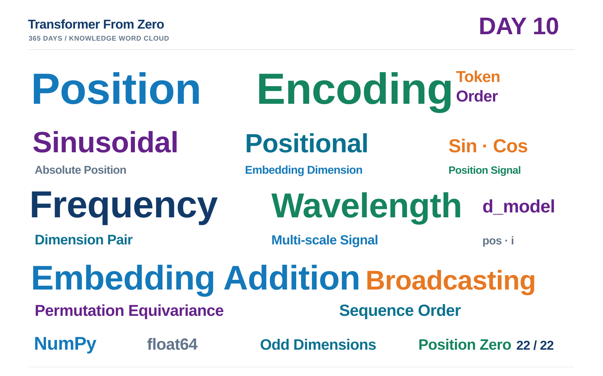

# Day 10 学习笔记｜Positional Encoding：让 Transformer 感知 Token 顺序

> **项目：** [Transformer From Zero · 365 Days](https://github.com/JiamuHan1122/transformer-from-zero)  
> **日期：** 2026-11-13  
> **阶段：** Transformer 输入表示 · Day 10  
> **今日主题：** Sinusoidal Positional Encoding、Embedding Addition、Position Information  
> **状态：** Task A/B 完成；22 项练习测试通过；Demo 与可视化验证成功  
> **核心实现：** exercises/week10.py  
> **测试：** tests/test_week10_exercises.py  
> **实验脚本：** scripts/day10_positional_encoding_demo.py

---

## 一、今天要解决的问题：Attention 如何知道 Token 的顺序？

Self-Attention 根据 Query 与 Key 的匹配关系聚合 Value。若只使用 Token Embedding，普通 Self-Attention 本身不直接携带 Token 的绝对位置编号。

设输入为 X，P 为 Token 维度上的置换矩阵。没有位置编码时，Self-Attention 满足置换等变关系：

$$
\operatorname{Attention}(PX)
=
P\operatorname{Attention}(X)
$$

这意味着输入 Token 被重新排列时，输出会跟着重新排列。注意力机制本身并没有获得“原来哪个 Token 在前、哪个 Token 在后”的额外标识。

位置编码的作用就是给每个 Token 的表示加入位置线索。

## 二、Sinusoidal Positional Encoding

原始 Transformer 使用不同频率的正弦和余弦函数生成位置向量。

偶数维度：

$$
PE(pos,2i)=
\sin\left(
\frac{pos}{10000^{2i/d_{model}}}
\right)
$$

奇数维度：

$$
PE(pos,2i+1)=
\cos\left(
\frac{pos}{10000^{2i/d_{model}}}
\right)
$$

其中：

- pos 是 Token 位置，从 0 开始；
- i 是维度对编号；
- d_model 是位置向量的总维度。

每一对相邻维度共享同一个频率：偶数维度使用 Sin，奇数维度使用 Cos。不同维度对的频率不同。

## 三、手算例子：d_model=8

偶数维度为 0、2、4、6，其频率分母为：

$$
10000^{0/8}=1,\quad
10000^{2/8}=10,\quad
10000^{4/8}=100,\quad
10000^{6/8}=1000
$$

当 pos=1 时：

$$
PE(1,:)=[
\sin(1),\cos(1),
\sin(0.1),\cos(0.1),
\sin(0.01),\cos(0.01),
\sin(0.001),\cos(0.001)
]
$$

近似为：

$$
[0.84147,0.54030,0.09983,0.99500,
0.01000,0.99995,0.00100,1.00000]
$$

当 pos=0 时：

$$
PE(0,:)=[0,1,0,1,0,1,0,1]
$$

这个例子帮助区分两个索引：pos 选择序列中的 Token 位置，i 选择 Embedding 中的频率组。

## 四、位置编码与 Token Embedding 相加

设 Token Embedding 的形状为 (B,T,D)，位置编码矩阵的形状为 (T,D)：

$$
E\in\mathbb{R}^{B\times T\times D}
$$

$$
PE\in\mathbb{R}^{T\times D}
$$

最终输入为：

$$
\boxed{X_{input}=E+PE}
$$

在 NumPy 中，可以将位置编码增加一个 Batch 轴：

~~~python
x = token_embeddings + positional_encoding[None, :, :]
~~~

维度变化：

$$
(B,T,D)+(1,T,D)\rightarrow(B,T,D)
$$

因此，位置编码不会改变序列长度或 Embedding 维度，只会改变输入表示的数值。

## 五、今天的代码任务

### Task A：生成位置编码

实现 sinusoidal_positional_encoding_numpy(seq_len, d_model)，返回 float64、形状为 (T,D) 的数组。需要支持奇数 d_model，并拒绝非法维度。

### Task B：加入 Token Embedding

实现 add_positional_encoding_numpy(token_embeddings, positional_encoding)，检查两个输入的秩和 T、D 维度，使用 Broadcasting 相加，并保持输入不变。

## 六、测试与实验

运行测试：

~~~powershell
conda activate tfz
python -m pytest -q -m exercise tests/test_week10_exercises.py
~~~

本次实际结果：

~~~text
......................
22 passed in 1.08s
~~~

22 项测试覆盖了公式数值、位置 0 的边界值、奇数维度、非法参数、有限数值、Batch Broadcasting、输入不变性、错误秩和维度不匹配。

运行 Demo：

~~~powershell
python -m scripts.day10_positional_encoding_demo
~~~

本次实际配置：

$$
B=2,\quad T=32,\quad D=16
$$

实际输出：

~~~json
{
  "token_embeddings_shape": [2, 32, 16],
  "positional_encoding_shape": [32, 16],
  "combined_input_shape": [2, 32, 16],
  "positional_encoding_dtype": "float64",
  "position_zero_max_error": 0.0,
  "all_encoding_values_finite": true,
  "mean_absolute_encoding_value": 0.5811393407647494
}
~~~

关键结论：

- 位置编码形状为 \((32,16)\)，与序列长度和模型维度一致。
- 加入位置编码后的输入仍为 \((2,32,16)\)，没有改变 Batch、Sequence 或 Embedding 维度。
- 位置 0 的最大误差为 0，说明边界值 \([0,1,0,1,\ldots]\) 正确。
- 所有编码值均为有限数值，没有 NaN 或 Inf。

## 七、实验图解读：不同维度拥有不同变化尺度

第一张曲线图显示，不同维度的变化速度不同。低维度变化更快，高维度变化更慢；相邻的 Sin/Cos 维度使用相同频率，彼此相位互补。

第二张热力图展示完整的 \((T,D)\) 位置编码矩阵。每一行对应一个 Embedding 维度，每一列对应一个 Token 位置。

特别注意 Dimension 14 和 15 在当前序列范围内近乎平坦。这不是实现错误。对 \(d_{\mathrm{model}}=16\)，最后一对维度的分母为：

$$
10000^{14/16}\approx3162.28
$$

最大位置 \(pos=31\) 对应的角度只有：

$$
\frac{31}{3162.28}\approx0.0098
$$

所以 Sin 值接近 0，Cos 值接近 1。这说明当前 32 个位置还不足以覆盖这一组低频信号的明显变化范围。

Demo 在本地生成：

- results/day10/positional_encoding_channels.png
- results/day10/positional_encoding_heatmap.png
- results/day10/metrics.json

这些文件遵循仓库规则保留在本地，不默认提交 results 目录。

## 八、Day 10 知识词云

核心关键词：

**Positional Encoding · Sinusoidal Encoding · Position · Token Order · Sin · Cos · Frequency · Wavelength · Embedding Addition · Broadcasting · Permutation Equivariance · NumPy**

## 九、Day 10 完成记录

- [x] Task A：Sinusoidal Positional Encoding
- [x] Task B：Embedding Addition
- [x] 支持奇数维度与非法参数检查
- [x] 22 项练习测试全部通过
- [x] Demo 运行成功
- [x] 位置编码热力图与维度曲线生成成功
- [x] 公式、维度与实验数值核对完成
- [x] 正式学习笔记与统一系列风格知识词云完成
- [x] GitHub 更新完成，准备同步 VS Code

$$
\boxed{
\text{Token Embedding}
+
\text{Positional Encoding}
=
\text{Position-aware Input}
}
$$

**Day 10 完成。**
