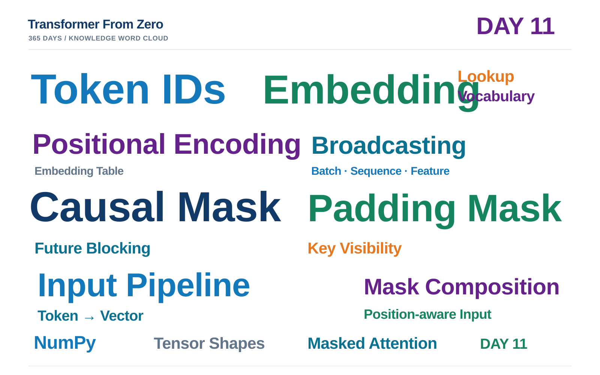

# Day 11 学习笔记｜Decoder Input Pipeline：从 Token IDs 到 Masked Attention

> **项目：** [Transformer From Zero · 365 Days](https://github.com/JiamuHan1122/transformer-from-zero)  
> **日期：** 2026-11-14  
> **阶段：** Transformer 输入表示与注意力整合 · Day 11  
> **今日主题：** Embedding Lookup、Positional Encoding、Causal + Padding Mask、Input Pipeline  
> **状态：** 学习脚手架已建立；实现与实验待完成

---

## 一、今天的核心问题

前十天分别实现了 Token 相关的数学基础、Self-Attention、Multi-Head Attention、Masked Attention 和位置编码。今天要把这些模块连成完整输入流水线：

[
	ext{Token IDs}

ightarrow 	ext{Embedding Lookup}

ightarrow 	ext{Embedding + PE}

ightarrow 	ext{Causal + Padding Mask}

ightarrow 	ext{Masked Attention}.
]

这不是新增一个复杂模型，而是验证我们之前实现的模块能否正确协作。

## 二、Embedding Lookup

设 Token IDs 为 (I)，Embedding Table 为 (W_E)：

[
Iinmathbb{Z}^{B	imes T},qquad
W_Einmathbb{R}^{V	imes D}.
]

查表：

[
E_{b,t,:}=W_E[I_{b,t},:].
]

因此输出张量形状为：

[
(B,T)
ightarrow(B,T,D).
]

这里不是把 Token ID 当作连续数值参与乘法，而是把每个整数 ID 作为 Embedding Table 的行索引。

## 三、加入位置信息

Day 10 已实现位置编码 (PE)，形状为 ((T,D))。Token Embedding 形状为 ((B,T,D))，沿 Batch 维广播相加：

[
X_{input}=E+PE,
]

[
(B,T,D)+(1,T,D)
ightarrow(B,T,D).
]

位置编码改变表示的数值，不改变张量形状。

## 四、组合因果与 Padding Mask

统一约定：True 表示 blocked，False 表示 visible。

[
M^{causal}_{i,j}=
egin{cases}
mathrm{True},&j>i,\
mathrm{False},&jleq i.
end{cases}
]

[
M^{pad}_{b,j}=mathbb{1}[I_{b,j}=PAD].
]

组合：

[
M^{combined}_{b,1,i,j}
=M^{causal}_{i,j}lor M^{pad}_{b,j}.
]

维度扩展：

[
(T,T)
ightarrow(1,1,T,T),
qquad
(B,T)
ightarrow(B,1,1,T).
]

广播组合后：

[
M^{combined}in{0,1}^{B	imes1	imes T	imes T}.
]

它会进一步广播到每个 Attention Head 的分数矩阵 ((B,H,T,T))。

**重要区别：** 本日 Padding Mask 屏蔽 PAD Key，不会自动将 PAD Query 的输出清零；若 PAD 位置不应参与训练目标，还需单独使用 Loss Mask。

## 五、端到端维度追踪

使用：

[
B=2,quad T=5,quad V=16,quad D=8,quad H=2.
]

| 变量 | 形状 |
|---|---|
| token_ids | (2,5) |
| embedding_table | (16,8) |
| token_embeddings | (2,5,8) |
| positional_encoding | (5,8) |
| input_embeddings | (2,5,8) |
| attention_mask | (2,1,5,5) |
| attention scores / weights | (2,2,5,5) |
| attention output | (2,5,8) |

## 六、今日实现任务

- Task A：实现 `token_embedding_lookup_numpy`，检查 ID 类型与索引范围。
- Task B：实现 `causal_padding_mask_numpy`，复用 Day 09 的 Mask 函数。
- Task C：实现 `prepare_decoder_input_numpy`，复用 Day 10 的位置编码相加函数，返回输入表示和 Attention Mask。

核心实现仅使用 NumPy；不使用 PyTorch 或自动微分。

## 七、测试与实验记录

练习测试：

```powershell
conda activate tfz
python -m pytest -q -m exercise tests/test_week11_exercises.py
```

端到端 Demo：

```powershell
python -m scripts.day11_input_pipeline_demo
```

当前为待实现脚手架，测试与 Demo 尚未验收。完成后应记录真实测试输出、张量形状、被屏蔽位置最大注意力权重和可见行归一化误差，不预填虚构结果。

本地实验结果放在 `results/day11/`，不默认提交 Git。

## 八、Day 11 知识词云



核心关键词：

**Token IDs · Embedding Lookup · Vocabulary · Embedding Table · Positional Encoding · Broadcasting · Causal Mask · Padding Mask · Key Visibility · Mask Composition · Input Pipeline · NumPy**

## 九、完成检查

- [ ] Embedding Lookup 实现与测试通过
- [ ] Causal + Padding Mask 组合实现与测试通过
- [ ] Decoder 输入组装实现与测试通过
- [ ] 全部练习测试通过
- [ ] Demo 端到端验证成功
- [ ] 公式、维度和知识词云核对完成
- [ ] GitHub 提交并同步 VS Code

**Day 11 的目标：把 Token IDs 转换为带位置信息、具有正确可见性约束的 Attention 输入。**
