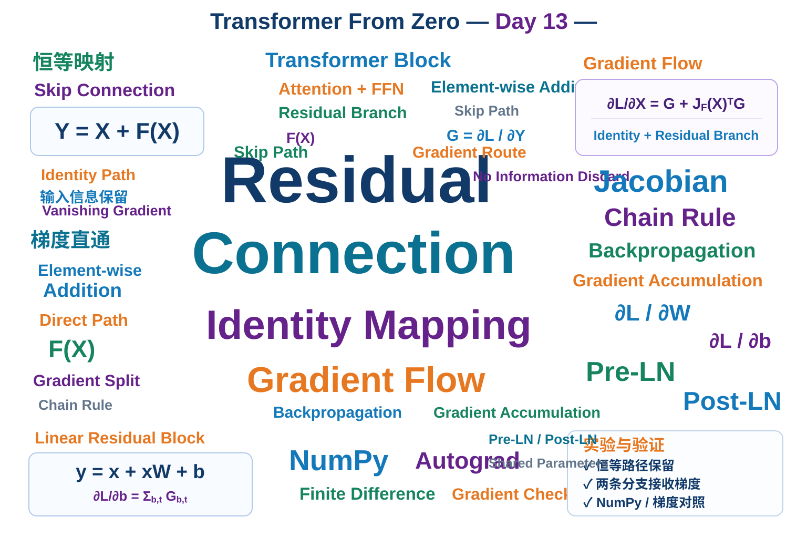

# Day 13 学习笔记｜Residual Connections：恒等映射与梯度传播

> **项目：** [Transformer From Zero · 365 Days](https://github.com/JiamuHan1122/transformer-from-zero)  
> **日期：** 2026-11-16  
> **主题：** Residual Connection、Identity Mapping、Gradient Flow、Pre-LN / Post-LN  
> **状态：** 学习材料与测试脚手架已发布；实现和实验待完成  
> **实现：** exercises/week13.py  
> **测试：** tests/test_week13_exercises.py  
> **Demo：** scripts/day13_residual_demo.py

---

## 一、今天为什么学习残差连接？

Day 12 已经实现 LayerNorm 的前向与手动反向传播。接下来补上 Transformer 子层周围的另一个关键结构：Residual Connection。

今天最重要的问题是：**为什么深层网络不只传递子层的变换结果，而是额外保留一条从输入直达输出的恒等映射路径？**

## 二、两种映射

普通映射：

\[
Y=F(X).
\]

残差映射：

\[
\boxed{Y=X+F(X)}.
\]

残差连接把原始表示与子层学习到的变化量逐元素相加。它不是拼接，也不是取平均。如果 \(F(X)=0\)，输出就是 \(X\)。

## 三、维度与梯度

设：

\[
X\in\mathbb{R}^{B\times T\times D}.
\]

标准残差要求 \(F(X)\) 具有相同形状，输出仍为 (B,T,D)。

令 \(G=\partial L/\partial Y\)，则加法节点向两条分支传递相同的上游梯度：

\[
\operatorname{grad}_{skip}=G,\quad
\operatorname{grad}_{branch}=G.
\]

继续经过 F 后：

\[
\boxed{\nabla_X L=G+J_F(X)^\top G}.
\]

恒等路径提供直接梯度通路，但不保证梯度永远不会消失或放大，两条路径也可能发生抵消。

## 四、Pre-LN 与 Post-LN

Post-LN：

\[
X_1=\operatorname{LN}(X+\operatorname{MHA}(X)),
\quad
Y=\operatorname{LN}(X_1+\operatorname{FFN}(X_1)).
\]

Pre-LN：

\[
X_1=X+\operatorname{MHA}(\operatorname{LN}(X)),
\quad
Y=X_1+\operatorname{FFN}(\operatorname{LN}(X_1)).
\]

两者都使用残差连接，但 LayerNorm 位置不同。Pre-LN 的恒等路径绕过当前子层及其前置 LayerNorm；Post-LN 的相加结果还要经过后置 LayerNorm。

## 五、今天的实现任务

### Task A：Residual Add

实现：

- **residual_add_forward_numpy(x, branch_output)**
- **residual_add_backward_numpy(grad_output)**

### Task B：Linear Residual Block

定义：

\[
Y=X+XW+b.
\]

实现：

- **residual_linear_forward_numpy(x, weight, bias)**
- **residual_linear_backward_numpy(grad_output, x, weight)**

反向：

\[
\frac{\partial L}{\partial X}=G+GW^\top,
\quad
\frac{\partial L}{\partial W}=\sum_{b,t}X_{b,t,:}^{\top}G_{b,t,:},
\quad
\frac{\partial L}{\partial b}=\sum_{b,t}G_{b,t,:}.
\]

这只是用于观察残差梯度的线性示例，不是完整 Transformer FFN。

## 六、Day 13 核心结论

1. 残差连接把输入与子层输出逐元素相加。
2. 标准恒等映射残差要求两个分支形状相同。
3. 加法节点向两条分支传递相同的上游梯度。
4. 输入梯度是恒等路径与残差分支路径的贡献之和。
5. 残差连接提供直接梯度通路，但不保证梯度永远稳定。
6. Attention 和 FFN 子层周围通常分别使用残差连接。
7. Pre-LN 与 Post-LN 的排列影响梯度经过的组件。

## 七、知识词云

核心关键词：

**Residual Connection · Identity Mapping · Skip Connection · Gradient Flow · Jacobian · Chain Rule · Element-wise Addition · Pre-LN · Post-LN · Transformer Block**

---

**Day 13 理论学习与练习脚手架已准备。实现和实验结果待本地验收后补充。**
