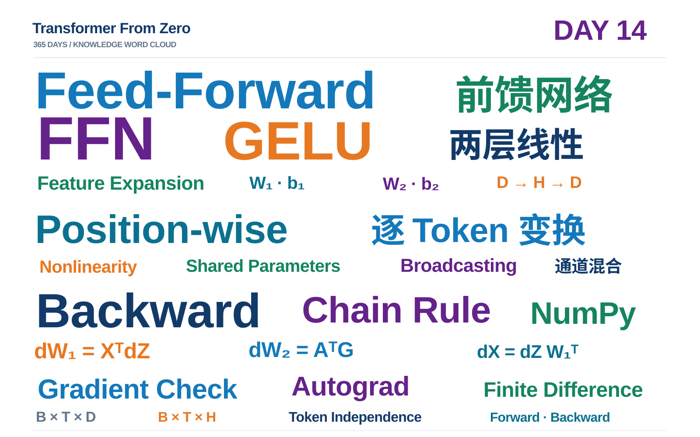

# Day 14 学习笔记｜Position-wise Feed-Forward Network：逐 Token 的非线性特征变换

> **项目：** [Transformer From Zero · 365 Days](https://github.com/JiamuHan1122/transformer-from-zero)  
> **日期：** 2026-11-17  
> **阶段：** Transformer Block 核心结构 · Day 14  
> **今日主题：** Feed-Forward Network、GELU、特征升维、Position-wise、Manual Backpropagation  
> **状态：** 本地实现、15 项专项测试、137 项全项目测试和 Demo 已完成；代码待推送 GitHub  
> **核心实现：** exercises/week14.py  
> **测试：** tests/test_week14_exercises.py  
> **实验脚本：** scripts/day14_ffn_demo.py

---

## 一、今天为什么学 FFN？

Day 13 的 Residual Connection 提供了恒等映射路径；Day 12 的 LayerNorm 调整每个 Token 的特征尺度。现在要掌握 Transformer Block 中与 Attention 并列的另一个核心子层：Position-wise Feed-Forward Network（FFN）。

**Attention 负责跨 Token 汇聚信息；FFN 负责独立处理每个 Token 内部的特征通道。**

### 1.1 为什么这两种计算要交替出现？

Attention 能根据输入计算不同 Token 之间的权重，并将有关的 Value 信息汇聚到当前位置。FFN 则不直接读取其他 Token，而是对当前 Token 的特征通道执行非线性加工。

必须区分：FFN 不进行直接的跨 Token 混合，不代表 FFN 完全看不到上下文信息。它收到的输入通常已经是 Attention 处理过的隐藏状态，因而可能包含其他 Token 汇聚过来的信息。

这是原始 Transformer 的重要架构分工，但并不是数学上规定所有 Transformer 变体都必须包含完全相同的 FFN。

## 二、FFN 的前向传播

设：

$$
X\in\mathbb{R}^{B\times T\times D}.
$$

本次选择两层线性变换，中间使用 Day 05 的 GELU tanh 近似：

$$
Z=XW_1+b_1,
$$

$$
A=\operatorname{GELU}_{\mathrm{tanh}}(Z),
$$

$$
\boxed{Y=AW_2+b_2}.
$$

合并为：

$$
\boxed{
\operatorname{FFN}(X)
=
\operatorname{GELU}_{\mathrm{tanh}}(XW_1+b_1)W_2+b_2
}.
$$

原始 Transformer 使用 ReLU；本课程为了复用 Day 05 的实现，采用 GELU tanh 近似。两者不可混淆。

## 三、维度一次看清楚

取：

$$
B=2,\quad T=5,\quad D=8,\quad H=D_{\mathrm{ff}}=32.
$$

| 变量 | 形状 | 作用 |
|---|---|---|
| X | (2,5,8) | 每个 Token 有 8 个特征 |
| W1 | (8,32) | 升维投影 |
| b1 | (32,) | 第一层偏置 |
| Z | (2,5,32) | GELU 前 |
| A | (2,5,32) | GELU 后 |
| W2 | (32,8) | 降维投影 |
| b2 | (8,) | 第二层偏置 |
| Y | (2,5,8) | FFN 输出 |

整个 FFN 不改变 B 或 T，只改变中间的通道宽度。

参数量为：

$$
N_{\mathrm{params}}=2DH+H+D.
$$

对于 $D=8,H=32$，共有 552 个参数。

### 3.1 为什么先升维再降维？

升维的重点不是创造新的输入信息，也不是增加 Token 数，而是提供更多中间特征通道，让非线性网络在更宽的表示空间中形成复杂的特征响应。降维则把中间特征组合回模型维度，方便与输入进行 Residual Addition。

例如 $D=768,H=3072$ 时，含两组 Bias 的参数量为：

$$
2\times768\times3072+3072+768=4{,}722{,}432.
$$

标准 Attention 的 Q、K、V、输出四个宽度为 D 的投影权重约为 $4D^2$，而 $H=4D$ 时，FFN 权重约为 $8D^2$。这里比较的是参数规模，不意味着 FFN 计算时长一定是 Attention 的两倍。

## 四、为什么 GELU 是必要的？

如果去掉激活函数：

$$
Y=(XW_1+b_1)W_2+b_2
=
X(W_1W_2)+(b_1W_2+b_2).
$$

它仍然只是一个线性/仿射映射。GELU 引入非线性，使模型能够学习更加丰富的特征变换。

Day 05 已有：

- `gelu_tanh_numpy`；
- `gelu_tanh_backward_numpy`。

今天必须复用它们，不能把 GELU 的实现复制一遍。

### 4.1 GELU 相对于 ReLU 的区别是什么？

原始 Transformer FFN 使用 ReLU，将负输入截断为 0。GELU 的响应更平滑，负输入不一定严格输出 0。今天使用的是 Day 05 的 GELU tanh 近似，而不是精确 erf 版本。

还有一类门控 FFN，例如 SwiGLU，会计算两组投影的逐元素交互：

$$
H=\operatorname{SiLU}(XW_g)\odot(XW_u),
\qquad Y=HW_d.
$$

这种结构多了门控分支，与简单地替换激活函数不同。今天先完成基础的两层 GELU-FFN，不在练习中提前加入门控结构。

## 五、FFN 为什么不混合 Token？

对于每个 Token 位置 $t$：

$$
Y_{b,t,:}
=
\operatorname{GELU}_{\mathrm{tanh}}
(X_{b,t,:}W_1+b_1)W_2+b_2.
$$

所有位置共用 W1、b1、W2、b2，但每个位置只读取自己原有的输入特征。因此仅扰动 Token 2 时，其他 Token 的 FFN 输出应保持不变。

### 5.1 一个真正可以手算的双 Token 例子

取 $B=1,T=2,D=2,H=3$，设：

$$
X=\begin{bmatrix}1&0\\0&1\end{bmatrix},
\quad W_1=\begin{bmatrix}1&-1&0.5\\0.5&1&1\end{bmatrix},
\quad b_1=0.
$$

**第一步：** 第一层线性投影：

$$
Z=XW_1=\begin{bmatrix}1&-1&0.5\\0.5&1&1\end{bmatrix}.
$$

**第二步：** 对每个中间特征独立执行 GELU tanh 近似：

$$
A\approx\begin{bmatrix}0.8412&-0.1588&0.3457\\0.3457&0.8412&0.8412\end{bmatrix}.
$$

例如 -1 经过 GELU 后约为 -0.1588，而不是像 ReLU 那样直接被置零。

**第三步：** 设：

$$
W_2=\begin{bmatrix}1&0\\0&1\\0.5&-0.5\end{bmatrix},
\quad b_2=0.
$$

则：

$$
Y=AW_2\approx\begin{bmatrix}1.0140&-0.3317\\0.7663&0.4206\end{bmatrix}.
$$

两个 Token 使用同一套参数，却各自生成不同的非线性特征组合。这里没有跨 Token 的矩阵乘法。

## 六、Backward：从输出依次传回输入

令：

$$
G=\frac{\partial L}{\partial Y}.
$$

第二层：

$$
\frac{\partial L}{\partial W_2}
=
\sum_{b,t}A_{b,t,:}^{\top}G_{b,t,:},
\qquad
\frac{\partial L}{\partial b_2}
=
\sum_{b,t}G_{b,t,:}.
$$

传入激活函数：

$$
G_A=GW_2^{\top},
\qquad
G_Z=G_A\odot\operatorname{GELU}_{\mathrm{tanh}}'(Z).
$$

第一层：

$$
\frac{\partial L}{\partial W_1}
=
\sum_{b,t}X_{b,t,:}^{\top}G_{Z,b,t,:},
\qquad
\frac{\partial L}{\partial b_1}
=
\sum_{b,t}G_{Z,b,t,:}.
$$

输入梯度：

$$
\boxed{
\frac{\partial L}{\partial X}
=
G_ZW_1^{\top}
}.
$$

五组梯度输出顺序：

`grad_x, grad_w1, grad_b1, grad_w2, grad_b2`

形状分别为：

`(B,T,D), (D,H), (H,), (H,D), (D,)`

### 6.1 为什么参数梯度需要求和，输入梯度不需要？

FFN 的 W1、b1、W2、b2 对整个 Batch 中每个 Token 共享，因此各位置的参数梯度贡献必须沿 Batch 和 Token 轴累积。输入 X 则包含每个位置自己的变量，所以输入梯度仍保持 (B,T,D)，不能把不同 Token 的输入梯度求和成一个向量。

反向传播必须倒序：先从第二层得到 W2、b2 的梯度，再乘 $W_2^\top$ 回到隐藏层；随后乘 GELU 的导数得到预激活梯度；最后求 W1、b1 的梯度并传回 X。Day 05 已经实现了 GELU 的导数，我们只需复用。

### 6.2 为什么后面还要残差与 LayerNorm？

对经过 Attention 更新的隐藏状态 $X_1$，常见结构包括：

Pre-LN：

$$
Y=X_1+\operatorname{FFN}(\operatorname{LN}(X_1)).
$$

Post-LN：

$$
Y=\operatorname{LN}(X_1+\operatorname{FFN}(X_1)).
$$

FFN、Residual、LayerNorm 负责的计算不同，排列顺序也会影响梯度路径。今天只独立验证 FFN，后续再组装完整 Transformer Block。

## 七、代码任务

**Task A：FFN Forward**

`ffn_forward_numpy(x, w1, b1, w2, b2)`

**Task B：FFN Backward**

`ffn_backward_numpy(grad_output, x, w1, b1, w2)`

核心实现只用 NumPy。测试中用 PyTorch Autograd 和 Day 03 的数值梯度做独立校验。

## 八、验收命令与实际结果

~~~powershell
python -m pytest -q -m exercise tests/test_week14_exercises.py
~~~

~~~powershell
python -m pytest -q -m exercise
~~~

~~~powershell
python -m scripts.day14_ffn_demo
~~~

验证内容：前向数值、手写五组梯度、有限差分、形状、Token 独立性、输入不变性、数值有限性。

本地实验结果目录：

~~~text
results/day14/
├── metrics.json
├── ffn_feature_heatmaps.png
└── token_perturbation_impact.png
~~~

**实际测试结果已在下文记录；本地实验通过，远程练习源文件仍需同步。**

### 8.1 Day 14 专项测试（本地实测）

运行：

~~~powershell
python -m pytest -q -m exercise tests/test_week14_exercises.py
~~~

结果：

~~~text
15 passed in 13.42s
~~~

包括 PyTorch 对照、手工反向传播、数值有限差分、形状与 Token 独立性等验收。

### 8.2 全项目回归测试（本地实测）

~~~powershell
python -m pytest -q -m exercise
~~~

结果：

~~~text
137 passed, 4 deselected in 2.46s
~~~

说明截至 Day 14，所有被选中的 Exercise 测试均通过。被 deselected 的 4 项不属于这次执行的测试集合。

### 8.3 Demo 运行（本地实测）

~~~powershell
python -m scripts.day14_ffn_demo
~~~

终端输出：

~~~text
SUCCESS: Day 14 FFN checks passed.
~~~

| 指标 | 实际结果 |
|---|---:|
| 输入形状 | (2,5,8) |
| 中间层形状 | (2,5,32) |
| 输出形状 | (2,5,8) |
| 五组梯度形状 | (2,5,8)、(8,32)、(32,)、(32,8)、(8,) |
| FFN 参数数量 | 552 |
| 扰动的 Token 下标 | 2 |
| Token 2 输出变化的 L2 范数 | 1.3879174060563375 |
| 其他 Token 输出最大变化 | 0.0 |
| 输出及梯度数值是否全部有限 | true |

### 8.4 两张可视化图的分析

**图一：输入/输出特征热力图**

`ffn_feature_heatmaps.png` 展示了第一个 Batch 内 5 个 Token 的 8 维特征在 FFN 前后的变化。输入、输出的形状相同，但各通道数值的分布明显不同，说明 FFN 实现了逐 Token 的非线性特征变换。

注意：左右两张热力图使用各自的色条，因此不能单凭颜色深浅直接比较输入与输出的绝对数值幅度；Demo 使用固定随机权重，并不是经过训练的语义特征可视化。

**图二：Token 扰动影响**

`token_perturbation_impact.png` 只改变第一个 Batch 中下标为 2 的输入 Token。该位置输出变化的 L2 范数为 1.3879174060563375，而其余 Token 的输出变化均为 0。

对于单独的 Position-wise FFN，有：

$$
Y_{b,t,:}=f(X_{b,t,:};\theta),
$$

不同 Token 的直接输入—输出依赖满足：

$$
\frac{\partial Y_{b,i,:}}{\partial X_{b,j,:}}=0
\qquad(i\ne j).
$$

因此，其在 Token 维度的 Jacobian 具有块对角结构。但这个性质不能直接推广到包含 Self-Attention 的完整 Transformer Block。

### 8.5 验收状态与代码同步

上述结果来自本地 VSCode 的实际测试日志和 Demo 输出，已经可以确认 **Day 14 本地练习验收通过**。

GitHub 的 `exercises/week14.py` 在记录本次验收时仍是初始练习脚手架。请先将本地已通过测试的版本提交并推送，才能认定远程代码也完成同步。本笔记不会把本地测试记录误写成已在 GitHub/CI 环境重新执行的结果。

## 九、Day 14 核心结论

1. FFN 在 Token 内部混合特征通道，不直接交换 Token 信息。
2. 第一层一般扩大特征宽度，第二层回到模型维度。
3. GELU 引入非线性；没有激活的两层线性变换可以合并。
4. 参数在所有 Token 位置共享，所以权重梯度和偏置梯度必须沿 B、T 累积。
5. 反向传播从 W2/b2 开始，经 GELU 返回 W1/b1，再得到输入梯度。
6. FFN、Attention、Residual 和 LayerNorm 是不同模块，后续组合时需要明确各自责任。

## 十、Day 14 知识词云

核心关键词：

**Feed-Forward Network · FFN · GELU · Position-wise · Feature Expansion · Two Linear Layers · Broadcasting · Gradient Check · NumPy · Backpropagation · Parameter Sharing**

---

**Day 14：理论、NumPy 实现、五组梯度对照、专项测试、全项目回归测试及可视化 Demo 均已在本地通过；等待同步最终练习源文件到 GitHub。**
