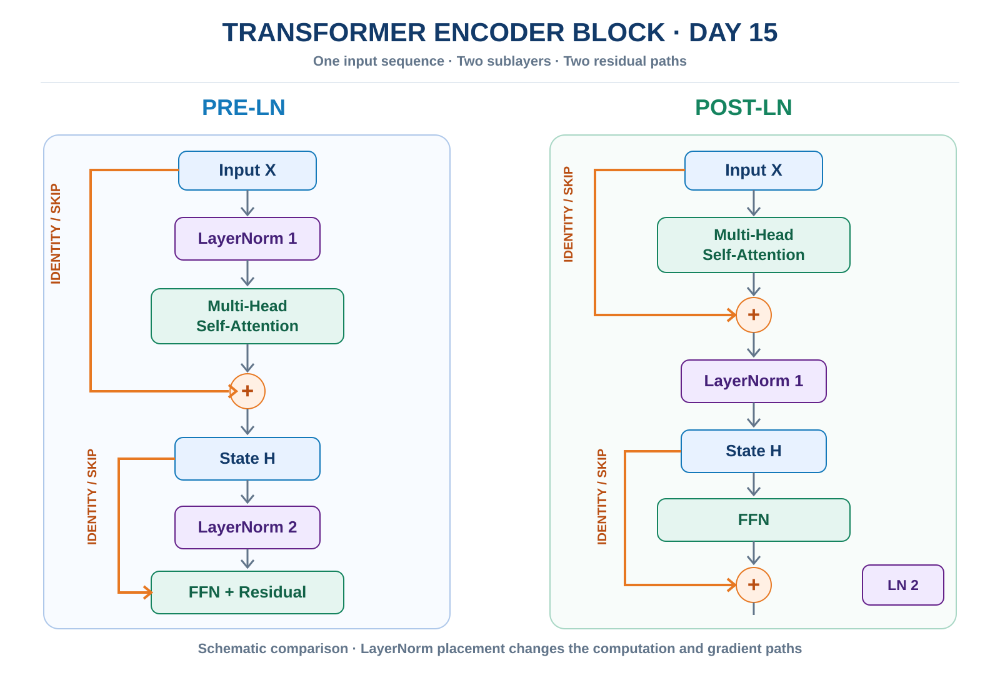
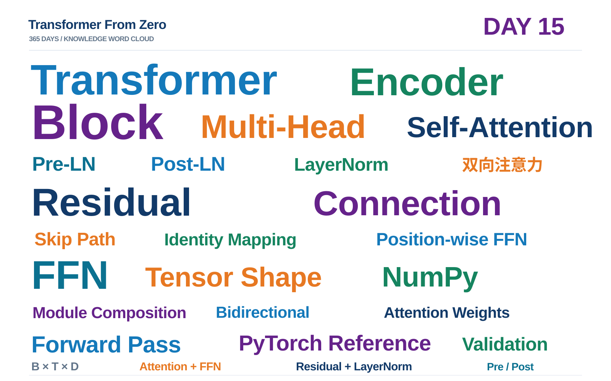

# Day 15 学习笔记｜Transformer Encoder Block：从独立模块到完整计算单元

> **项目：** [Transformer From Zero · 365 Days](https://github.com/JiamuHan1122/transformer-from-zero)  
> **日期：** 2026-11-18  
> **阶段：** Transformer Block 核心结构 · Day 15  
> **今日主题：** Encoder Block、Multi-Head Self-Attention、Pre-LN / Post-LN、Residual、LayerNorm、FFN  
> **状态：** 本地 16 项专项测试、153 项回归测试及 Demo 已通过；最终代码待推送 GitHub  
> **核心实现：** exercises/week15.py  
> **测试：** tests/test_week15_exercises.py  
> **实验脚本：** scripts/day15_encoder_block_demo.py

---

## 一、今天为什么要组装 Encoder Block？

前十四天，我们已经逐步实现了 Transformer 的关键部件：

- Day 08：Multi-Head Self-Attention，完成跨 Token 信息聚合；
- Day 09：Causal / Padding Mask，理解注意力可见性约束；
- Day 10：Sinusoidal Positional Encoding，为输入加入位置信息；
- Day 12：Layer Normalization，逐 Token 归一化特征；
- Day 13：Residual Connection，保留恒等映射和梯度通路；
- Day 14：Position-wise FFN，对每个 Token 的通道进行非线性变换。

今天不再单独实现一个算子，而是回答：

**这些模块在一个完整的 Transformer Encoder Block 中究竟如何连接？数据从输入到输出经历了哪些步骤？**

今天的重点是理解模块之间的责任边界、计算顺序和张量形状，并把现有函数组合成一个可运行的 Encoder Block。

## 二、先分清三个层级

1. **子层（Sublayer）**：例如 Multi-Head Self-Attention 或 FFN。
2. **Encoder Block / Encoder Layer**：把 Attention 子层、FFN 子层及其 Residual、LayerNorm 组合起来。
3. **Encoder Stack**：将多个 Encoder Block 依次堆叠。

今天实现的是第二层：一个 Encoder Block，不是完整 Encoder Stack，也不是完整 Encoder–Decoder Transformer。

## 三、Encoder Block 的整体计算

输入：

$$
X\in\mathbb{R}^{B\times T\times D}.
$$

其中 B 是 Batch Size，T 是 Token 数量，D 是模型特征维度。

一个 Encoder Block 包含两个主要子层：

- Multi-Head Self-Attention：在 Token 维度上建立信息交互；
- Position-wise FFN：在每个 Token 内部变换特征通道。

两个子层各自配有 Residual Connection 和 LayerNorm。LayerNorm 的位置形成 Pre-LN 与 Post-LN 两种组织方式。

## 四、第一部分：Multi-Head Self-Attention

对输入 X 做三组线性投影：

$$
Q=XW_Q,\qquad K=XW_K,\qquad V=XW_V.
$$

今天使用 Day 08 的无偏置投影实现。为了与残差分支相加，Q、K、V 的投影总宽度均为 D，输出投影也回到 D。

令注意力头数为 h，且 D 能被 h 整除：

$$
d_{\mathrm{head}}=\frac{D}{h}.
$$

拆分后：

$$
Q_h,K_h,V_h
\in\mathbb{R}^{B\times h\times T\times d_{\mathrm{head}}}.
$$

每个 Head 计算：

$$
S_h=\frac{Q_hK_h^\top}{\sqrt{d_{\mathrm{head}}}},
$$

$$
A_h=\operatorname{Softmax}(S_h),
$$

$$
C_h=A_hV_h.
$$

拼接所有 Head，再执行输出投影：

$$
\operatorname{MHA}(X)
=
\operatorname{Concat}(C_1,\ldots,C_h)W_O.
$$

最终：

$$
\operatorname{MHA}(X)\in\mathbb{R}^{B\times T\times D}.
$$

注意力权重形状为：

$$
A\in\mathbb{R}^{B\times h\times T\times T}.
$$

其中每一行对应一个 Query Token 对所有 Key Token 的注意力分布，沿最后一维求和为 1。

### 4.1 Encoder 为什么不使用 Causal Mask？

Encoder 需要利用输入序列的双向上下文。对位置 i 的 Token，它可以关注位置 i 之前和之后的 Token。

因此今天的 Encoder Self-Attention 不使用 Causal Mask。它与 Decoder 的自回归注意力不同。

但要明确一个实现限制：Day 08 的 multi_head_attention_numpy 当前是 unmasked attention，没有 padding mask。因此今天的最小 Encoder Block 假设输入序列没有需要屏蔽的 PAD 位置。真实批量 NLP 数据通常还需要处理 padding mask，今天不擅自把未实现的能力算作已支持。

## 五、第二部分：Residual Connection 与 LayerNorm

Day 13 已经推导过：

$$
Y=X+F(X).
$$

这里 F(X) 可以是 Attention 或 FFN 的输出。

因为残差相加要求两条分支形状一致，所以 Attention 和 FFN 的输出都必须回到：

$$
(B,T,D).
$$

LayerNorm 对每一个 Token 独立地沿特征维 D 归一化。它不会改变张量形状：

$$
\operatorname{LN}:
(B,T,D)\rightarrow(B,T,D).
$$

一个 Encoder Block 中有两组独立的 LayerNorm 参数：

- LN1：Attention 子层对应的归一化参数；
- LN2：FFN 子层对应的归一化参数。

两组 gamma、beta 不共享。

## 六、两种架构：Post-LN 与 Pre-LN

这是今天最重要的结构区别。

### 6.1 Post-LN：原始 Transformer 采用的组织方式

第一子层：

$$
H=\operatorname{LN}_1
\left(X+\operatorname{MHA}(X)\right).
$$

第二子层：

$$
Y=\operatorname{LN}_2
\left(H+\operatorname{FFN}(H)\right).
$$

Post-LN 的 LayerNorm 位于每次残差相加之后。

### 6.2 Pre-LN：现代深层 Transformer 中常见的组织方式

第一子层：

$$
H=X+\operatorname{MHA}
\left(\operatorname{LN}_1(X)\right).
$$

第二子层：

$$
Y=H+\operatorname{FFN}
\left(\operatorname{LN}_2(H)\right).
$$

Pre-LN 的 LayerNorm 位于每个子层计算之前，残差主路径可以直接绕过当前子层。

### 6.3 两者最本质的区别

| 比较 | Post-LN | Pre-LN |
|---|---|---|
| Attention 输入 | X | LN1(X) |
| Attention 后 | LN1(X + MHA(X)) | X + MHA(LN1(X)) |
| FFN 输入 | H | LN2(H) |
| FFN 后 | LN2(H + FFN(H)) | H + FFN(LN2(H)) |
| 残差主路径 | 相加后还经过 LN | 直接绕过当前子层 |
| 深层训练 | 对优化和初始化更敏感 | 通常具有更直接的梯度通路 |

不能简单说 Pre-LN 在所有任务上都优于 Post-LN。它们是不同的架构选择，训练行为、归一化位置和最终表示尺度都可能不同。

今天代码通过 norm_first 参数支持两者：

- norm_first=True：Pre-LN；
- norm_first=False：Post-LN。

默认使用 Pre-LN。

## 七、完整的张量维度追踪

今天 Demo 使用：

$$
B=2,\quad T=5,\quad D=8,\quad h=2,\quad D_{\mathrm{ff}}=32.
$$

| 计算步骤 | 张量形状 |
|---|---|
| 输入 X | (2,5,8) |
| Q、K、V 投影 | (2,5,8) |
| 拆分多头 | (2,2,5,4) |
| 注意力分数 | (2,2,5,5) |
| 注意力权重 | (2,2,5,5) |
| Head 聚合结果 | (2,2,5,4) |
| 合并 Heads | (2,5,8) |
| Attention 输出投影 | (2,5,8) |
| 第一次残差与归一化相关状态 | (2,5,8) |
| FFN 隐藏层 | (2,5,32) |
| FFN 输出 | (2,5,8) |
| 第二次残差与归一化 | (2,5,8) |
| Encoder Block 输出 Y | (2,5,8) |

今天要特别注意：Attention 改变 Token 之间的信息依赖；FFN 改变每个 Token 内部的通道表示；LayerNorm 和 Residual 不改变 B、T、D 三个维度。

## 八、参数量核算

本练习使用无偏置的 Q、K、V、O 四组 D×D 投影，因此 Attention 参数量为：

$$
N_{\mathrm{MHA}}=4D^2.
$$

FFN 参数量：

$$
N_{\mathrm{FFN}}=2DD_{\mathrm{ff}}+D_{\mathrm{ff}}+D.
$$

两组 LayerNorm 各有 gamma、beta：

$$
N_{\mathrm{LN}}=4D.
$$

总参数量：

$$
\boxed{
N_{\mathrm{Block}}
=
4D^2+2DD_{\mathrm{ff}}
+D_{\mathrm{ff}}+D+4D
}
$$

对于 D=8、D_ff=32：

$$
N_{\mathrm{Block}}
=256+512+32+8+32=840.
$$

注意，这个计数对应今天的具体实现约定，不包含 MHA 投影 Bias、Dropout 或额外的最终 LayerNorm。

## 九、今天的代码任务

实现文件：**exercises/week15.py**

唯一核心函数：

**transformer_encoder_block_forward_numpy(...)**

它需要接收输入 X、四组 Attention 权重、num_heads、两组 LayerNorm 参数、FFN 参数、eps 和 norm_first。

返回：

- output：(B,T,D)；
- attention_weights：(B,h,T,T)。

### 实现要求

1. 输入校验辅助函数已经提供，不要删除。
2. 复用 Day 08 的 multi_head_attention_numpy。
3. 复用 Day 12 的 layer_norm_forward_numpy。
4. 复用 Day 13 的 residual_add_forward_numpy。
5. 复用 Day 14 的 ffn_forward_numpy。
6. 支持 Pre-LN 和 Post-LN 两种顺序。
7. 核心实现只使用 NumPy，不使用 Torch 或 Autograd。
8. 所有计算和返回结果使用 float64。
9. 不修改任何调用者传入的数组。
10. 不在今天擅自加入 Causal Mask、Padding Mask、Dropout 或额外位置编码。

## 十、为什么今天不实现整个 Block 的反向传播？

Day 12 已有 LayerNorm backward，Day 13 已有 Residual backward，Day 14 已有 FFN backward。

但 Day 08 的 Multi-Head Self-Attention 目前只有前向实现，还没有完整的手写 backward。

如果今天直接声称完整 Encoder Block 的反向传播也已实现，就会掩盖一个真实的模块缺口。

因此今天只完成完整 Block 的前向组装和 PyTorch 参考对照。后续可以专门补齐 Attention backward，再完成整个 Block 的梯度链路。

## 十一、测试与验收

专项测试：

~~~powershell
python -m pytest -q -m exercise tests/test_week15_exercises.py
~~~

全项目回归：

~~~powershell
python -m pytest -q -m exercise
~~~

Demo：

~~~powershell
python -m scripts.day15_encoder_block_demo
~~~

测试覆盖：

- Pre-LN 与 Post-LN 的 PyTorch 前向对照；
- 输出及注意力权重形状；
- 注意力概率归一化；
- Encoder 双向注意力行为；
- Pre-LN 零分支恒等性质；
- Post-LN 零分支仍执行归一化；
- 两种结构输出差异；
- Attention 的跨 Token 信息混合；
- 输入完整性；
- 非法 Head 数、FFN 维度和 norm_first 类型。

本地实验输出：

~~~text
results/day15/
├── metrics.json
├── attention_weights.png
└── pre_post_ln_outputs.png
~~~

## 十二、思考题

1. 为什么 Attention 的输出必须回到 D 维，才能与原输入直接相加？
2. 为什么一个 Encoder Block 需要两组独立的 LayerNorm，而不是只在最后归一化一次？
3. Pre-LN 中，为什么残差主路径不需要经过当前子层的 LayerNorm？
4. 为什么 Encoder Self-Attention 不需要 Causal Mask？
5. 为什么 Padding Mask 与 Causal Mask 不能混为一谈？
6. 如果把 FFN 从 Attention 子层中拿掉，Encoder Block 还保留了什么能力，又缺少什么能力？
7. 为什么今天的 Pre-LN 零分支实验可以退化为恒等映射，而 Post-LN 不一定？

---

**Day 15 的核心目标：不只是记住 Transformer Block 的结构图，而是能够从张量维度、计算顺序和模块责任三个角度，独立解释并实现一个完整 Encoder Block。**

## 十三、Day 15 知识词云

核心关键词：

**Transformer Encoder Block · Multi-Head Self-Attention · Pre-LN · Post-LN · Residual Connection · LayerNorm · Position-wise FFN · Bidirectional Attention · Tensor Shape · Module Composition · NumPy**

---

## 十四、Day 15 本地实测结果（2026-11-18）

### 14.1 运行命令与结果

Day 15 专项：

~~~powershell
python -m pytest -q -m exercise tests/test_week15_exercises.py
~~~

~~~text
16 passed in 2.21s
~~~

全部 Exercise 回归：

~~~powershell
python -m pytest -q -m exercise
~~~

~~~text
153 passed, 4 deselected in 2.65s
~~~

其中四项 deselected 是此次测试标记选择范围外的项目，不是失败。

Day 15 可视化 Demo：

~~~powershell
python -m scripts.day15_encoder_block_demo
~~~

~~~text
SUCCESS: Day 15 Encoder Block checks passed.
~~~

### 14.2 主要数值

| 指标 | 本地实测 |
|---|---:|
| 输入 / Pre-LN 输出 / Post-LN 输出 | (2,5,8) |
| 注意力权重形状 | (2,2,5,5) |
| 模型维度 D | 8 |
| FFN 隐藏维度 | 32 |
| 头数 / 每头维度 | 2 / 4 |
| 参数量 | 840 |
| Pre-LN 与 Post-LN 输出 L2 差异 | 5.262866564783503 |
| 注意力行和最大误差 | 2.220446049250313e-16 |
| 平均注意力熵（nats） | 1.3384076372651348 |
| 扰动 Token 2 后其他 Token 最大绝对元素变化 | 0.06565182911588863 |
| 数值是否全部有限 | true |
| 原始输入是否保持不变 | true |

### 14.3 图一：Pre-LN 与 Post-LN 的输出特征

本地生成文件：results/day15/pre_post_ln_outputs.png。

两种组织方式的输出形状完全相同，但数值分布不同，L2 差异约为 5.26。可见 LayerNorm 位置不是可随意交换的操作。热力图左右色条范围不同，不能直接用相同颜色判断对应的绝对数值；这些权重也是随机初始化的，不能推断哪种结构在真实任务中精度更高。

### 14.4 图二：两个 Attention Head 的权重

本地生成文件：results/day15/attention_weights.png。

图中两个 Head 的 (5,5) Query×Key 注意力矩阵模式不同。Softmax 行和的最大误差为：

$$
\max_{b,h,i}\left|\sum_j A_{b,h,i,j}-1\right|
=2.220446049250313\times10^{-16}.
$$

平均注意力熵为 1.3384076372651348 nats；对 5 个 Key 的均匀分布，最大熵为 $\ln 5\approx 1.60944$ nats。这是随机权重条件下的描述性统计，不代表注意力已学习到可靠的语义关系。

### 14.5 与 Day 14 的跨 Token 对照

Day 14 中单独的 FFN 不直接在 Token 间交换信息；只扰动一个 Token 后，其他 Token 输出变化为 0。Day 15 加入 Self-Attention 后，其他 Token 的最大绝对元素输出变化为 0.06565182911588863。

这表明完整 Encoder Block 的跨 Token 信息通路已经生效。但非零影响本身并不代表影响对任务有益，也不能仅凭本次随机输入分析真实语义。

### 14.6 代码归档状态

上述结果由本地 VSCode 运行日志和用户上传的图像支持，未在 GitHub CI 环境独立复测。GitHub 的 exercises/week15.py 当前仍是练习脚手架，应先将本地已通过测试的最终文件提交并推送。results/day15 下生成的图像也仍位于本地，尚未自动归档到 GitHub。

**Day 15 本地实现、对照测试和可视化实验验收完成；远程代码归档待完成。**
