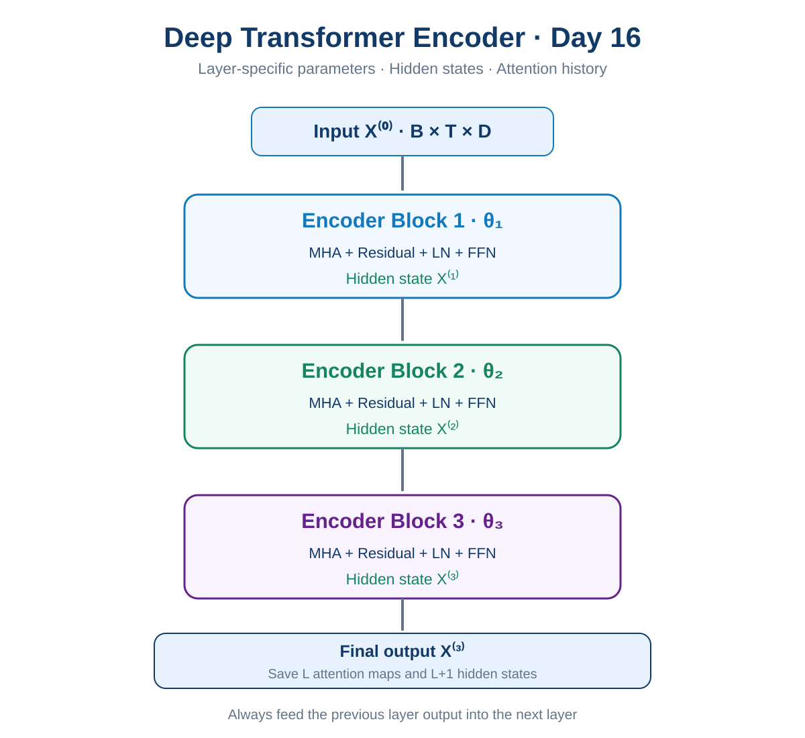
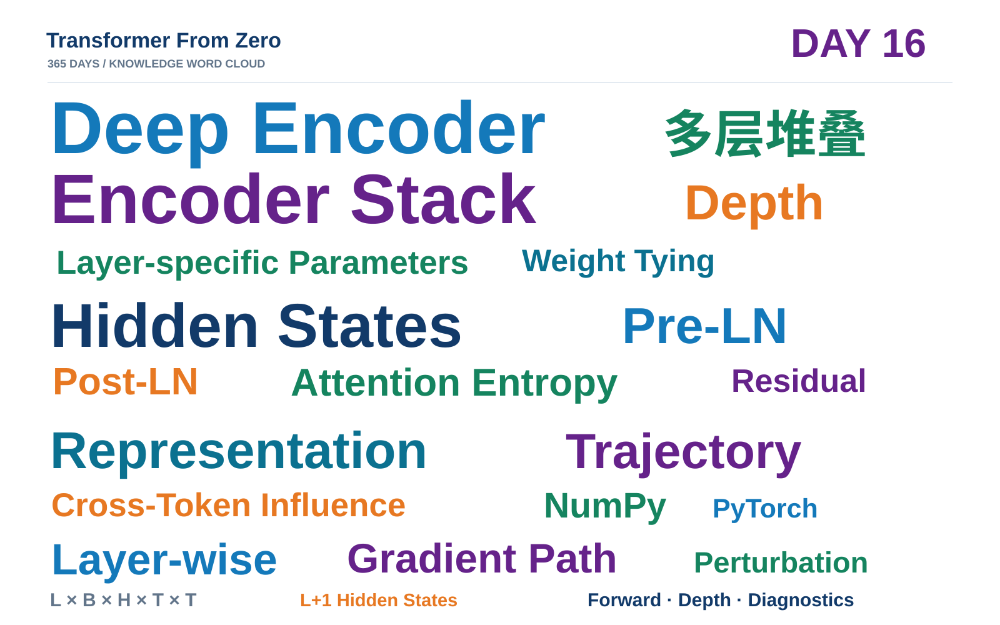

# Day 16 学习笔记｜Deep Transformer Encoder：多层堆叠与表示演化

> **项目：** [Transformer From Zero · 365 Days](https://github.com/JiamuHan1122/transformer-from-zero)  
> **日期：** 2026-11-19  
> **阶段：** Transformer Encoder · 多层组装与深度诊断  
> **今日主题：** Encoder Stack、Layer-specific Parameters、Pre-LN / Post-LN、Hidden-State Trajectory、Attention Entropy  
> **状态：** 理论与练习脚手架已发布；代码实现、测试和 Demo 尚未验收  
> **核心实现：** exercises/week16.py  
> **测试：** tests/test_week16_exercises.py  
> **实验脚本：** scripts/day16_encoder_stack_demo.py

---

## 一、今天学什么？

Day 15 已经实现单层 Encoder Block，今天重点是将 L 个不同参数的 Block 串接成 Encoder Stack，并且观察隐藏表示和注意力权重如何逐层变化。每一层使用上一层的输出，而不是再次使用原输入。

## 二、数学递推与维度

设初始状态为：

$$
X^{(0)}\in\mathbb{R}^{B\times T\times D}.
$$

对第 ell 层：

$$
\boxed{X^{(\ell)}=F_\ell(X^{(\ell-1)};\theta_\ell).}
$$

最终：

$$
X^{(L)}=F_L\circ\cdots\circ F_2\circ F_1(X^{(0)}).
$$

各层的输出形状仍为 (B,T,D)，但数值和表示均可以变化。

对于 B=2、T=5、D=8、L=3、h=2：

| 内容 | 形状 |
|---|---|
| 初始输入 | (2,5,8) |
| 每层输出 | (2,5,8) |
| 最终输出 | (2,5,8) |
| 全部注意力 | (3,2,2,5,5) |
| 全部隐藏状态（含输入） | (4,2,5,8) |

隐藏状态历史需要 L+1 个张量，因为包括初始输入。

## 三、独立参数与 Weight Tying

标准独立参数的 Encoder Stack 使用不同的权重集合：

$$
\theta_1,\theta_2,\ldots,\theta_L.
$$

重复调用相同的 Python 函数不意味着共享权重。若重复把同一个参数字典传入不同层，才是在此练习中显式模拟 Weight Tying。

今天的单层参数量（注意力投影无 Bias，FFN 有 Bias，LayerNorm 有仿射参数）：

$$
N_{\mathrm{block}}=4D^2+2DD_{\mathrm{ff}}+D_{\mathrm{ff}}+5D.
$$

当 D=8、D_ff=32 时为 840；三层独立参数共 2520。不包括 Embedding、位置编码、分类头。

## 四、深度中的 Pre-LN 和 Post-LN

Pre-LN：

$$
H^{(\ell)}=X^{(\ell-1)}+
\operatorname{MHA}_{\ell}\big(
\operatorname{LN}_{\ell,a}(X^{(\ell-1)})\big),
$$

$$
X^{(\ell)}=H^{(\ell)}+
\operatorname{FFN}_{\ell}\big(
\operatorname{LN}_{\ell,f}(H^{(\ell)})\big).
$$

Post-LN：

$$
H^{(\ell)}=\operatorname{LN}_{\ell,a}
\big(X^{(\ell-1)}+\operatorname{MHA}_{\ell}(X^{(\ell-1)})\big),
$$

$$
X^{(\ell)}=\operatorname{LN}_{\ell,f}
\big(H^{(\ell)}+\operatorname{FFN}_{\ell}(H^{(\ell)})\big).
$$

Pre-LN 的直接残差路径能绕过当前子层归一化；Post-LN 的残差和必须再通过 LayerNorm。它们的梯度路径不同，但随机权重下的输出差异不能当作性能优劣证据。

## 五、多层信息聚合的直观例子

简化为两个不含 Q/K、残差、FFN 或 LayerNorm 的固定权重线性 Token 聚合层：

$$
A^{(1)}=\begin{bmatrix}0.8&0.2\\0.3&0.7\end{bmatrix},
\quad
A^{(2)}=\begin{bmatrix}0.6&0.4\\0.1&0.9\end{bmatrix}.
$$

则：

$$
A^{(2)}A^{(1)}=\begin{bmatrix}0.60&0.40\\0.35&0.65\end{bmatrix}.
$$

这个简化例子说明连续信息聚合可能改变有效权重，但实际 Transformer 的 Attention 权重依赖输入，并含残差与非线性，不能把这个矩阵乘积解释为真实模型的 Token 因果贡献。

## 六、三个深度诊断

平均 Token 范数：

$$
r_\ell=\frac{1}{BT}\sum_{b,t}\|X_{b,t,:}^{(\ell)}\|_2.
$$

每层每头注意力熵：

$$
\mathcal H_{\ell,h,i}=-\sum_j A_{\ell,h,i,j}\log A_{\ell,h,i,j}.
$$

扰动输入位置 k 后，观察第 ell 层位置 i 的变化：

$$
R_{\ell,i}=\|\widetilde X_{0,i,:}^{(\ell)}-X_{0,i,:}^{(\ell)}\|_2.
$$

这些指标描述数值尺度、注意力集中程度和局部输入敏感性。它们都不能直接等同于语义解释、层的重要性或下游任务效用。

## 七、深层梯度与当前边界

$$
\frac{\partial\mathcal L}{\partial X^{(0)}}
=
J_{F_1}^{\top}J_{F_2}^{\top}\cdots J_{F_L}^{\top}
\frac{\partial\mathcal L}{\partial X^{(L)}}.
$$

对于简单残差函数：

$$
F(X)=X+G(X),\qquad J_F=I+J_G.
$$

恒等项提供直接梯度路径，但不能保证梯度永不消失或爆炸。由于完整 Multi-Head Attention 的手写反向仍未实现，今天只完成整个 Stack 的 NumPy Forward。

## 八、练习和验收

实现函数：encoder_stack_forward_numpy(x, layers, num_heads, norm_first=True, eps=1e-5)。

它返回 final_output、all_attentions 和 all_hidden_states，顺序固定，且所有数据均为 float64。要重复调用 Day 15 完整 Block，不能重新抄写它的内部结构。

~~~powershell
python -m pytest -q -m exercise tests/test_week16_exercises.py
python -m pytest -q -m exercise
python -m scripts.day16_encoder_stack_demo
~~~

实验输出将保存于 results/day16，包含 metrics.json 和三张逐层诊断图。完成本地测试后再填写实际数字，不提前宣称成功。

## 九、Day 16 知识词云

**Encoder Stack · Depth · Pre-LN · Post-LN · Hidden States · Layer-wise Attention · Weight Tying · Layer-specific Parameters · Gradient Path · Representation Trajectory · Attention Entropy · Perturbation Response**

---

**Day 16 当前状态：理论与实验脚手架准备完成，等待亲手实现与测试验收。**
