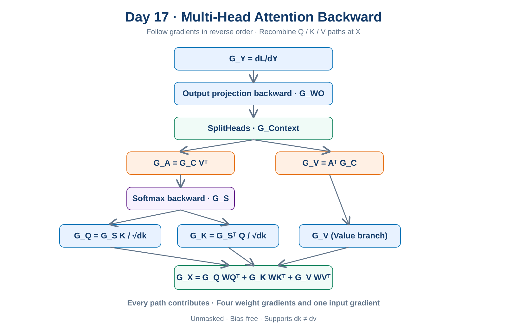
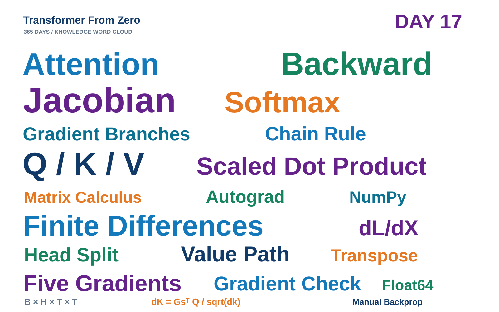

# Day 17 学习笔记｜Multi-Head Attention Backward：Softmax Jacobian 与梯度分支汇合

> **项目：** [Transformer From Zero · 365 Days](https://github.com/JiamuHan1122/transformer-from-zero)  
> **日期：** 2026-11-20  
> **阶段：** Transformer 手写反向传播 · Day 17  
> **今日主题：** Softmax Backward、Attention Gradients、Q/K/V Branches、Matrix Calculus、Autograd Cross-check  
> **状态：** 理论与练习脚手架已经发布；手写实现、测试和 Demo 等待本地验收  
> **核心实现：** exercises/week17.py  
> **测试：** tests/test_week17_exercises.py  
> **实验脚本：** scripts/day17_attention_backward_demo.py

---

## 一、从前向 Encoder 转向完整反向传播

Day 16 的三层 Encoder Forward 已通过本地专项 31 项和全项目 184 项 Exercise 测试，所有层的 Hidden States 和 Attention 均已记录。但 Day 08 的 Multi-Head Attention 仍缺少 NumPy 手写 Backward。今天先攻克这个缺口。

## 二、前向计算图

$$
Q=XW_Q,\qquad K=XW_K,\qquad V=XW_V.
$$

拆分 Head 后：

$$
S=Q_hK_h^\top/\sqrt{d_k},\quad
A=\operatorname{Softmax}(S),\quad
C=AV_h.
$$

再合并多个 Head：

$$
M=\operatorname{MergeHeads}(C),\qquad Y=MW_O.
$$

这里和 Day 08 一致，$d_k$ 与 $d_v$ 可以不同，且当前没有 Mask 或 Bias。

## 三、Softmax Jacobian

逐行 Softmax 定义为：

$$
a_i=\frac{e^{s_i}}{\sum_j e^{s_j}}.
$$

对应 Jacobian：

$$
\frac{\partial a_i}{\partial s_j}=a_i(\delta_{ij}-a_j),
\quad J=\operatorname{diag}(a)-aa^\top.
$$

因此对上游梯度 $g_a$：

$$
\boxed{
g_s=a\odot\left(g_a-\sum_j a_jg_{a,j}\right).
}
$$

**手算例子：** $a=[0.2,0.3,0.5]$，$g_a=[1,2,-1]$，加权点积为 0.3，结果：

$$
g_s=[0.14,0.51,-0.65].
$$

行和为 0，反映 Softmax 对 Score 同一行整体平移的不变性。

## 四、Multi-Head Attention 的五组梯度

从上游梯度 $G_Y$ 开始：

输出投影：

$$
G_M=G_YW_O^\top,\quad
G_{W_O}=\sum_{b,t}M_{b,t,:}^\top G_{Y,b,t,:}.
$$

Context 拆头后，对 $C=AV_h$：

$$
G_A=G_CV_h^\top,\quad G_{V_h}=A^\top G_C.
$$

Softmax：

$$
G_S=A\odot(G_A-\sum_jA_jG_{A,j}).
$$

点积：

$$
G_{Q_h}=G_SK_h/\sqrt{d_k},
\quad
G_{K_h}=G_S^\top Q_h/\sqrt{d_k}.
$$

各 Head 合并后得到 $G_Q,G_K,G_V$，求三组权重梯度：

$$
G_{W_Q}=\sum_{b,t}X_{b,t,:}^\top G_{Q,b,t,:},
$$

$$
G_{W_K}=\sum_{b,t}X_{b,t,:}^\top G_{K,b,t,:},
$$

$$
G_{W_V}=\sum_{b,t}X_{b,t,:}^\top G_{V,b,t,:}.
$$

对同一个 X 的三个分支必须合并：

$$
\boxed{G_X=G_QW_Q^\top+G_KW_K^\top+G_VW_V^\top.}
$$

这是今天最容易漏掉的计算步骤。

## 五、维度追踪

示例 $B=2,T=4,D=6,H=3,d_k=2,d_v=4,D_{\mathrm{out}}=5$。

| 张量 / 梯度 | 形状 |
|---|---|
| X / G_X | (2,4,6) |
| W_Q、W_K / 梯度 | (6,6) |
| W_V / 梯度 | (6,12) |
| W_O / 梯度 | (12,5) |
| Qh、Kh | (2,3,4,2) |
| Vh | (2,3,4,4) |
| A、G_A、G_S | (2,3,4,4) |
| Y、G_Y | (2,4,5) |

这里的 H 表示 Heads，不能与 FFN 的隐藏宽度混淆。

## 六、代码任务与测试

需要独立实现两个函数：

1. softmax_backward_numpy：使用 Jacobian-vector product；
2. multi_head_attention_backward_numpy：沿输出投影、Value 聚合、Softmax、Q/K 点积和输入投影逆序传播。

已提供数据类型、形状验证辅助函数。代码必须是 NumPy，统一转换 float64，不修改调用者输入。

PyTorch Autograd 用于独立检查。用固定上游梯度构造目标：

$$
\mathcal L=\sum_{b,t,d}Y_{b,t,d}G_{Y,b,t,d}.
$$

有限差分补充验证：

$$
\frac{\partial\mathcal L}{\partial z}
\approx
\frac{\mathcal L(z+\epsilon)-\mathcal L(z-\epsilon)}{2\epsilon}.
$$

专项：

~~~powershell
python -m pytest -q -m exercise tests/test_week17_exercises.py
~~~

全项目：

~~~powershell
python -m pytest -q -m exercise
~~~

Demo：

~~~powershell
python -m scripts.day17_attention_backward_demo
~~~

预计在 results/day17 生成 metrics.json、gradient_error_by_tensor.png、input_gradient_heatmaps.png。

**当前尚未运行，不预填测试数量或误差。**

## 七、能力边界

Day 17 实现的只会是 Day 08 无掩码、无偏置 Multi-Head Attention Backward。不能将其直接等同于已经具备带 Padding/Causal Mask、Dropout、完整 Encoder Block 和 Encoder Stack 的手写训练流程。

下一阶段需要把今天的结果和 Residual、LayerNorm、FFN 的反向计算连接起来。

## 八、Day 17 知识词云

**Attention Backward · Jacobian · Softmax Gradient · Q/K/V · Scaled Dot Product · Chain Rule · Gradient Branches · Finite Differences · Autograd Reference · dL/dX**

---

**Day 17 的最终标准：五组手写梯度不仅形状正确，还必须在 PyTorch 和有限差分两套数值参考下正确。**
