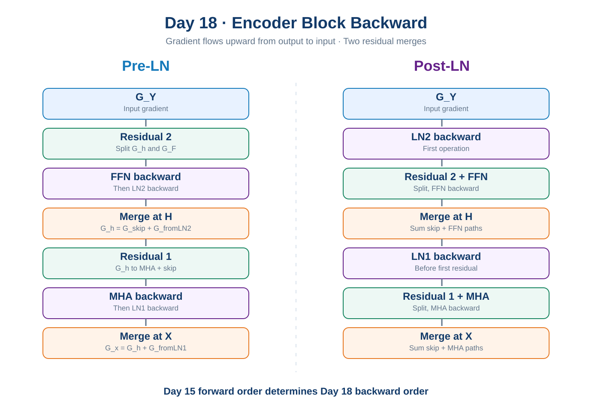
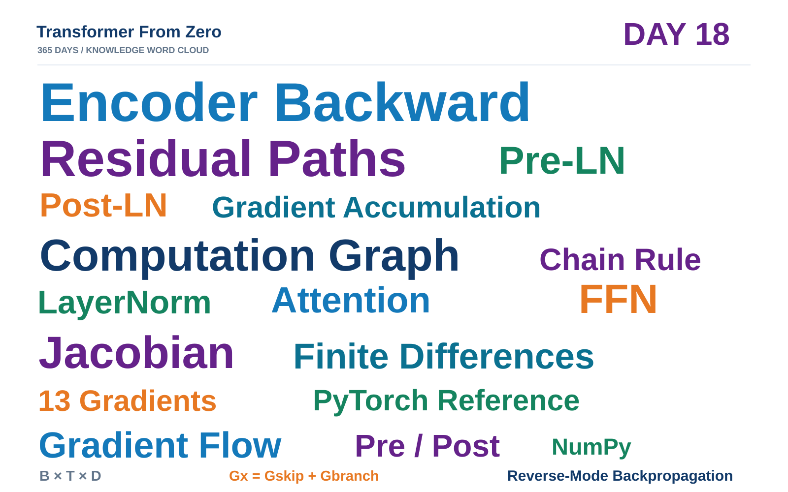

# Day 18 学习笔记｜Encoder Block Backward：从独立梯度到完整计算图

> **项目：** [Transformer From Zero · 365 Days](https://github.com/JiamuHan1122/transformer-from-zero)  
> **日期：** 2026-11-24  
> **阶段：** Transformer Encoder · 手写反向传播  
> **主题：** Pre-LN / Post-LN、Residual Gradient Paths、Block-level Jacobian、13 Gradients  
> **状态：** 理论及脚手架已发布，等待亲手编码、测试和 Demo 验收  
> **实现：** exercises/week18.py  
> **测试：** tests/test_week18_exercises.py  
> **Demo：** scripts/day18_encoder_block_backward_demo.py

---

## 一、今天比 Day 17 多了什么？

Day 17 解决了一个 Attention 模块的五组梯度；今天要完成完整 Encoder Block 的 13 组梯度（输入 X 加 12 组可学习参数）。已经实现的四种 NumPy Backward 是今天要复用的工具：Attention（Day 17）、LayerNorm（Day 12）、Residual（Day 13）、FFN（Day 14）。

**最大的难点不是矩阵求导，而是不同路径的梯度能否按正确顺序汇合。**

## 二、链式法则和残差求导

复合函数按前向逆序求导。对于：

$$
Y=X+F(X),
$$

输入梯度包含两项：

$$
\boxed{G_X=G_Y+J_F^\top G_Y}.
$$

即使函数路径产生零梯度，恒等路径仍可能存在。每个 Encoder Block 有两个残差节点，因此反向必须执行两次正确的分叉和汇合。

## 三、Pre-LN 计算图

Forward：

$$
N_1=\operatorname{LN}_1(X),\quad
A=\operatorname{MHA}(N_1),\quad H=X+A,
$$

$$
N_2=\operatorname{LN}_2(H),\quad
F=\operatorname{FFN}(N_2),\quad Y=H+F.
$$

Backward 首先拆分末尾残差节点：

$$
G_{H,\mathrm{skip}}=G_Y,\qquad G_F=G_Y.
$$

FFN -> LN2：

$$
G_{N_2}=\operatorname{FFNBackward}(G_F;N_2),
\quad
G_{H,\mathrm{LN2}}=\operatorname{LNBackward}(G_{N_2};H).
$$

H 上的梯度汇合：

$$
\boxed{G_H=G_Y+G_{H,\mathrm{LN2}}}.
$$

再拆分第一层残差，Attention -> LN1：

$$
G_{N_1}=\operatorname{MHABackward}(G_H;N_1),
\quad
G_{X,\mathrm{LN1}}=\operatorname{LNBackward}(G_{N_1};X).
$$

最终：

$$
\boxed{G_X=G_H+G_{X,\mathrm{LN1}}}.
$$

注意 $G_H$ 已包含 FFN 路径的梯度贡献，不等于原始 $G_Y$。

## 四、Post-LN 计算图

Forward：

$$
A=\operatorname{MHA}(X),\quad
H_{\mathrm{raw}}=X+A,\quad
H=\operatorname{LN}_1(H_{\mathrm{raw}}),
$$

$$
F=\operatorname{FFN}(H),\quad
Y_{\mathrm{raw}}=H+F,\quad
Y=\operatorname{LN}_2(Y_{\mathrm{raw}}).
$$

Backward 必须从 LN2 开始：

$$
G_{Y_{\mathrm{raw}}}
=\operatorname{LNBackward}(G_Y;Y_{\mathrm{raw}}).
$$

第二个残差 + FFN：

$$
G_H=G_{Y_{\mathrm{raw}}}
+\operatorname{FFNBackward}(G_{Y_{\mathrm{raw}}};H).
$$

经过 LN1：

$$
G_{H_{\mathrm{raw}}}
=\operatorname{LNBackward}(G_H;H_{\mathrm{raw}}).
$$

第一个残差 + MHA：

$$
\boxed{
G_X=G_{H_{\mathrm{raw}}}
+\operatorname{MHABackward}(G_{H_{\mathrm{raw}}};X).
}
$$

Post-LN 的直接残差梯度仍然经过 LN。即使 Attention、FFN 两分支都不对输入产生梯度，也不能直接推出 $G_X=G_Y$。

## 五、一个标量残差手算例子

设：

$$
h=x+2x=3x,\qquad
y=h+3h=4h=12x.
$$

若上游 $G_y=5$，反向先经过第二个残差：

$$
G_h=5+3\times5=20.
$$

再经过第一个残差：

$$
G_x=20+2\times20=60.
$$

直接求导 $dy/dx=12$，得到 $G_x=5\times12=60$，一致。

如果两次残差只各取一条路径，结果就会错。这是 Day 18 代码审查最重要的直觉检查。

## 六、形状与参数顺序

今天使用的示例形状：$B=2,T=5,D=8,H=2,D_{\mathrm{ff}}=32$。

| 对象 | 形状 |
|---|---|
| X、Y、G_X、G_Y | (2,5,8) |
| Wq/Wk/Wv/Wo 梯度 | (8,8) |
| gamma_attn/beta_attn 梯度 | (8,) |
| W1 梯度 | (8,32) |
| b1 梯度 | (32,) |
| W2 梯度 | (32,8) |
| b2 梯度 | (8,) |
| gamma_ffn/beta_ffn 梯度 | (8,) |

**返回顺序：**

1. grad_x
2. grad_w_q / grad_w_k / grad_w_v / grad_w_o
3. grad_gamma_attn / grad_beta_attn
4. grad_w1 / grad_b1 / grad_w2 / grad_b2
5. grad_gamma_ffn / grad_beta_ffn

一共 13 项，严格对应 Day 15 Forward 的数组参数。

## 七、今天真正要实现的部分

在 exercises/week18.py 完成函数：

~~~python
transformer_encoder_block_backward_numpy(
    grad_output, x, w_q, w_k, w_v, w_o, num_heads,
    gamma_attn, beta_attn,
    w1, b1, w2, b2,
    gamma_ffn, beta_ffn,
    eps=1e-5, norm_first=True
)
~~~

注意：

- 沿用 Day 15 的输入 Validator；
- 将全部数组转换为 float64；
- 重算正确的前向中间量；
- 复用 Day 12/13/14/17 的 Backward；
- Pre-LN 与 Post-LN 不共享错误的中间值；
- 每个参数梯度保持原始参数 Shape；
- 不修改输入。

## 八、验收设计

目标标量：

$$
\mathcal L=\sum_{b,t,d}Y_{b,t,d}G_{Y,b,t,d}.
$$

通过三个层次验证：

- 13 个梯度的返回顺序、形状、dtype；
- 与独立 PyTorch Autograd 计算图对照，Pre-LN/Post-LN 全部比较；
- 对 13 个输入或参数数组的选定元素做中心有限差分；

附加结构不变量：Pre-LN 把 Attention 与 FFN 分支设置为零，反向输入应满足 $G_X=G_Y$。Post-LN 则仍需要经过两个 LayerNorm。

运行：

~~~powershell
python -m pytest -q -m exercise tests/test_week18_exercises.py
python -m pytest -q -m exercise
python -m scripts.day18_encoder_block_backward_demo
~~~

本地输出目录：

~~~text
results/day18/
├── metrics.json
├── gradient_error_comparison.png
├── pre_post_gradient_norms.png
└── input_gradient_pre_post.png
~~~

**尚未实际运行 Day 18 的完整代码，不能记录任何通过数量或编造误差结果。**

## 九、知识词云

**Encoder Backward · Pre-LN · Post-LN · Residual Paths · Gradient Accumulation · Computation Graph · Chain Rule · LayerNorm · Attention · FFN · Jacobian · Finite Difference**

---

**Day 18 目标：真正写出完整 Encoder Block 的手动反向传播，全部 13 个梯度可解释、可验证；下一阶段才讨论多层 Stack Backward。**
