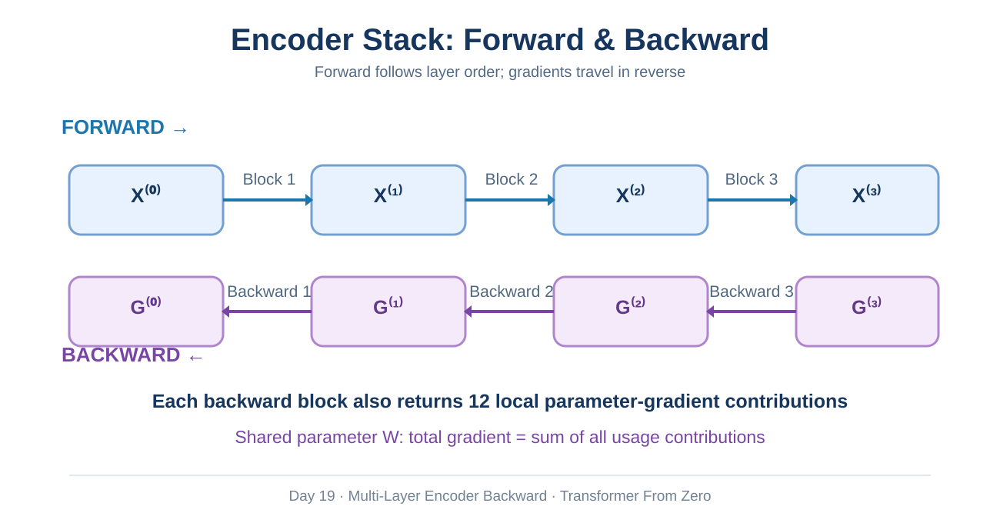
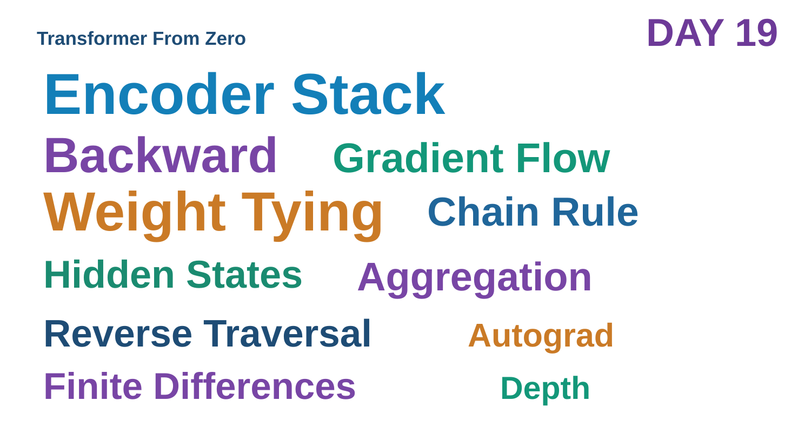

# Day 19 学习笔记｜Encoder Stack Backward 与 Weight Tying

> 日期：2026-11-25  
> 项目：Transformer From Zero · 365 Days  
> 状态：课程与测试脚手架已发布，等待学生实现与本地验收  
> 练习：exercises/week19.py

## 一、今天真正新增的内容

Day 18 已解决单层 Encoder Block 的 13 个梯度；Day 19 要将单层求导作为子程序，从最后一层往第一层回传，计算完整多层 Stack 的所有隐藏状态和参数梯度。

Forward：

$$
X^{(l+1)}=F_l(X^{(l)};\theta_l).
$$

Backward：

$$
G^{(l)}=J_{F_l}(X^{(l)})^\top G^{(l+1)}.
$$

## 二、Day 16 历史值有什么用？

Day 16 的 all_hidden_states 保存 X^(0)、X^(1)、...、X^(L)。每一次 Day 18 Backward 需要该层实际前向时的输入 X^(l)，不能拿 X^(0) 反复代替。每个状态 X^(l) 的梯度 G^(l) 也应保存到相同索引，方便前向和反向分析。

## 三、不同层之间不是加法

多层串联用 Jacobian 链式法则传播梯度；不是把每一层对隐藏状态的梯度相加。真正需要相加的是**同一个可学习参数对象被复用产生的多次梯度贡献**。

## 四、Weight Tying 和梯度聚合

同一个 ndarray 对象多次被引用，则每次使用都对共享权重产生梯度贡献。总梯度：

$$
\boxed{G_{W,\mathrm{total}}=\sum_{l\in\mathcal S}G_{W,l}.}
$$

注意 NumPy 数组的数值相等并不等于对象共享。今日任务 B 将利用对象身份分组，给每个使用位置提供总梯度的独立副本；将来优化器只应更新每个真实权重数组一次。

## 五、Day 19 的输出

- grad_x：最终对 Stack 原始输入的梯度，(B,T,D)。
- per_layer_grads：L 个参数字典，分别保存 12 组参数的使用位置梯度。
- hidden_grads：所有 G^(0) 到 G^(L)，shape (L+1,B,T,D)。

## 六、今日测试及 Demo

~~~powershell
python -m pytest -q -m exercise tests/test_week19_exercises.py
python -m pytest -q -m exercise
python -m scripts.day19_encoder_stack_backward_demo
~~~

本地结果应包括 metrics.json、gradient_norm_across_depth.png、gradient_error_by_layer.png。还需要分别比较 Pre-LN / Post-LN、独立参数 / 共享参数与有限差分。

## 七、研究视角

深度方向梯度随层传播会受到多层 Jacobian 连乘、Residual 和 LayerNorm 等影响。单次随机初始化下看到一个深度梯度曲线，不足以证明某一类架构一定更加稳定。

**关键词：Encoder Stack, Depth, Chain Rule, Gradient Flow, Reverse Traversal, Hidden States, Weight Tying, Aggregation, Autograd, Finite Differences**

---

**今日数值结果要以本地实际运行日志为准，暂不填写。**
